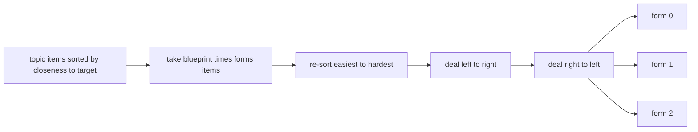
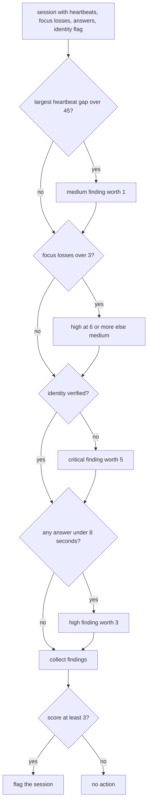
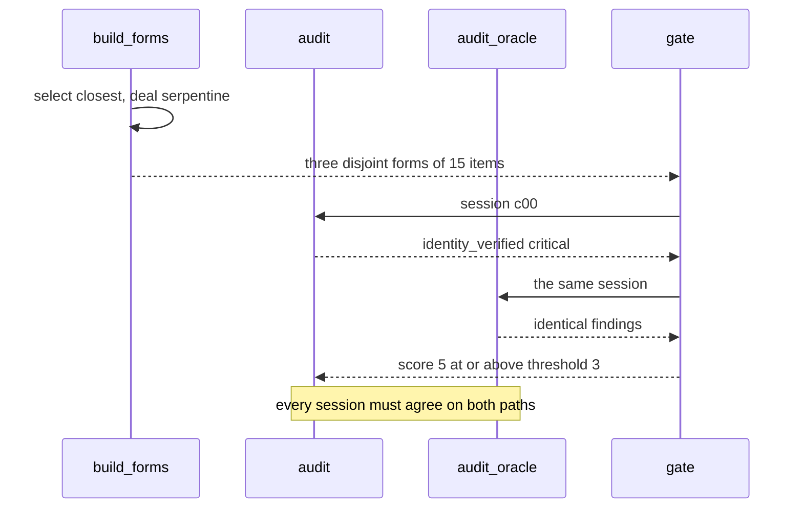

# 979 — Implement certification exam generator and proctoring integration.

> **Tier:** Master · **CTCI chapter:** Beyond — Software Engineering & Tooling
> **Task spec:** [979-implement-certification-exam-generator-and-proctoring-integratio.md](../../../tasks/master/979-implement-certification-exam-generator-and-proctoring-integratio.md)
> **Solutions:** [Python](../../../solutions/python/master/979-implement-certification-exam-generator-and-proctoring-integratio/solution.py) ·
> [Java](../../../solutions/java/master/979-implement-certification-exam-generator-and-proctoring-integratio/Solution.java) ·
> [JavaScript](../../../solutions/javascript/master/979-implement-certification-exam-generator-and-proctoring-integratio/solution.js) ·
> [C#](../../../solutions/csharp/master/979-implement-certification-exam-generator-and-proctoring-integratio/Solution.cs)

## 1. Problem restatement

Two halves of a certification platform, sharing one small in-memory item bank.

**Half one — form generation.** An item bank of 45 items spread over
`TOPICS = ("arrays", "hashing", "sorting", "graphs", "dp")`, nine items per topic with
difficulties `0.6 + 0.2 * index` (so `0.6` through `2.2`) and four points each. A blueprint
(`BLUEPRINT = {topic: 3}`) says how many items each topic contributes to a form, and
`FORMS = 3` equivalent forms must be produced:

* every form carries exactly the blueprint counts (`3` per topic) and the full item count of `15`,
* the three forms are **disjoint** and together consume exactly `blueprint[topic] * FORMS` items per topic,
* the forms are **comparable in difficulty**: each mean within `TOLERANCE = 0.2` of the target `1.4`,
  and the spread between the form means at most `0.2`,
* every form has the same point total (`15 * 4 = 60`).

**Half two — proctoring audit.** A session supplies a heartbeat timeline, a focus-loss count, its
answers with per-answer durations, and an identity-verification flag. Four rules produce severity-
weighted findings, and a session is flagged when its score reaches `FLAG_THRESHOLD = 3`:

| Rule | Trigger | Severity | Weight |
| --- | --- | --- | --- |
| `heartbeat_gap` | a gap over `45` seconds between heartbeats | `medium` | `1` |
| `focus_losses` | more than `3` focus losses | `high` at `6` or more, else `medium` | `3` / `1` |
| `identity_verified` | the identity check failed | `critical` | `5` |
| `impossible_speed` | any answer under `MIN_SECONDS = 8` seconds | `high` | `3` |

## 2. Intuition

A naive form generator sorts each topic by difficulty and deals the easiest three items to form one,
the next three to form two and so on. Every form then obeys the blueprint, but the *means* differ: the
first form gets the easiest tercile, the last one the hardest. Candidates would be taking different
exams.

The key insight is **serpentine dealing**: sort the topic's chosen items from easiest to hardest, deal
them left to right, then right to left, then left to right again. One item from each difficulty tercile
lands in each form, so the means converge while disjointness is untouched — disjointness comes from
*which items were selected*, not from how they were dealt. Combining that with a selection restricted
to the items closest to the target difficulty gives both properties at once:

```text
mean(form) ≈ target      and      forms are disjoint
```

The proctoring half rests on a different insight: **independent rules, additive severity.** Four rules
that never interact are trivially auditable — each fired rule contributes a fixed weight, the score is
their sum, and the decision is a threshold. Because the weights are ordered
(`medium = 1`, `high = 3`, `critical = 5`), an identity failure alone is enough to flag a session
(`5 >= 3`) while a single small heartbeat gap is not (`1 < 3`).



## 3. Algorithm

### Form generation

1. **Validate.** Reject an empty bank, and reject any topic whose pool holds fewer than
   `blueprint[topic] * forms` items — with the exact counts in the message
   (`topic 'x' needs 9 items but holds 4`). A silent short form is worse than an error.
2. **Select per topic.** Sort the topic's pool by `(abs(difficulty - target), ident)` and keep the
   first `blueprint[topic] * forms` items: the closest to the target, with the item id as the
   tie-break.
3. **Re-sort for dealing.** Sort the selected items by `(difficulty, ident)`, easiest first.
4. **Deal serpentine.** For position `p` in that list, compute `row, column = divmod(p, forms)` and
   assign the item to form `column` when `row` is even and to form `forms - 1 - column` when it is odd.
5. **Canonicalise.** Return each form sorted by item id, so the output does not depend on dealing order.

```text
procedure build_forms(bank, blueprint, forms, target)
    if bank is empty then
        raise ValueError with the empty-bank message
    end
    for each topic in blueprint do
        if count of bank items in topic < blueprint[topic] * forms then
            raise ValueError naming the topic and both counts
        end
    end
    picked ← one empty list per form
    for each topic in sorted order do
        pool ← topic items sorted by distance to target then by ident
        selected ← first blueprint[topic] * forms items of pool, sorted by difficulty then ident
        for position, item in enumerate(selected) do
            row ← position div forms
            column ← position mod forms
            if row is even then
                append item to picked[column]
            else
                append item to picked[forms − 1 − column]
            end
        end
    end
    return every form sorted by ident
end
```

### Proctoring audit

1. **Gap rule.** `max(gaps)` over consecutive heartbeats; fire `medium` when it exceeds `45`.
2. **Focus rule.** Fire when `focus_losses > 3`; escalate to `high` at `2 * 3 = 6` losses.
3. **Identity rule.** Fire `critical` when `identity_verified` is false.
4. **Speed rule.** Count answers below `8` seconds; fire `high` with the count when there is at least
   one.
5. **Score and gate.** `risk_score` sums `SEVERITY[level]`; `flagged` compares it with `3`.



A second, independent implementation — `audit_oracle` — evaluates the same four rules while walking
the raw fields in a different order. Every session must produce **identical** findings from both, which
catches ordering assumptions, off-by-one comparisons and accidental short-circuiting in either version.

```text
procedure audit(session, rules)
    findings ← empty list
    gaps ← consecutive differences of session.heartbeats
    worst ← largest gap or 0 when there are fewer than two beats
    if worst > rules.heartbeat_gap then
        append (heartbeat_gap, medium, largest gap) to findings
    end
    if session.focus_losses > rules.focus_losses then
        level ← high if session.focus_losses >= 2 * rules.focus_losses else medium
        append (focus_losses, level, count) to findings
    end
    if session.identity_verified is false then
        append (identity_verified, critical) to findings
    end
    fast ← answers with seconds below rules.min_seconds
    if fast is not empty then
        append (impossible_speed, high, count) to findings
    end
    return findings
end
```

## 4. Worked example

Running the Python file prints:

```text
bank=45 forms=3 items=15 points=60 mean_difficulty=[1.333, 1.4, 1.467] sessions=11 flagged=3 cheaters=3 honest=8 findings=[0, 0, 0, 0, 0, 0, 0, 0, 1, 2, 1]
```

**The form means, derived by hand.** Take the `arrays` topic: difficulties
`0.6, 0.8, 1.0, 1.2, 1.4, 1.6, 1.8, 2.0, 2.2` (items `ar00..ar08`). Distances to the target `1.4` are
`0.8, 0.6, 0.4, 0.2, 0.0, 0.2, 0.4, 0.6, 0.8`; sorted by `(distance, ident)` the selection keeps
`ar04, ar03, ar05, ar02, ar06, ar01, ar07, ar00, ar08` — which is the whole pool. Re-sorted by
difficulty it is the natural order again, and serpentine dealing with `forms = 3` assigns:

| Position | Item | Difficulty | Row | Column | Form | Form's difficulty list |
| --- | --- | --- | --- | --- | --- | --- |
| 0 | `ar00` | `0.6` | 0 | 0 | 0 | `0.6` |
| 1 | `ar01` | `0.8` | 0 | 1 | 1 | `0.8` |
| 2 | `ar02` | `1.0` | 0 | 2 | 2 | `1.0` |
| 3 | `ar03` | `1.2` | 1 | 0 | 2 | `1.0, 1.2` |
| 4 | `ar04` | `1.4` | 1 | 1 | 1 | `0.8, 1.4` |
| 5 | `ar05` | `1.6` | 1 | 2 | 0 | `0.6, 1.6` |
| 6 | `ar06` | `1.8` | 2 | 0 | 0 | `0.6, 1.6, 1.8` |
| 7 | `ar07` | `2.0` | 2 | 1 | 1 | `0.8, 1.4, 2.0` |
| 8 | `ar08` | `2.2` | 2 | 2 | 2 | `1.0, 1.2, 2.2` |

Per-topic means: form 0 `(0.6 + 1.6 + 1.8) / 3 = 1.3333`, form 1 `(0.8 + 1.4 + 2.0) / 3 = 1.4`,
form 2 `(1.0 + 1.2 + 2.2) / 3 = 1.4667`. Every topic contributes the same triple of means — the pattern
is identical for all five topics — so the whole-form means are exactly the printed
`[1.333, 1.4, 1.467]`. The spread is `0.1333`, inside `TOLERANCE = 0.2`, and each is within `0.2` of
the `1.4` target.

**The proctoring verdicts.** The cohort is eight honest sessions (`s00..s07`) plus three planted
cheaters, one per rule family:

| Session | Planted defect | Findings | Score | Flagged |
| --- | --- | --- | --- | --- |
| `s00..s07` | none — heartbeat spacing of `8 + rng.below(6)` seconds, answers of `30..89` seconds | `[]` | `0` | no |
| `c00` | `identity_verified = False` | `identity_verified` (`critical`) | `5` | yes |
| `c01` | every fifth heartbeat pushed out by `90` seconds, every answer `2` seconds | `heartbeat_gap` (`medium`), `impossible_speed` (`high`) | `4` | yes |
| `c02` | `7` focus losses | `focus_losses` (`high`, since `7 >= 6`) | `3` | yes |

That is exactly the printed `findings=[0, 0, 0, 0, 0, 0, 0, 0, 1, 2, 1]` with `flagged=3`, complete
recall on the cheaters and no false positive on the honest cohort.



## 5. Complexity

With `B` bank items, `T` topics, `F` forms and `S` sessions of at most `H` heartbeats and `A` answers:

| Phase | Time | Space | Why the bound holds |
| --- | --- | --- | --- |
| bank construction | `O(B)` | `O(B)` | one item per topic/index pair |
| selection per topic | `O((B / T) log (B / T))` | `O(B / T)` | the pool sort dominates |
| serpentine dealing | `O(F * blueprint[topic])` per topic | `O(F * blueprint[topic])` | one `divmod` per selected item |
| whole generation | `O(B log (B / T))` | `O(B)` | the per-topic sorts add up to at most a full sort |
| `audit` on one session | `O(H + A)` | `O(H)` | one pass over heartbeats for the gaps, one over answers |
| whole cohort | `O(S * (H + A))` | `O(S * (H + A))` | the cohort itself is the largest allocation |
| `audit_oracle` | `O(H + A)` | `O(1)` | same shape, different traversal — the redundancy is the point |

The generator is asymptotically the same as a naive round-robin deal; the whole gain is in the
*constant-size claim* that the forms are equivalent, which the brute-force mean check enforces. The
alternative implementation choices in this repository trade determinism for optimisation: the Java
solution orders candidates by `(times used, seed-fixed tie-break)` and enforces a per-item **exposure
limit** — a form may not use an item more than a fixed number of times across sittings — while the
JavaScript solution apportions seats with the largest-remainder method and prefers low-exposure items.
The C# solution shuffles candidates with a `splitmix64` stream seeded from the topic name and the
blueprint seed, and reports an impossible blueprint as an explicit shortfall rather than shrinking the
form quietly.

## 6. Pitfalls and edge cases

* **An under-provisioned topic is an error, not a warning.** `build_forms(BANK[:4])` raises
  `ValueError`; so does an empty bank. Silently producing a form with four topics would pass every
  count check while failing the certification blueprint.
* **Ties in distance.** Two items can be equally close to the target (`1.4` here has neighbours at
  distance `0.0`, `0.2`, `0.2`); the sort key ends with `ident`, so the choice never depends on
  dictionary or insertion order.
* **A single heartbeat must not crash the gap rule.** `gaps` is empty for a session with fewer than
  two beats and `worst` becomes `0`, so `Session("e", (), 0, (), True)` yields no findings at all.
* **Severity arithmetic is additive and independent.** `risk_score([])` is `0`,
  `risk_score([("identity_verified", "critical", "x")])` is `5`, and appending `("extra", "high",
  "y")` adds exactly `3`. Nothing multiplies, so the threshold has a clear meaning.
* **Only one finding per rule.** A session with a hundred fast answers still produces one
  `impossible_speed` finding with the count in its detail — `4` findings is the maximum.
* **Different forms count separately.** `build_forms(BANK, forms=2)` is legal when the bank allows it
  (each topic then needs `3 * 2 = 6` items), and the result is a different object from the
  three-form plan; the check asserts the disjointness of the pair explicitly.
* **Reproducibility.** `build_forms(BANK)`, `cohort()` and every audit are pure functions of their
  arguments plus the `splitmix64` stream, so the whole pipeline is byte-identical across runs.

## 7. Variants and follow-ups

* **Exposure control and item rotation.** Real certification programmes limit how often an item may
  appear and retire items after a number of sittings; the Java solution in this repository adds
  exactly that exposure limit plus a shortfall report for impossible quotas.
* **Adaptive certification.** Instead of assembling equivalent linear forms, serve each candidate an
  adaptive test; see
  [978-implement-adaptive-test-generator-that-adjusts-difficulty-to-tar.md](../../../tasks/master/978-implement-adaptive-test-generator-that-adjusts-difficulty-to-tar.md)
  for the estimate-then-choose loop and the precision stopping rule that replaces the fixed blueprint.
* **Post-hoc statistics and calibration.** Equivalent forms are only provably equivalent once
  candidates have taken them; see
  [980-implement-continuous-feedback-loop-for-curriculum-improvement-fr.md](../../../tasks/master/980-implement-continuous-feedback-loop-for-curriculum-improvement-fr.md)
  for a closed loop that turns observed attempts, times and complaints into curriculum actions.
* **Security review of the proctoring data itself.** Session timelines and identity flags are personal
  data; see
  [984-implement-legal-privacy-compliance-checks-for-user-data-handling.md](../../../tasks/master/984-implement-legal-privacy-compliance-checks-for-user-data-handling.md)
  for the retention, consent and erasure rules that must surround a store like this.

## 8. Check yourself

<details><summary>Why does serpentine dealing make the form means comparable?</summary>

Because each form receives exactly one item from each tercile of the topic's difficulty list. A left-to-
right-only deal gives form 0 all the easy items and the last form all the hard ones; reversing direction
every row means the ranks `0..F-1`, `F..2F-1`, ... are handed out in a different order to each form. For
`forms = 3` the ranks per form are `(0, 5, 6)`, `(1, 4, 7)` and `(2, 3, 8)`, and each triple sums to the
same `11` in rank space — which is why the means come out `1.333`, `1.4`, `1.467` rather than
`1.0 / 1.4 / 1.8`.</details>

<details><summary>What stops a form from containing the same item twice, or two forms from sharing one?</summary>

`build_forms` never inserts an item twice: each item appears at exactly one position of exactly one
topic's `selected` list, and `divmod` maps each position to one form. The check then asserts
`len(used) == len(set(used)) == total * FORMS`, i.e. `45 == 15 * 3`, and that each topic contributes
exactly `blueprint[topic] * FORMS = 9` items across the three forms.</details>

<details><summary>Why is `focus_losses = 6` graded `high` while `focus_losses = 4` is `medium`?</summary>

The rule fires above the `3` threshold and escalates at twice the threshold: `level = "high" if
focus_losses >= 2 * rules["focus_losses"] else "medium"`. The planted cheater has `7` losses, so it is
`high` and worth `3` points — exactly the threshold, which is why that session is flagged on its own.</details>

<details><summary>What is the point of writing `audit_oracle` if it implements the same four rules?</summary>

It evaluates them in a different traversal: it scans heartbeat pairs by index into a running maximum
rather than building a `gaps` list, tests `biggest >= threshold + 1` instead of `worst > threshold`, and
tests `identity_verified is False` in a separate branch. Divergent implementations that must agree
exactly are the cheapest way to catch a boundary mistake: the check
`all(audit(session) == audit_oracle(session) for session in sessions)` compares the raw finding tuples,
including their detail strings.</details>
