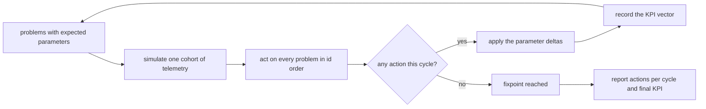
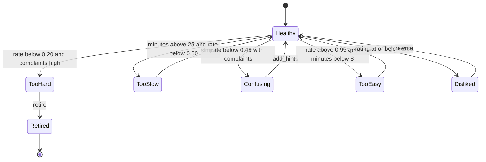
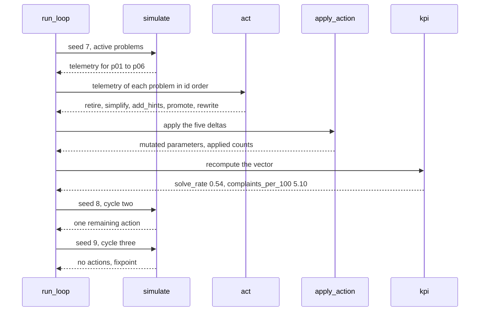

# 980 — Implement continuous feedback loop for curriculum improvement from user telemetry.

> **Tier:** Master · **CTCI chapter:** Beyond — Software Engineering & Tooling
> **Task spec:** [980-implement-continuous-feedback-loop-for-curriculum-improvement-fr.md](../../../tasks/master/980-implement-continuous-feedback-loop-for-curriculum-improvement-fr.md)
> **Solutions:** [Python](../../../solutions/python/master/980-implement-continuous-feedback-loop-for-curriculum-improvement-fr/solution.py) ·
> [Java](../../../solutions/java/master/980-implement-continuous-feedback-loop-for-curriculum-improvement-fr/Solution.java) ·
> [JavaScript](../../../solutions/javascript/master/980-implement-continuous-feedback-loop-for-curriculum-improvement-fr/solution.js) ·
> [C#](../../../solutions/csharp/master/980-implement-continuous-feedback-loop-for-curriculum-improvement-fr/Solution.cs)

## 1. Problem restatement

**Input:** six practice problems with *expected* telemetry parameters, and a cohort size
(`COHORT = 34`). For each problem the expected parameters are a solve rate, a median minutes figure, a
complaints count and a rating:

| Problem | Solve rate | Minutes | Complaints | Rating |
| --- | --- | --- | --- | --- |
| `p01` | `0.05` | `30.0` | `4.0` | `2.2` |
| `p02` | `0.50` | `40.0` | `3.0` | `3.4` |
| `p03` | `0.35` | `20.0` | `3.0` | `3.8` |
| `p04` | `0.98` | `6.0` | `0.0` | `4.6` |
| `p05` | `0.70` | `18.0` | `1.0` | `2.0` |
| `p06` | `0.70` | `15.0` | `1.0` | `4.5` |

**Output:** a closed loop that runs up to six cycles of *(collect telemetry, decide one action per
problem, apply it)* and stops at a fixpoint; a KPI vector after every cycle; and the evidence that the
loop is an improvement loop rather than a random walk:

1. every rule fires on its own planted problem in cycle one,
2. overlapping rules resolve by fixed priority,
3. the documented parameter deltas are applied exactly,
4. the loop ends on a cycle with **no actions** and re-running the rules there changes nothing,
5. solve rate and rating rise while minutes and complaints per hundred attempts fall, monotonically,
6. exactly one problem is retired, and it is gone from every later cohort.

The KPI vector is four means over the active curriculum: `solve_rate`, `minutes`, `rating` and
`complaints_per_100 = 100 * complaints / attempts`.

## 2. Intuition

The naive improvement pipeline is "look at the numbers and change something". It fails twice: it
changes several things at once, so nobody can attribute an effect, and it never stops, so a nightly job
keeps "improving" an already healthy curriculum and drifting away from its fixpoint.

The key insight is to make the loop **one action per problem per cycle, chosen by a fixed priority
list**, and to let the environment be the only thing that can change the numbers:

* The decision function `act` reads one problem's telemetry and returns at most one action. Priority
  runs from the most severe signal to the least: unsolvable-and-hated (`retire`), far too slow
  (`simplify`), fought over (`add_hints`), trivially easy (`promote`), poorly rated (`rewrite`).
* The action mutates the problem's *expected parameters*, not the observed telemetry. So the next
  cycle observes a different world, and the KPI movement is an effect of the action.
* The loop terminates because the parameter space has a fixpoint: once no rule selects a problem, a
  cycle produces an empty action list, and by definition the next cycle repeats it. That idempotence is
  the stopping criterion — not a cycle budget.



The order of the four `apply_action` deltas is what encodes engineering intuition:

| Action | Solve-rate shift | Minute factor | Complaint shift | Rating shift | Meaning |
| --- | --- | --- | --- | --- | --- |
| `simplify` | `+0.15` | `0.75` | `-0.5` | `+0.1` | smaller problem, faster to solve |
| `add_hints` | `+0.10` | `1.0` | `-2.0` | `+0.3` | hints lift success and satisfaction without cutting work |
| `promote` | `-0.20` | `1.0` | `0.0` | `-0.1` | raise difficulty, accept some loss |
| `rewrite` | `+0.05` | `1.0` | `-2.0` | `+1.0` | rewrite the statement: complainers dominate |

## 3. Algorithm

1. **Seed the world.** `initial_problems()` deep-copies `PLANTED` so runs do not share mutable state.
2. **Collect one cohort.** `simulate(problems, seed)` walks the active problems in id order and draws
   jittered telemetry: `attempts = 34 + rng.below(13)`, `solves = round(attempts * solve_rate)`,
   `minutes = round(minutes_param * (0.9 + rng.below(21) / 100), 2)`,
   `complaints = max(0, round(complaints_param) + rng.below(3) - 1)`,
   `rating = clamp(rating_param + (rng.below(5) - 2) / 10, 1.0, 5.0)`. Retired problems are skipped.
3. **Decide.** `act(metrics)` returns `None` below `MIN_ATTEMPTS = 10` attempts (too little evidence),
   then walks the priority list:

   ```text
   rate < 0.20 and complaints per 100 >= 5.0        -> retire
   minutes > 25.0 and rate < 0.60                  -> simplify
   rate < 0.45 and complaints per 100 >= 2.0       -> add_hints
   rate > 0.95 and minutes < 8.0                   -> promote
   rating <= 2.5                                   -> rewrite
   otherwise                                       -> no action
   ```

4. **Apply.** `apply_action` mutates the expected parameters by the table above (clamping the solve
   rate into `[0, 1]`, minutes by a factor, complaints at `>= 0`, rating into `[1, 5]`) and counts the
   application in an `applied` field. `retire` only flips `status` to `"retired"`.
5. **Score.** `kpi(problems, telemetry)` averages the four metrics over the active problems;
   `kpi_oracle` recomputes the same numbers with running totals.
6. **Loop.** `run_loop(seed=7, cycles=6)` repeats steps 2–5 with `seed + number` for each cycle and
   breaks as soon as a cycle produces no action.

```text
procedure run_loop(seed, cycles)
    problems ← initial_problems()
    history ← empty list
    for number in 0..cycles − 1 do
        telemetry ← simulate(problems, seed + number)
        record ← cycle number, kpi(problems, telemetry), empty action list
        for each ident in sorted order of telemetry do
            action ← act(telemetry[ident])
            if action is not None then
                append (ident, action) to record.actions
                apply_action(problems, ident, action)
            end
        end
        append record to history
        if record.actions is empty then
            stop the loop
        end
    end
    return problems, history
end
```

```text
function act(metrics, pace, minimum)
    if metrics.attempts < minimum then
        return none
    end
    rate ← metrics.solves / metrics.attempts
    complaints ← 100 * metrics.complaints / metrics.attempts
    if rate < 0.20 and complaints >= 5.0 then return retire end
    if metrics.minutes > pace and rate < 0.60 then return simplify end
    if rate < 0.45 and complaints >= 2.0 then return add_hints end
    if rate > 0.95 and metrics.minutes < 8.0 then return promote end
    if metrics.rating <= 2.5 then return rewrite end
    return none
end
```



## 4. Worked example

Running the Python file prints:

```text
problems=6 cycles=3 actions=[5, 1, 0] retired=['p01']
kpi_first={complaints_per_100:5.10, minutes:20.67, rating:3.32, solve_rate:0.54} kpi_final={complaints_per_100:1.54, minutes:18.80, rating:3.98, solve_rate:0.69}
```

**Cycle one.** The simulated cohort is jittered, yet the decisions are exact — the check compares the
action list with `EXPECTED_FIRST_CYCLE` element by element:

| Problem | Telemetry (seeded) | First matching rule | Action |
| --- | --- | --- | --- |
| `p01` | rate around `0.05`, complaints per 100 around `5` | `retire` | problem leaves the curriculum |
| `p02` | rate `0.50`, minutes around `40` | `minutes > 25 and rate < 0.60` | `simplify` |
| `p03` | rate `0.35`, complaints around `3` | `rate < 0.45 and complaints >= 2` | `add_hints` |
| `p04` | rate `0.98`, minutes around `6` | `rate > 0.95 and minutes < 8` | `promote` |
| `p05` | rate `0.70`, rating around `2.0` | `rating <= 2.5` | `rewrite` |
| `p06` | rate `0.70`, rating around `4.5` | none | no action |

Five actions in cycle one, one in cycle two and zero in cycle three: `actions=[5, 1, 0]`.

**The `simplify` effect on `p02`, step by step.** This is the one application the solution checks field
by field:

| Field | Before | Delta applied | After |
| --- | --- | --- | --- |
| `solve_rate` | `0.50` | `+0.15` | `round(0.65, 4) = 0.65` |
| `minutes` | `40.0` | `* 0.75` | `round(30.0, 4) = 30.0` |
| `complaints` | `3.0` | `-0.5` | `round(2.5, 4) = 2.5` |
| `rating` | `3.4` | `+0.1` | `round(3.5, 4) = 3.5` |
| `applied` | absent | `+1` | `1` |

The check also asserts that the `PLANTED` dictionary itself was not touched
(`before["solve_rate"] == PLANTED["p02"]["solve_rate"]`), which is why `initial_problems()` copies.

**The KPI movement.**

| Cycle | Actions | solve_rate | minutes | rating | complaints per 100 |
| --- | --- | --- | --- | --- | --- |
| 1 (first recorded) | `5` | `0.54` | `20.67` | `3.32` | `5.10` |
| 3 (fixpoint) | `0` | `0.69` | `18.80` | `3.98` | `1.54` |

Solve rate and rating rise, minutes and complaints per hundred fall — and the check additionally
requires the solve-rate sequence to be non-decreasing cycle over cycle, not merely better at the end.



## 5. Complexity

Let `P` be the number of problems, `C` the number of cycles actually run and `A` the actions applied.

| Phase | Time | Space | Why the bound holds |
| --- | --- | --- | --- |
| `initial_problems` | `O(P)` | `O(P)` | one dictionary copy per problem |
| `simulate` one cohort | `O(P)` | `O(P)` | one PRNG draw sequence per active problem |
| `act` per problem | `O(1)` | `O(1)` | a fixed chain of comparisons |
| `apply_action` | `O(1)` | `O(1)` | four arithmetic updates plus a counter |
| `kpi` / `kpi_oracle` | `O(P)` | `O(1)` | one accumulation pass over the telemetry |
| one cycle | `O(P log P)` | `O(P)` | dominated by the id-sorted iteration, which is `O(P log P)` |
| whole loop | `O(C * P log P)` | `O(C * P)` | the history keeps one record per cycle; `C <= 6` is the declared ceiling |

With `P = 6` and the observed `C = 3`, the loop is trivially cheap; the interesting cost is *human*:
each cycle is a deployment of curriculum changes. The declared `cycles=6` ceiling exists so the loop
can never run forever even if a rule were to oscillate — and the fixpoint check
(`len(final_history) == 3`, `final_history[-1]["actions"] == []`) proves it does not.

## 6. Pitfalls and edge cases

* **Too little evidence means no action.** `act(Metrics(9, 0, 90.0, 9, 1.0))` is `None` because
  `attempts < MIN_ATTEMPTS = 10`, even though the minutes look terrible. With `minimum=0` the same
  metrics are still `None`, because `solve_rate` of zero fails no rule that requires a low rate *and*
  complaints above `5` — the point is that every rule needs its full conjunction.
* **Priority, not best match.** `Metrics(60, 3, 60.0, 20, 1.0)` satisfies the `retire` conditions *and*
  several later ones; `act` returns `retire` because it is checked first, and the check then walks the
  overlapping cases one by one (`simplify`, `add_hints`, `promote`, `rewrite`, and the healthy
  `Metrics(60, 40, 20.0, 0, 4.5)` returning `None`).
* **Zero attempts must not divide by zero.** `solve_rate` and `complaints_per_100` both guard with
  `if metrics.attempts else 0.0`, and `kpi({}, {})` returns the all-zero vector.
* **Retirement is one-way and bookkeeping must balance.** `p01` is the only retired problem; the check
  asserts `len(final_problems) == len(final_telemetry) + len(retired_ids)` and that no later cohort
  contains `p01` at all.
* **Actions are attributed per cycle.** Cycle one applies five deltas, cycle two one, cycle three zero;
  the loop breaks on the empty cycle, so the history length is exactly `3` — not the `6`-cycle budget.
* **Jitter is bounded but real.** Because `simulate` adds jitter, a problem can drift in and out of a
  rule's range; the fixpoint is guaranteed by the *parameter* movement (rate up, minutes down,
  complaints down, rating up for every non-retire action), not by the jitter.
* **Reproducibility.** `run_loop()` returns the same `(problems, history)` on every run, and
  `simulate(initial_problems(), 7)` is byte-identical across calls, because every random draw goes
  through the `splitmix64` stream seeded from `seed + cycle`.

## 7. Variants and follow-ups

* **The same loop with richer telemetry.** The simplest extension is additional columns — time to first
  attempt, hint usage, retry-after-failure. The Java solution in this repository classifies problems
  against a *desirable-difficulty band* (`0.40..0.85`) and spends a bounded change budget per round; the
  C# solution compares empirical difficulty `1 - solveRate` with an assumed difficulty and only reacts
  when that drift leaves a dead band, which is the same idea with a hysteresis guard.
* **Item-level discrimination.** The JavaScript solution derives a point-biserial discrimination per
  item from a learner-by-item response matrix and drives its rule table from that, which is the natural
  bridge to calibration:
  [976-implement-automatic-difficulty-calibration-from-crowd-sourced-ru.md](../../../tasks/master/976-implement-automatic-difficulty-calibration-from-crowd-sourced-ru.md).
* **Who sees what.** Curriculum changes must survive privacy review — complaints and ratings are
  learner data; see
  [984-implement-legal-privacy-compliance-checks-for-user-data-handling.md](../../../tasks/master/984-implement-legal-privacy-compliance-checks-for-user-data-handling.md)
  for the retention and purpose-limitation rules, and
  [970-implement-analytics-dashboard-tracking-learner-progress-and-drop.md](../../../tasks/master/970-implement-analytics-dashboard-tracking-learner-progress-and-drop.md)
  for the dashboard the same telemetry feeds.
* **Release discipline around curriculum edits.** Applying actions is a deployment; see
  [981-implement-reproducible-deployment-of-full-platform-via-infra-as.md](../../../tasks/master/981-implement-reproducible-deployment-of-full-platform-via-infra-as.md)
  for the plan-apply-idempotence pattern that makes such changes reviewable.

## 8. Check yourself

<details><summary>Why does the loop terminate, and what exactly is asserted about it?</summary>

Because a cycle with no actions is a fixpoint of the rules on that telemetry: nothing changes the
parameters, so the next cohort — simulated from the same seeds and the same parameters — produces the
same (empty) action list. The checks assert `final_history[-1]["actions"] == []`, that re-running `act`
on the fixpoint telemetry returns `None` for every problem, and that the run took exactly `3` cycles
rather than the `6`-cycle budget.</details>

<details><summary>`p02` is simplified in cycle one; why does it not stay "too slow"?</summary>

Because `apply_action` reduces its minutes by the `simplify` factor: `40.0 * 0.75 = 30.0`, still above
the `25.0` pace budget — so `minutes > 25` remains true — but its solve rate rises to `0.65`, and the
rule requires *both* `minutes > 25` **and** `rate < 0.60`. The conjunction is what stops the loop from
simplifying a problem forever just because it is slow for its current solvers.</details>

<details><summary>Why is the KPI computed from the simulated telemetry rather than from the parameters?</summary>

Because the KPI is a learner-experience claim and the telemetry is what learners would experience,
jitter included. `kpi_oracle` recomputes it with running totals — a completely different accumulation
strategy — and the check requires the two to agree within `1e-9` for seeds `7..11`, which also proves
the metric definitions handle a zero-attempt problem identically.</details>

<details><summary>`act(Metrics(9, 0, 90.0, 9, 1.0))` describes a catastrophic problem. Why is the answer `None`?</summary>

Because there are only nine attempts, below `MIN_ATTEMPTS = 10`. Nine attempts carry no statistical
evidence: a single learner who gave up could produce exactly this row. The rule is "do not act on noise"
and it is checked as a boundary rather than left implicit.</details>
