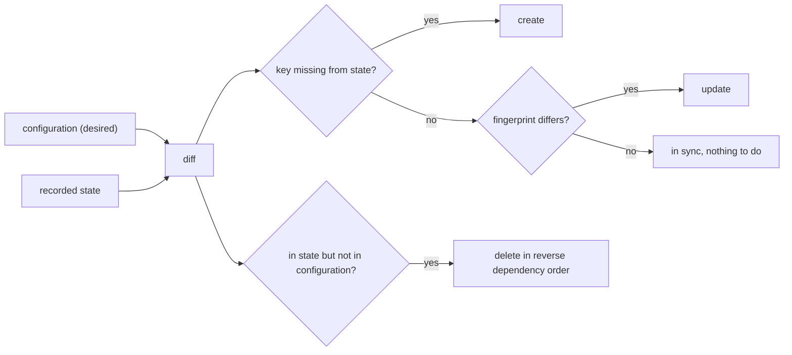
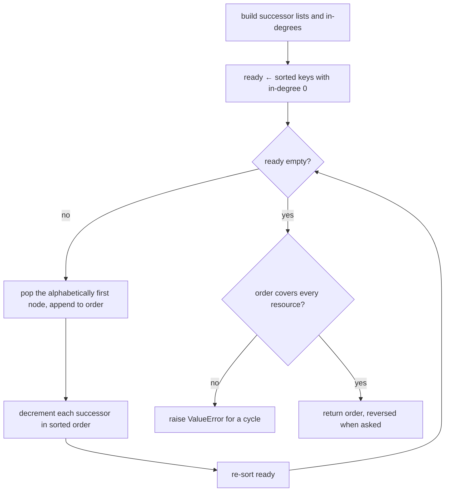
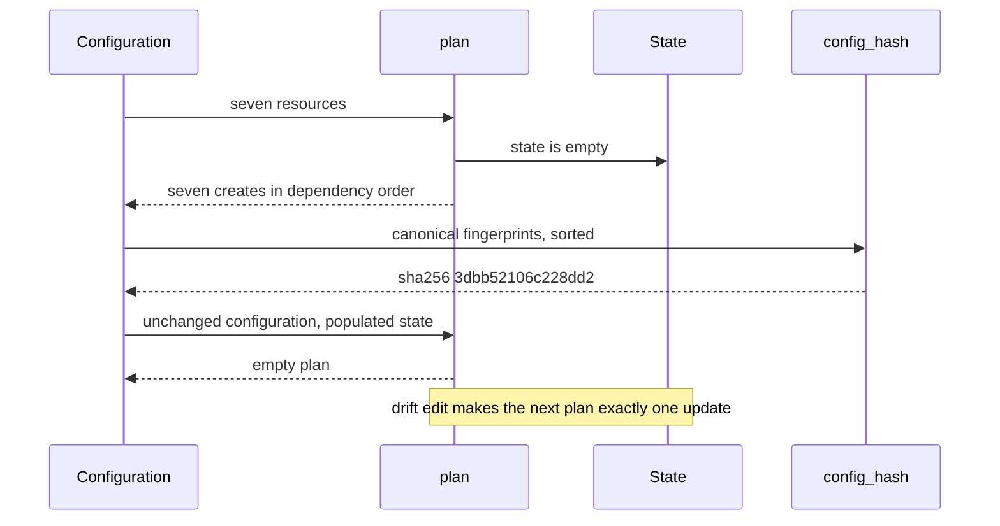

# 981 — Implement reproducible deployment of full platform via infra-as-code.

> **Tier:** Master · **CTCI chapter:** Beyond — Software Engineering & Tooling
> **Task spec:** [981-implement-reproducible-deployment-of-full-platform-via-infra-as.md](../../../tasks/master/981-implement-reproducible-deployment-of-full-platform-via-infra-as.md)
> **Solutions:** [Python](../../../solutions/python/master/981-implement-reproducible-deployment-of-full-platform-via-infra-as/solution.py) ·
> [Java](../../../solutions/java/master/981-implement-reproducible-deployment-of-full-platform-via-infra-as/Solution.java) ·
> [JavaScript](../../../solutions/javascript/master/981-implement-reproducible-deployment-of-full-platform-via-infra-as/solution.js) ·
> [C#](../../../solutions/csharp/master/981-implement-reproducible-deployment-of-full-platform-via-infra-as/Solution.cs)

## 1. Problem restatement

**Input:** a declarative configuration — a tuple of seven resources, each a named tuple
`Resource(kind, name, properties, depends_on)`:

| Resource | Kind | Properties | Depends on |
| --- | --- | --- | --- |
| `network.core` | `network` | `cidr 10.0.0.0/16` | — |
| `database.primary` | `database` | `engine postgres`, `size m5.large` | `network.core` |
| `cache.sessions` | `cache` | `engine redis`, `size m5.small` | `network.core` |
| `queue.jobs` | `queue` | `engine kafka`, `partitions 6` | `network.core` |
| `service.api` | `service` | `replicas 3`, `image api:1.4` | `database.primary`, `cache.sessions` |
| `service.worker` | `service` | `replicas 2`, `image worker:1.4` | `queue.jobs`, `database.primary` |
| `dashboard.ops` | `dashboard` | `replicas 1`, `image dash:0.9` | `service.api` |

plus a *recorded state*: a map from resource key to the canonical fingerprint of what was last applied.

**Output:** a plan and a new state.

1. `plan(config, state)` → a list of `(action, key)` where action is `create`, `update` or `delete`.
2. `apply(config, state)` → `(actions, new_state)`.
3. `config_hash(config)` → a 64-character SHA-256 of the canonical configuration, independent of
   declaration order.
4. Errors, not guesses: a dependency cycle, an unknown dependency, an empty bank of resources or an
   unrepresentable configuration must raise `ValueError`.

The state fingerprint of one resource is the canonical, order-insensitive payload:

```text
fingerprint(resource) = (kind, name, tuple(sorted(properties.items())), tuple(sorted(depends_on)))
```

## 2. Intuition

The naive deployment script is imperative: "create the network, then the database, then ...". It is
unreadable, unreviewable and, worst of all, not idempotent — running it twice creates everything twice.

The first insight is **desired state plus recorded state**. The configuration is what should exist; the
state is what was last applied; and the plan is the *difference* between them. Nothing is created
because a script said so — it is created because it is missing from the state. That immediately gives
three properties for free:

* **order** comes from the dependency edges, not from the order of statements in a script;
* **idempotence** comes from the diff: if the state already equals the desired fingerprints, the plan
  is empty;
* **drift repair** comes from the same diff: if somebody edits a resource behind the engine's back, the
  fingerprint no longer matches, and the next apply plans exactly one `update`.

The second insight is that **deletion is the plan read backwards**. When a resource is dropped from the
configuration, it must be destroyed only after everything that depends on it — so the deletion order is
the reverse of the deployment order computed over the *leaving* subgraph. One algorithm serves both
directions.



## 3. Algorithm

1. **Order.** `deploy_order(config)` runs Kahn's algorithm over the dependency edges. It builds a
   successor list and an in-degree per resource, rejects any dependency that is not in the
   configuration (`resource X depends on unknown resource Y`), then repeatedly pops the alphabetically
   first ready node. Every pop re-sorts the ready list so the order is deterministic. If fewer than
   `len(resources)` nodes are emitted, the remaining subgraph is a cycle and the function raises
   `ValueError("the configuration has a dependency cycle")`.
2. **Diff.** `plan` walks the deployment order and emits `create` for keys absent from the state and
   `update` for keys whose recorded fingerprint differs from the desired one; then it appends the
   deletions.
3. **Delete.** `deletion_order` keeps only the state entries that are no longer desired, rebuilds a
   graph restricted to the edges between those entries, and calls `deploy_order(..., reverse=True)`.
4. **Apply.** `apply` runs the plan and folds it into a copy of the state: `delete` removes a key,
   anything else stores the desired fingerprint.
5. **Hash.** `config_hash` serialises `sorted(fingerprint(r) for r in config)` with `json.dumps(...,
   sort_keys=True)` and returns the SHA-256 hex digest. Sorting the fingerprints makes the hash
   insensitive to declaration order; `sort_keys` makes it insensitive to property insertion order.

```text
procedure deploy_order(config, reverse)
    resources ← map from ident to resource
    successors ← empty list per resource
    indegree ← zero per resource
    for each key and resource in resources do
        for each dependency in resource.depends_on do
            if dependency is not in resources then
                raise ValueError naming the key and the unknown dependency
            end
            append key to successors[dependency]
            indegree[key] ← indegree[key] + 1
        end
    end
    ready ← sorted keys with indegree zero
    order ← empty list
    while ready is not empty do
        key ← remove the first element of ready
        append key to order
        for each successor in sorted(successors[key]) do
            indegree[successor] ← indegree[successor] − 1
            if indegree[successor] equals 0 then
                append successor to ready
            end
        end
        sort ready
    end
    if length of order is not length of resources then
        raise ValueError for the dependency cycle
    end
    return order reversed when reverse is true, otherwise order
end
```

```text
procedure plan(config, state)
    desired ← map from ident to resource
    actions ← empty list
    for each key in deploy_order(config) do
        if key is not in state then
            append (create, key) to actions
        else if state[key] is not fingerprint(desired[key]) then
            append (update, key) to actions
        end
    end
    for each key in deletion_order(state, desired) do
        append (delete, key) to actions
    end
    return actions
end
```



## 4. Worked example

Running the Python file prints:

```text
resources=7 hash=3dbb52106c228dd2 created=7 drift_actions=[('update', 'database.primary')] destroy_order=['service.worker', 'dashboard.ops', 'service.api']...
state_keys=['cache.sessions', 'dashboard.ops', 'database.primary', 'network.core', 'queue.jobs', 'service.api', 'service.worker']
```

**First apply, derived by hand.** The only resource with no dependency is `network.core`, so it is the
only ready node; each pop re-sorts the ready list:

| Pop | Ready list after the pop | Order so far |
| --- | --- | --- |
| `network.core` | `cache.sessions`, `database.primary`, `queue.jobs` | `network.core` |
| `cache.sessions` | `database.primary`, `queue.jobs` (`service.api` is at in-degree 1) | `…, cache.sessions` |
| `database.primary` | `queue.jobs`, `service.api` (`service.worker` at in-degree 1) | `…, database.primary` |
| `queue.jobs` | `service.api`, `service.worker` | `…, queue.jobs` |
| `service.api` | `dashboard.ops`, `service.worker` | `…, service.api` |
| `dashboard.ops` | `service.worker` | `…, dashboard.ops` |
| `service.worker` | — | `…, service.worker` |

The result is `network.core, cache.sessions, database.primary, queue.jobs, service.api, dashboard.ops,
service.worker` — seven creates with every dependency strictly earlier than its dependent, which is
what the check asserts by comparing positions. Destroying that state with an empty configuration is
the same list reversed: `service.worker, dashboard.ops, service.api, …`, matching the printed
`destroy_order` prefix and satisfying the dual check that every dependent is deleted *before* the
resource it depends on.

**Drift repair.** `drift(base_state, "database.primary", size="m5.xlarge")` rewrites the recorded
properties, so the stored fingerprint no longer equals the desired one:

| Stage | `database.primary` recorded size | Plan | Result |
| --- | --- | --- | --- |
| after first apply | `m5.large` | `[]` | state unchanged, second apply is a no-op |
| after `drift` | `m5.xlarge` | `[("update", "database.primary")]` | exactly one action |
| after the repair apply | `m5.large` | `[]` | `repaired == base_state`, and the state hashes differ before and after |

**Additions and removals.** Dropping `service.worker` from the configuration and adding a new
`service.reports` that depends on `database.primary` produces a plan containing exactly one
`create` (`service.reports`, in deployment order) and exactly one `delete` (`service.worker`, ordered
after everything that depended on it), and the resulting state contains `service.reports` but no
`service.worker`.



## 5. Complexity

Let `V` be the number of resources, `E` the number of dependency edges and `P` the largest property
map.

| Phase | Time | Space | Why the bound holds |
| --- | --- | --- | --- |
| graph construction | `O(V + E)` | `O(V + E)` | one pass over resources, one edge per dependency |
| Kahn loop | `O(V * (V log V))` worst case | `O(V)` | the ready list is re-sorted after every pop, and it holds up to `V` entries |
| same loop with a heap | `O((V + E) log V)` | `O(V)` | the alternative implementation choice: a priority queue instead of repeated sorts |
| `plan` | `O(V + E)` plus the deletions | `O(V)` | a membership test and one fingerprint comparison per key |
| `deletion_order` | `O(V + E)` | `O(V)` | it builds the leaving subgraph once and reuses `deploy_order` |
| `config_hash` | `O(V log V * P)` | `O(V * P)` | sort the fingerprints, then serialise and hash the whole string |
| `apply` | `O(V)` | `O(V)` | one copy of the state plus one write per action |

With `V = 7` the repeated re-sorting is invisible; the honest statement is that the deterministic
tie-break costs a `log` factor over an unordered Kahn sweep, and the choice is deliberate. The
*real* cost of an apply is the deployment itself, which is why the empty second plan matters: a
no-op apply is what allows the pipeline to rerun continuously.

## 6. Pitfalls and edge cases

* **A cycle must be refused before anything is touched.** `deploy_order` on two resources that depend
  on each other raises `ValueError`, and so does a self-referential `network.core -> network.edge ->
  network.core`. Because the *validation pass builds the whole graph first*, a cyclic configuration
  never produces a partial plan.
* **Unknown dependencies are a configuration bug, not a runtime condition.** A resource that depends on
  `network.missing` raises `ValueError` at plan time; it never silently deploys out of order.
* **Drift is detected on the canonical fingerprint, not on raw equality.** Properties are compared as
  `sorted(properties.items())`, so a reordered dictionary is not drift, while a changed value is.
* **A ghost state entry is a deletion.** `plan(CONFIG, {"ghost.resource": (...)})` ends with
  `("delete", "ghost.resource")` — resources that exist only in the state must be cleaned up.
* **Empty state and empty configuration are legal boundaries.** `deploy_order(())` and
  `deletion_order({}, {})` both return `[]`, `apply((), base_state)` deletes all seven resources and
  leaves `{}`, and `plan((), {})` is empty.
* **A single resource with no dependencies.** `apply((Resource("storage", "bucket", {"class": "cold"},
  ()),), {})` plans one create, and the second apply plans nothing; `storage.bucket` is its own
  deployment order.
* **The hash must not depend on declaration order.** `config_hash(CONFIG) ==
  config_hash(tuple(reversed(CONFIG)))`, and both are 64 characters; an edit that changes a service's
  replicas changes the digest. This is the property the deployment pipeline relies on to say "same
  input, same platform".
* **Replay oracle.** For every one of the four state transitions the check re-executes the returned
  action list against the original state and requires the result to equal the state the engine
  returned, and the next plan to be empty. A plan that is not self-consistent cannot pass.

## 7. Variants and follow-ups

* **Destructive updates.** This engine models a `service` replica change as an in-place `update`; a
  database engine change would be a replace, i.e. delete-plus-create. That is a policy decision inside
  `plan`, not a change to the ordering algorithm.
* **Remote state and locking.** The `state` map is in memory; a real tool stores it remotely and locks
  it during apply. The diff, the ordering and the hash are unchanged by that move.
* **Review before apply.** The plan is a review artefact — see
  [983-implement-end-to-end-security-review-checklist-and-automated-sca.md](../../../tasks/master/983-implement-end-to-end-security-review-checklist-and-automated-sca.md)
  for the security gate that a plan-runner should sit behind, and
  [982-implement-monitoring-and-alerting-playbooks-for-platform-inciden.md](../../../tasks/master/982-implement-monitoring-and-alerting-playbooks-for-platform-inciden.md)
  for what watches the deployed platform afterwards.
* **What a deployment must be able to reproduce.** The same canonicalisation idea, applied to a build
  environment instead of a platform, is the subject of
  [990-implement-reproducible-docker-images-for-canonical-environment-w.md](../../../tasks/master/990-implement-reproducible-docker-images-for-canonical-environment-w.md)
  and of
  [900-implement-full-featured-reproducible-research-platform-with-hard.md](../../../tasks/master/900-implement-full-featured-reproducible-research-platform-with-hard.md).
  The Java, JavaScript and C# solutions of this task all implement plan-apply with a different diff
  shape: Java emits an attribute-level diff, JavaScript diffs a resource document with explicit
  `dependsOn` fields, and C# renders the creates and updates as an ordered schedule rather than a flat
  action list.

## 8. Check yourself

<details><summary>Why is the deletion order exactly the reverse of the deployment order?</summary>

Because "B depends on A" means "A must exist before B is created", which is the same edge read in the
opposite temporal direction: "B must be destroyed before A disappears". Reversing a valid topological
order of the dependency graph therefore gives a valid destruction order for the same graph. In the
worked example `service.worker` (which depends on `queue.jobs` and `database.primary`) is destroyed
first — exactly the printed `destroy_order` prefix.</details>

<details><summary>What makes the second apply a no-op rather than a second deployment?</summary>

The state stores the *canonical fingerprint* of each resource, not a copy of the resource object.
`plan` compares `state[key]` with `fingerprint(desired[key])`; after the first apply they are equal for
all seven keys, so no action is emitted. The check asserts both `repeat_actions == []` and
`repeat_state == base_state`, and additionally that `plan(CONFIG, base_state) == []`.</details>

<details><summary>Why does `config_hash` sort the resource fingerprints before hashing?</summary>

So that the digest is a property of the *set* of resources, not of the order they were declared in. A
configuration written as a tuple and the same configuration written backwards must describe the same
platform, and the check asserts `config_hash(CONFIG) == config_hash(tuple(reversed(CONFIG)))`. Inside
each fingerprint, `sorted(properties.items())` and `sorted(depends_on)` do the same job for the nested
structures.</details>

<details><summary>Where does the cycle check live, and why there rather than in the loop?</summary>

Kahn's algorithm *detects* it in the loop (`len(order) != len(resources)`), but the solution treats
that as the assertion of last resort and the loop is the place where a cycle shows up as a stalled
ready list. Because all edges are validated before any ordering work starts, a cycle and an unknown
dependency are both rejected with a specific `ValueError` message, and no caller can mistake a partial
plan for a valid one.</details>
