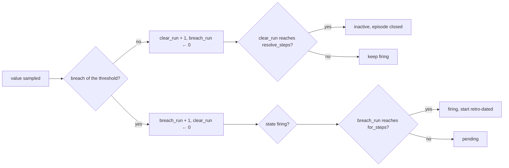
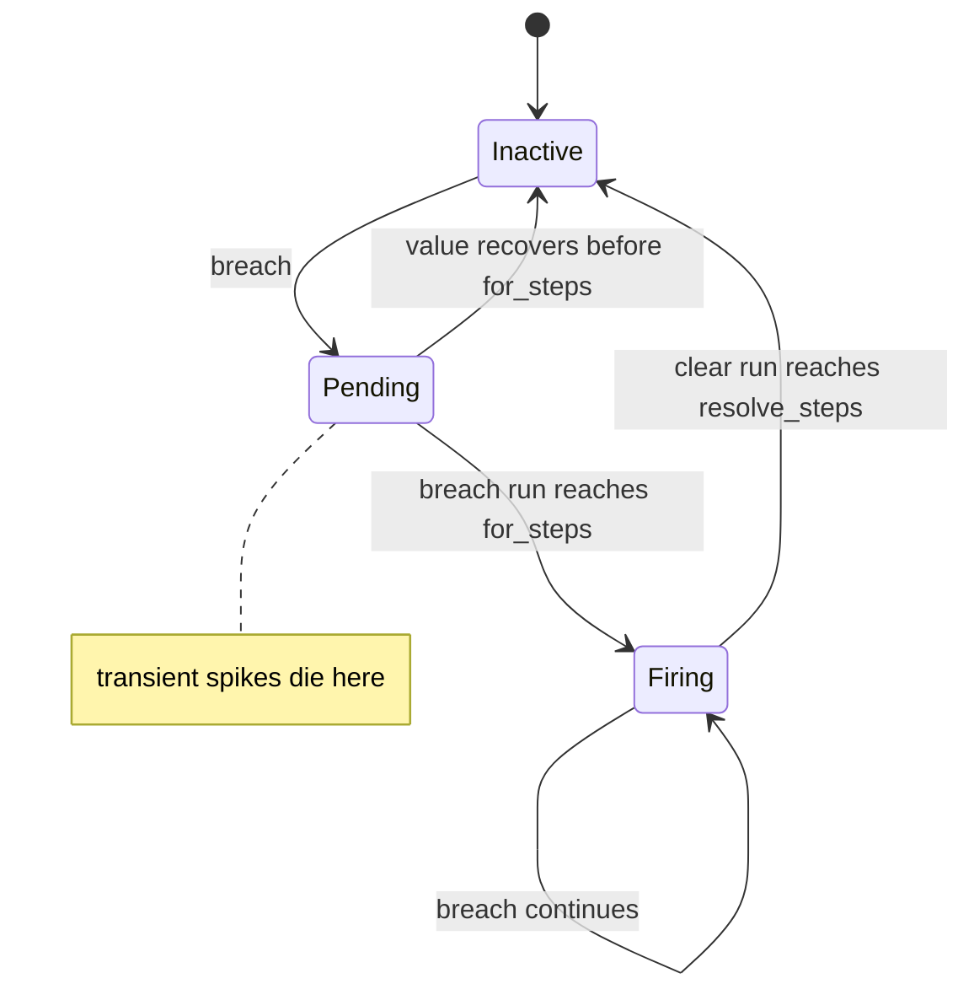
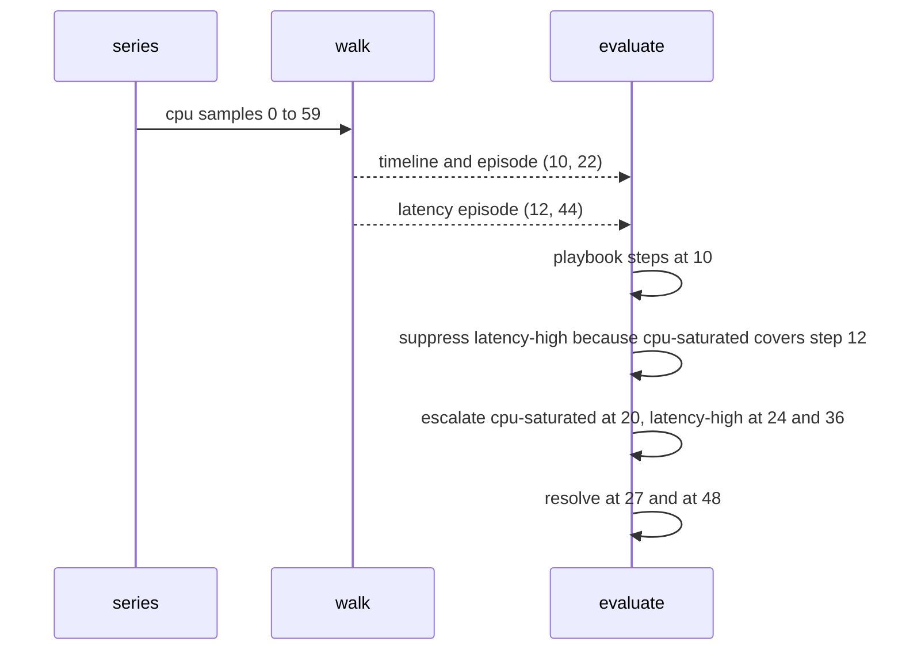

# 982 — Implement monitoring and alerting playbooks for platform incidents.

> **Tier:** Master · **CTCI chapter:** Beyond — Software Engineering & Tooling
> **Task spec:** [982-implement-monitoring-and-alerting-playbooks-for-platform-inciden.md](../../../tasks/master/982-implement-monitoring-and-alerting-playbooks-for-platform-inciden.md)
> **Solutions:** [Python](../../../solutions/python/master/982-implement-monitoring-and-alerting-playbooks-for-platform-inciden/solution.py) ·
> [Java](../../../solutions/java/master/982-implement-monitoring-and-alerting-playbooks-for-platform-inciden/Solution.java) ·
> [JavaScript](../../../solutions/javascript/master/982-implement-monitoring-and-alerting-playbooks-for-platform-inciden/solution.js) ·
> [C#](../../../solutions/csharp/master/982-implement-monitoring-and-alerting-playbooks-for-platform-inciden/Solution.cs)

## 1. Problem restatement

**Input:** metric series of `SAMPLES = 60` samples (one sample per 15-second step, so a 15-minute
window) and a rule set. A rule is a named tuple
`Rule(name, metric, severity, threshold, direction, for_steps, resolve_steps, escalation_steps, steps)`:

| Rule | Metric | Severity | Threshold | Direction | `for` | `resolve` | `escalation` | Playbook |
| --- | --- | --- | --- | --- | --- | --- | --- | --- |
| `cpu-saturated` | `cpu` | `critical` | `90.0` | `above` | `4` | `5` | `10` | page the db on-call, check the query plan |
| `latency-high` | `latency` | `warning` | `800.0` | `above` | `3` | `4` | `12` | inspect the edge cache |
| `disk-full` | `disk` | `warning` | `85.0` | `above` | `6` | `3` | `20` | rotate the logs |
| `queue-empty` | `queue` | `warning` | `5.0` | `below` | `2` | `2` | `20` | check the consumers |
| `cpu-short` | `cpu` | `info` | `96.0` | `above` | `6` | `2` | `30` | watch only |

One inhibition edge: `cpu-saturated` suppresses the *notifications* of `latency-high`.

**Output:** per-step alert states, firing windows, a notification log (playbook steps, escalations,
resolutions) and the suppression list — with the guarantee that a short spike never fires.

## 2. Intuition

The naive alert is a single comparison: `cpu > 90 → page`. It is worse than useless, because a
15-second spike during a deploy pages the on-call engineer at 03:00 and teaches them to ignore alerts.

The key insight is that a **threshold crossing is evidence, and evidence needs duration**. Every rule
therefore demands that its condition hold *continuously* for a `for` duration before it may fire, and
that it be clean *continuously* for a `resolve` duration before the alert clears. Between those two
states sits `pending`:

```text
inactive --(breach run reaches for_steps)--> firing
pending  --(clear)--> inactive
firing   --(clear run reaches resolve_steps)--> inactive
```

Three consequences fall out of that one idea:

* a two-step spike only ever reaches `pending` — it is recorded, visible, and silent;
* the firing window is `[step - for_steps + 1, last breach]`, i.e. the alert's start is *retro-dated*
  to the first breach of the run, so the incident timeline is honest;
* `resolve_steps >= 1` makes firing sticky, which is what prevents flapping.

The second insight is **inhibition is suppression of notification, not of state**. When
`cpu-saturated` is firing, `latency-high` still walks its own state machine and still resolves; only
its paging is dropped, with the blocking alert recorded as the reason.



## 3. Algorithm

1. **Build the series.** `series()` produces four metrics: `cpu` as `40 + step % 5` with a 13-step
   spike to `95 + step % 3` over steps `10..22` and a two-step spike to `98` at `45, 46`; `latency` as
   `420 + 3 * step` with `900` over steps `12..44`; `disk` as `60 + 0.5 * step` with `88.0` over steps
   `30..59`; and `queue` constant at `30.0`.
2. **Compare.** `breaches(value, direction, threshold)` is `value >= threshold` for `above` and
   `value <= threshold` for `below` — deliberately inclusive, so a value sitting exactly on the
   threshold counts.
3. **Walk the state machine.** `walk(rule, values)` keeps `state`, `breach_run`, `clear_run` and the
   episode `start`:
   * if firing and `clear_run >= resolve_steps`, close the episode at
     `step - resolve_steps` and go back to `inactive`;
   * else if `breach_run >= for_steps`, enter `firing` with `start = step - for_steps + 1`;
   * else `pending` when breached, `inactive` otherwise.
   A run still firing at the end of the series is closed at the last sample.
4. **Evaluate.** `evaluate(rules, metrics)` walks every rule (skipping rules whose metric is absent),
   then for each episode logs the playbook steps in order at `start`, logs a `firing` entry unless an
   inhibitor is firing over that start, logs `escalate` entries at `start + level * escalation_steps`
   while those stay inside the episode, and logs `resolved` at `stop + resolve_steps`.
5. **Cross-check.** `windows_oracle(rule, values)` recomputes the windows with a completely different
   formulation: count the consecutive breach run and record `[step - for_steps + 1, step]` when the run
   first reaches `for_steps`, extending the end on every further breach.

```text
procedure walk(rule, values)
    timeline ← empty list
    episodes ← empty list
    state ← inactive
    breach_run ← 0
    clear_run ← 0
    start ← undefined
    for step, value in enumerate(values) do
        breached ← breaches(value, rule.direction, rule.threshold)
        breach_run ← breach_run + 1 if breached else 0
        clear_run ← 0 if breached else clear_run + 1
        if state is firing then
            if clear_run >= rule.resolve_steps then
                state ← inactive
                append (start, step − rule.resolve_steps) to episodes
                start ← undefined
            end
        else if breach_run >= rule.for_steps then
            state ← firing
            start ← step − rule.for_steps + 1
        else
            state ← pending if breached else inactive
        end
        append state to timeline
    end
    if state is firing then
        append (start, length of values − 1) to episodes
    end
    return timeline, episodes
end
```

```text
procedure evaluate(rules, metrics, inhibit)
    log ← empty list
    timelines ← empty map
    windows ← empty map
    suppressed ← empty list
    for each rule in rules do
        values ← metrics[rule.metric]
        if values is undefined then continue end
        timeline, episodes ← walk(rule, values)
        timelines[rule.name] ← timeline
        windows[rule.name] ← episodes
    end
    for each rule in rules do
        for each (start, stop) in windows[rule.name] do
            resolved_at ← stop + rule.resolve_steps
            for order, step in enumerate(rule.steps, from 1) do
                append (start, rule.name, playbook, order, step) to log
            end
            blocker ← first source whose target is rule.name and whose window covers start
            if blocker exists then
                append (start, rule.name, blocker) to suppressed
            else
                append (start, rule.name, firing, 0, rule.severity) to log
            end
            for level in 1..2 do
                at ← start + level * rule.escalation_steps
                if at <= stop then append (at, rule.name, escalate, level) to log end
            end
            append (resolved_at, rule.name, resolved, 0, rule.severity) to log
        end
    end
    return sorted log, timelines, windows, suppressed
end
```



## 4. Worked example

Running the Python file prints:

```text
rules=5 samples=60 windows={'cpu-saturated': [(10, 22)], 'cpu-short': [], 'disk-full': [(30, 59)], 'latency-high': [(12, 44)], 'queue-empty': []}
log_entries=13 suppressed=[(12, 'latency-high', 'cpu-saturated')] escalations=[('cpu-saturated', 1), ('latency-high', 1), ('latency-high', 2), ('disk-full', 1)]
```

**The `cpu-saturated` state machine, step by step** (`for_steps = 4`, `resolve_steps = 5`, threshold
`90`):

| Steps | `cpu` value | `breach_run` / `clear_run` | State | Why |
| --- | --- | --- | --- | --- |
| `0..9` | `40 + step % 5` (so `40..44`) | `0` / rising | `inactive` | well below the threshold |
| `10` | `95 + 10 % 3 = 96` | `1` / `0` | `pending` | breached, but the run is shorter than `4` |
| `11`, `12` | `97`, `95` | `2`, `3` / `0` | `pending` | still short of the duration |
| `13` | `95 + 13 % 3 = 96` | `4` / `0` | `firing` | run reaches `for_steps`; start retro-dated to `13 - 4 + 1 = 10` |
| `14..22` | `95..96` | up to `13` / `0` | `firing` | the spike keeps breaching |
| `23` | `40 + 23 % 5 = 43` | `0` / `1` | `firing` | clear, but not for `resolve_steps` yet |
| `24..26` | `44, 40, 41` | `0` / `2..4` | `firing` | sticky by design |
| `27` | `42` | `0` / `5` | `inactive` | episode closed as `(10, 27 - 5) = (10, 22)` |
| `45`, `46` | `98`, `98` | `1`, `2` / `0` | `pending` | the two-step spike: only 2 of the required 6 |
| `47` | `42` | `0` / `1` | `inactive` | recovered — this is the false-positive guard |

The corresponding window is exactly `(10, 22)`, the boundary states are exactly
`cpu[10:13] == ["pending"] * 3` and `cpu[13:27] == ["firing"] * 14`, and the short spike leaves
`cpu[45] == "pending"` with `cpu[47:] == ["inactive"] * 13`.

**The other windows**, each with its own arithmetic:

| Rule | Breach range in the series | `for` | First firing step | Window |
| --- | --- | --- | --- | --- |
| `latency-high` | `12..44` at `900` | `3` | `14` (`cpu[13]` is still `pending`) | `(12, 44)`, closed at `45 - 4` |
| `disk-full` | `30..59` at `88.0` | `6` | `35` | `(30, 59)` — the run never clears, so the episode is closed at the last sample |
| `queue-empty` | never — `queue` is `30.0` all the way and the rule is `below 5.0` | `2` | — | `[]` |
| `cpu-short` | `45, 46` at `98` (threshold `96`, `for` `6`) | `6` | — | `[]` |

**The log.** Thirteen entries: `cpu-saturated` contributes two playbook steps, one `firing`, one
`escalate` at step `20` (level 1; level 2 would be step `30`, past the end `22`) and one `resolved`;
`latency-high` contributes one playbook step, **no** `firing` entry, escalations at `24` and `36`
(both inside `12..44`), and a resolution; `disk-full` contributes one playbook step, a `firing`, an
escalation at `50` and a resolution. `2 * 5` for the suppressed alert is what makes the count odd
rather than a multiple of three.



## 5. Complexity

Let `R` be the number of rules, `S` the number of samples, `E` the number of episodes and `K` the
longest playbook.

| Phase | Time | Space | Why the bound holds |
| --- | --- | --- | --- |
| `series` | `O(S)` per metric | `O(S * M)` | six list traversals over 60 samples |
| `breaches` | `O(1)` | `O(1)` | one comparison |
| `walk` | `O(S)` | `O(S)` for the timeline, `O(E)` for the windows | one pass, constant work per step |
| `evaluate` | `O(R * S + R * E * (K + 2))` | `O(R * S + R * E * K)` | the walk dominates; the log grows with playbook length, escalations and resolutions |
| inhibition check | `O(I * E)` per rule | `O(I)` | one scan over the inhibit edges per episode |
| `windows_oracle` | `O(S)` | `O(E)` | one pass with a running counter |
| final sort of the log | `O(L log L)` | `O(L)` | the log entries are tuples compared lexicographically |

For the shipped numbers that is `5 * 60 = 300` state steps plus 13 log entries — nothing. The
interesting complexity is operational: `for_steps` and `resolve_steps` are the two dials that trade
detection latency against alert noise, and `escalation_steps` decides how quickly a long incident
reaches the second on-call level. The sibling implementations in this repository use the same
two-duration idea with different SLO arithmetic: Java and C# compute a **burn rate**
(`observed error rate / (1 - SLO)`) over one short and one long window and page only when *both*
breach, and JavaScript adds a p99 latency guardrail and a no-data rule on top.

## 6. Pitfalls and edge cases

* **The comparison is inclusive.** `breaches(5.0, "above", 5.0)` is true and `breaches(4.999, "above",
  5.0)` is false; the same holds for `below`. A value exactly on the threshold is an incident, which
  is a policy decision worth asserting.
* **A missing metric is not an empty metric.** `evaluate(RULES, {"latency": [...]})` simply skips the
  rules whose metric is absent, and `evaluate(RULES, {})` returns
  `{"log": [], "timelines": {}, "windows": {}, "suppressed": []}` — no error, no phantom alerts.
* **Fewer samples than `for_steps`.** `walk(RULES[0], [])` returns `([], [])`, and a rule with
  `for_steps = 2` over a single sample produces no window while one with `for_steps = 1` produces
  `[(0, 0)]` and exactly three log entries (playbook, firing, resolved).
* **A single heartbeat of data is legal.** A session with one heartbeat has no gaps
  (`max(gaps) if gaps else 0`), so it can never trip the gap rule — the same defensive default the
  alerting walk uses for short series.
* **The episode end is retro-dated too.** Because the alert stays `firing` through the clear window,
  the recorded end is `step - resolve_steps`, not the last clear step. Without that, every incident
  would look `resolve_steps` samples longer than it was.
* **Escalation is bounded by the episode.** `at = start + level * escalation_steps` is logged only
  while `at <= stop`; `cpu-saturated` escalates once (step `20` inside `10..22`) and `latency-high`
  twice (`24` and `36` inside `12..44`), which is exactly the printed escalation list.
* **Suppression must not corrupt state.** `latency-high` has no `firing` log entry, yet its timeline
  still contains `firing` states and it still logs a `resolved`; the check asserts all three facts at
  once, which is what stops someone "fixing" inhibition by removing the state transition.
* **Every log entry must be owned.** The final check requires each entry's step to map to a rule that
  is `pending`, `firing` or `inactive` at that step, and that all 13 entries are unique — a cheap
  invariant that catches duplicated playbook runs and off-by-one step indices.

## 7. Variants and follow-ups

* **SLO burn-rate alerting.** Instead of absolute thresholds, derive them from an objective: with a
  99.9% availability target the error budget allows a `0.001` error rate, and a "burn rate" of `14.4x`
  means the budget would be gone in a couple of days. Java and C# in this repository implement that
  formulation with short and long windows; the state machine, the `for`/`resolve` windows and the
  playbooks are unchanged.
* **Silencing and grouping.** Real systems add silences and group related alerts into one notification;
  both are log-stage filters, exactly like the inhibition list here.
* **Alerting on the deploy that caused the incident.** See
  [981-implement-reproducible-deployment-of-full-platform-via-infra-as.md](../../../tasks/master/981-implement-reproducible-deployment-of-full-platform-via-infra-as.md)
  for the plan-apply pipeline whose step boundaries are the natural annotation on an incident timeline.
* **Performance regressions as alerts.** The same "two windows, then page" discipline applies to
  latency regressions of the platform itself; see
  [991-implement-benchmark-suite-across-machines-and-store-historical-p.md](../../../tasks/master/991-implement-benchmark-suite-across-machines-and-store-historical-p.md)
  for the historical record an alert rule should be calibrated against, and
  [900-implement-full-featured-reproducible-research-platform-with-hard.md](../../../tasks/master/900-implement-full-featured-reproducible-research-platform-with-hard.md)
  for reproducibility guarantees on the measurement side.

## 8. Check yourself

<details><summary>Why is the episode start retro-dated to `step - for_steps + 1`?</summary>

Because the incident began at the first breach of the run, not at the step where the alert finally
fired. Retro-dating lets the timeline answer "how long was the system unhealthy" (`13` samples here)
rather than "how long until we noticed", and it makes the reported window independent of the `for`
setting for the *same* underlying breach run. The same reasoning closes episodes at
`step - resolve_steps`.</details>

<details><summary>The `cpu` metric breaches `96` at steps `45` and `46` but `cpu-short` never fires. What is the difference from `cpu-saturated`?</summary>

Duration. `cpu-short` requires `for_steps = 6` consecutive breaches; the spike is two steps long, so
`breach_run` reaches `2` and the machine falls back to `inactive` as soon as the value recovers at step
`47`. This is exactly the same mechanism that makes `cpu-saturated` wait until step `13` even though
the breach began at step `10`.</details>

<details><summary>`latency-high` is firing, yet the log has no `firing` entry for it. Where did the notification go?</summary>

It was inhibited: `INHIBIT = (("cpu-saturated", "latency-high"),)` and the `cpu-saturated` window
`(10, 22)` covers the `latency-high` start at `12`, so the blocker is recorded in `suppressed` and the
`firing` log entry is skipped. Everything else about the incident is still recorded — its playbook ran,
it escalated twice and it resolved — which is the intended semantics of suppression as a notification
filter rather than a state filter.</details>

<details><summary>How does `windows_oracle` differ from `walk`, and why keep both?</summary>

`walk` is a four-variable state machine that produces a timeline *and* episodes; `windows_oracle`
ignores states entirely and simply counts consecutive breaches, opening a window when the count first
reaches `for_steps` and extending its end on every further breach. They must agree on every rule, which
is a strong check that the state machine's entry and exit conditions are right; the oracle also has to
agree on the two hand-written cases `[(1, 1)]` and `[(0, 1)]` for single-sample and two-sample rules.</details>
