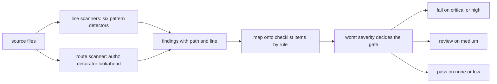
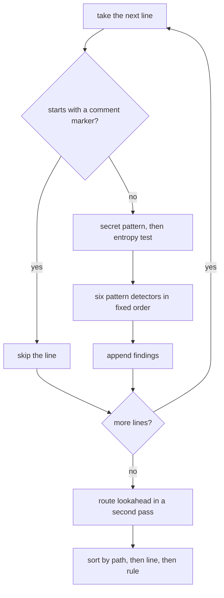
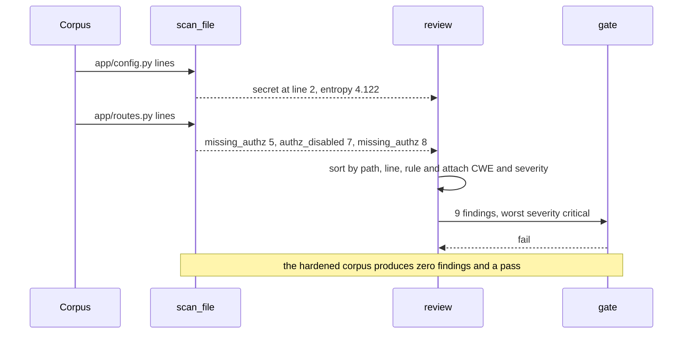

# 983 — Implement end-to-end security review checklist and automated scans for repository code.

> **Tier:** Master · **CTCI chapter:** Beyond — Security & Privacy
> **Task spec:** [983-implement-end-to-end-security-review-checklist-and-automated-sca.md](../../../tasks/master/983-implement-end-to-end-security-review-checklist-and-automated-sca.md)
> **Solutions:** [Python](../../../solutions/python/master/983-implement-end-to-end-security-review-checklist-and-automated-sca/solution.py) ·
> [Java](../../../solutions/java/master/983-implement-end-to-end-security-review-checklist-and-automated-sca/Solution.java) ·
> [JavaScript](../../../solutions/javascript/master/983-implement-end-to-end-security-review-checklist-and-automated-sca/solution.js) ·
> [C#](../../../solutions/csharp/master/983-implement-end-to-end-security-review-checklist-and-automated-sca/Solution.cs)

## 1. Problem restatement

**Input:** an in-memory source corpus — seven files under `app/` — and a printed checklist of eight
control items. Each item names the detector rule that enforces it, a human title, a CWE code and a
severity:

| Rule | Checklist item | CWE | Severity |
| --- | --- | --- | --- |
| `secret` | No credentials in source control | `CWE-798` | `critical` |
| `sql_injection` | Queries must be parameterised | `CWE-89` | `critical` |
| `dynamic_code` | No eval/exec of untrusted input | `CWE-95` | `high` |
| `weak_randomness` | Secrets must come from a CSPRNG | `CWE-338` | `medium` |
| `weak_hash` | Passwords must use a slow KDF | `CWE-916` | `high` |
| `tls_verification` | TLS verification must stay enabled | `CWE-295` | `critical` |
| `missing_authz` | Every route needs an authorization check | `CWE-862` | `high` |
| `authz_disabled` | Authorization decorators must not be bypassed | `CWE-863` | `high` |

**Output:** a report of `Finding(rule, path, line, severity, cwe)` sorted by path then line, and a
gate decision from `GATE = {"critical": "fail", "high": "fail", "medium": "review", "low": "pass"}`
driven by the worst severity found.

The planted corpus is designed so each committed vulnerability is detectable by exactly one rule:

| File | Offending line | Rule that owns it |
| --- | --- | --- |
| `app/config.py` | `API_KEY = 'sk_live_9f3ac7b1d2e4'` | `secret` |
| `app/db.py` | `query = 'SELECT * FROM users WHERE id = %s' % user_id` | `sql_injection` |
| `app/rules.py` | `return eval(expression)` | `dynamic_code` |
| `app/tokens.py` | `random.choice('abcdef0123456789')` | `weak_randomness` |
| `app/auth.py` | `hashlib.md5(password.encode()).hexdigest()` | `weak_hash` |
| `app/edge.py` | `requests.get(url, verify=False)` | `tls_verification` |
| `app/routes.py` | route with no authz decorator, and a route with `# nosec:authz` | `missing_authz`, `authz_disabled` |

## 2. Intuition

The naive scanner is a grep with a list of bad words. It has two failure modes that make it useless in
practice: it flags every literal that merely *looks* like a secret (so the review queue fills with
`API_KEY = os.environ['API_KEY']`), and it cannot say *where* the problem is or *which* control it
violates (so the reviewer has to re-derive the policy by hand).

Two insights fix both.

**Insight one: a secret is a value with high entropy, not a name that looks secret.** The detector
matches an assignment shape (a key-like name, `=`, a quoted literal of at least 8 characters) and then
tests the *literal's* Shannon entropy against `HASH_ENTROPY_THRESHOLD = 3.2` bits per character. A
random-looking API key (`sk_live_9f3ac7b1d2e4`, entropy `4.122`) fires; a placeholder
(`'aaaaaaaaaaaaaaa'`) and an environment lookup (`os.environ['SECRET']`) do not, because the first has
entropy `0` and the second has no quoted literal at all.

**Insight two: map every detector onto a checklist item, and let the checklist drive the gate.** A
finding is only actionable if it names a control, a CWE and a severity, and the release decision is
then a pure function of the severities — the *highest* severity present decides. That makes the gate
auditable: "the build failed because a `critical` finding was present" is a statement somebody can
dispute, unlike "the linter was unhappy".



## 3. Algorithm

1. **Skip comments.** `scan_file` ignores any line whose stripped form starts with `#`, so a
   commented-out `eval(x)` or a documentation snippet cannot fail the build. (This is why the injected
   `# nosec:authz` marker must be detected by a *different* rule that sees the whole line including the
   comment.)
2. **Scan each line for secrets.** `SECRET_PATTERN` is a case-insensitive match of a key-like
   identifier (`api_key`, `secret`, `password`, `token`, `passwd`, with a word boundary) followed by
   `= 'literal'` or `= "literal"` of at least eight characters. The captured literal's
   `shannon_entropy` must be at least `3.2`.
3. **Scan each line with the six detectors**, in a fixed order — `sql_injection`, `dynamic_code`,
   `weak_randomness`, `weak_hash`, `tls_verification`, `authz_disabled` — each a single regular
   expression:

   ```text
   sql_injection     a quoted string containing SELECT/INSERT/UPDATE/DELETE followed by % or + or .format(
   dynamic_code      eval( or exec( or pickle.loads(
   weak_randomness   random.choice / choices / randint / random / randbytes (
   weak_hash         md5( or sha1(
   tls_verification  verify=False or ssl._create_unverified_context
   authz_disabled    # nosec:authz or @public_route or authz = False
   ```

4. **Scan for unauthenticated routes.** `unauthenticated_routes` finds every route decorator
   (`@app.route`, `@app.get`, `@app.post`, `@router.*`) and looks at the next three non-empty lines: if
   none of them carries `@login_required`, `@requires_role` or `@authorize`, the route is reported as
   `missing_authz` at the route's own line number.
5. **Map and sort.** Every `(rule, path, line)` triple becomes a `Finding` with the checklist item's
   severity and CWE; the report is sorted by `(path, line, rule)`.
6. **Gate.** The decision is `GATE[SEVERITY_NAMES[worst]]` where `worst` is the maximum severity rank
   in the report, and `"pass"` when the report is empty.

```text
procedure scan_file(path, lines)
    findings ← empty list
    for number, line in enumerate(lines, from 1) do
        if line stripped starts with "#" then continue end
        for each match of SECRET_PATTERN in line do
            if shannon_entropy(match.value) >= 3.2 then
                append (secret, path, number) to findings
            end
        end
        for each (rule, pattern) in DETECTORS do
            if pattern matches line then
                append (rule, path, number) to findings
            end
        end
    end
    extend findings with unauthenticated_routes(path, lines)
    return findings
end
```

```text
function shannon_entropy(text)
    if text is empty then return 0.0 end
    counts ← frequency of each character in text
    length ← number of characters in text
    return − sum over counts of (count / length) * log2(count / length)
end
```



## 4. Worked example

Running the Python file prints:

```text
files=7 findings=9 decision=fail by_rule={authz_disabled:1, dynamic_code:1, missing_authz:2, secret:1, sql_injection:1, tls_verification:1, weak_hash:1, weak_randomness:1} hardened_findings=0 hardened_decision=pass entropy_of_planted_secret=4.122
```

**File by file.** Nine findings, one per planted defect except `app/routes.py`, which contributes
three. `app/routes.py` is the interesting file because its findings come from two different mechanisms:

| Line | Content | Detector | Finding |
| --- | --- | --- | --- |
| `1` | `@app.route('/admin/users')` | route lookahead sees `@login_required` on line `2` | — (trusted) |
| `5` | `@app.post('/admin/impersonate')` | next three non-empty lines are `def impersonate(...)`, the `return` with `# nosec:authz`, and `@app.get('/health')` — none is an authz decorator | `missing_authz` at `5` |
| `7` | `return impersonate_user(user_id)  # nosec:authz` | `authz_disabled` pattern | `authz_disabled` at `7` |
| `8` | `@app.get('/health')` | next lines carry no authz decorator | `missing_authz` at `8` |

The reported lines for that file are therefore `[5, 7, 8]`, exactly as the check asserts, and the
line-number table for the other files is `app/db.py -> [2]` and `app/auth.py -> [3]`.

**The entropy test, computed by hand.** The planted key literal `sk_live_9f3ac7b1d2e4` has 19
characters; its Shannon entropy is `4.122` bits per character, above the `3.2` threshold. The two
counter-examples the solution checks are the placeholder `aaaaaaaaaaaaaaa` (one distinct symbol,
entropy `0`) and the environment lookup `os.environ['SECRET']`, which never matches the assignment
shape in the first place. A separate probe file with `password = 'Zq7!vL2#pR9$'` does fire — one
finding, rule `secret` — while `API_KEY = 'aaaaaaaaaaaaaaa'` and `SECRET = os.environ['SECRET']`
produce a clean report and a `pass`.

The self-check of the entropy implementation is exact rather than approximate:

| Input | Expected entropy | Why |
| --- | --- | --- |
| `""` | `0.0` | guarded before the summation |
| `"aaaa"` | `0.0` | one symbol at frequency `1.0`, `log2(1) = 0` |
| `"abcd"` | `2.0` | four symbols at frequency `0.25` |
| `"abab"` | `1.0` | two symbols at frequency `0.5` |
| `sk_live_9f3ac7b1d2e4` | `4.122` | the printed value; must match `entropy_oracle` to `1e-12` |



## 5. Complexity

Let `F` be the number of files, `L` the average lines per file, `D = 6` the pattern detectors plus the
secret pattern, and `K` the length of a line.

| Phase | Time | Space | Why the bound holds |
| --- | --- | --- | --- |
| `shannon_entropy` | `O(K)` | `O(σ)` | one count dictionary pass over the literal |
| one line | `O(K)` amortised | `O(σ)` | a fixed number of regex searches per line |
| `scan_file` | `O(L * K)` | `O(E)` findings | the per-line work is constant in the number of detectors |
| `unauthenticated_routes` | `O(L * 3 * K)` | `O(E)` | each route line inspects at most three following non-empty lines |
| `review` | `O(F * L * K + N log N)` | `O(N)` | the corpus scan dominates; the sort is over `N` findings |
| `per_rule` | `O(N)` | `O(1)` distinct rules | a counter over the finding rules |

For the shipped corpus that is `7` files, `22` source lines and `9` findings. The scaling question is
not asymptotic but *noise*: a real repository runs this on millions of lines, and that is why the
entropy test exists — it removes the most common class of false positive (environment lookups and
placeholders) at the cost of one linear pass over a string.

## 6. Pitfalls and edge cases

* **Comment lines are skipped before any detector runs.** A file consisting only of
  `# API_KEY = 'sk_live_1'` and `# eval(x)` produces no findings. This is deliberate but it has a
  consequence: a leak committed inside a comment is *not* caught by the secret rule, which is why
  `authz_disabled` deliberately looks for its marker inside comments.
* **The secret rule is a conjunction.** Assignment shape **and** entropy. Either test alone produces
  false positives or false negatives: the shape alone flags placeholders, the entropy alone flags
  random-looking identifiers with no assignment.
* **Route lookahead is bounded.** `unauthenticated_routes` inspects `lines[number + 1:number + 4]` —
  at most three lines, blanks excluded. A decorator separated from its route by four blank lines is
  therefore *not* recognised, and the route is reported. That is a deliberate, documented limit, and
  the "blank line in between" case is explicitly checked as trusted.
* **Findings carry the checklist item's metadata, never their own.** `Finding.severity ==
  SEVERITY[finding.rule]` and `Finding.cwe == CWE[finding.rule]` for all nine findings, so rule and
  policy cannot drift apart.
* **The gate is decided by the worst severity, not the count.**
  `GATE["critical"] == GATE["high"] == "fail"`, `GATE["medium"] == "review"` and `GATE["low"] ==
  "pass"`; a single `medium` finding in an otherwise clean corpus yields a `review` decision rather
  than a failed build.
* **A single-rule corpus reports only that rule.** `review({"app/one.py": ("eval(payload)",)})` yields
  exactly `["dynamic_code"]`, which is the cheapest possible regression test for detector leakage.
* **Empty boundaries are clean.** `review({})`, `review({"app/empty.py": ()})` and
  `scan_file("app/none.py", ())` all return no findings and a `pass` — an empty corpus must not be an
  error, because a fresh repository is legitimately empty.
* **Two independent entropy implementations.** `entropy_oracle` recomputes the same value with
  `math.log(share) / math.log(2.0)` instead of `math.log2`, and the check requires agreement to
  `1e-12`; a sign error or a forgotten `count / length` normalisation would break the identity.

## 7. Variants and follow-ups

* **Static analysis with real data flow.** The documented simplification is line-oriented regexes on a
  tiny corpus instead of a parser and taint analysis: this scanner cannot follow a secret from a
  function argument into a log line. A real SAST tool adds an AST, an inter-procedural taint graph and
  reachability from an entry point.
* **Waivers and expiring suppressions.** The C# solution in this repository adds a waiver mechanism —
  a high-severity finding blocks the build *unless* a written waiver survives — which is the policy
  half of the same gate. The Java solution replaces the regexes with token and case-insensitive
  substring analysis and adds command injection; the JavaScript solution keys its controls to
  OWASP-style ids and reports 1-based line numbers for file-level controls.
* **The gate in CI.** A failing security gate belongs in the release pipeline; see
  [981-implement-reproducible-deployment-of-full-platform-via-infra-as.md](../../../tasks/master/981-implement-reproducible-deployment-of-full-platform-via-infra-as.md)
  for the plan that a gate must block, and
  [870-implement-continuous-integration-pipeline-for-large-scale-numeri.md](../../../tasks/master/870-implement-continuous-integration-pipeline-for-large-scale-numeri.md)
  for the pipeline shape around it.
* **Data-protection review of the same repository.** Secrets are one class of risk; personal data is
  another, with different rules — see
  [984-implement-legal-privacy-compliance-checks-for-user-data-handling.md](../../../tasks/master/984-implement-legal-privacy-compliance-checks-for-user-data-handling.md)
  for the retention, consent, minimisation and erasure checks that sit alongside this gate.

## 8. Check yourself

<details><summary>Why does the solution test entropy instead of matching a key format such as `sk_live_...`?</summary>

Because formats are vendor-specific and change; entropy is a property of the value itself. The
security property being enforced is "this literal has enough information to be a real credential", and
`4.122` bits per character over 19 characters is about `78` bits — far beyond a placeholder. The check
pins the implementation against four exact values (`0.0` for empty and single-symbol, `2.0` for four
distinct symbols, `1.0` for a two-symbol alternation) so the threshold cannot drift silently.</details>

<details><summary>The route at line `1` of `app/routes.py` is not reported, although it has no authz decorator on its own line. Why?</summary>

Because the authz decorator order is flexible: `@login_required` sits on line `2`, below the route
decorator, which is how the framework actually composes them. The rule therefore looks at the decorator
*and* the next up-to-three non-empty lines, and treats a match anywhere in that window as sufficient.
The variant check with a blank line between `@app.get('/ok')` and `@login_required` confirms the window
skips blanks.</details>

<details><summary>Both `missing_authz` findings and the `authz_disabled` finding come from the same file, and two of them point at lines that are not decorators. Is the line number meaningful?</summary>

Yes: `missing_authz` is reported at the **route decorator's** line (the point where the control should
have been declared), and `authz_disabled` at the line carrying the `# nosec:authz` marker (the point
where the control was switched off). The ordering check requires the report to be sorted by path then
line, so a reviewer reads the file top to bottom: `5` (`missing_authz`), `7` (`authz_disabled`),
`8` (`missing_authz`).</details>

<details><summary>The hardened corpus produces zero findings. What changes were needed, and why does that matter?</summary>

Each file was repaired the way the checklist prescribes: the key comes from the environment, the query
is parameterised, `ast.literal_eval` replaces `eval`, `secrets.token_hex` replaces `random.choice`,
`generate_password_hash` replaces `md5`, `verify=False` is dropped, and every remaining route carries
`@login_required`. A scanner whose rules cannot be satisfied by a legitimate fix will be disabled by
its users; the hardened corpus is the proof that each rule has a clean counterpart.</details>
