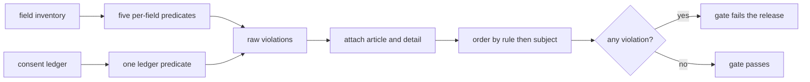
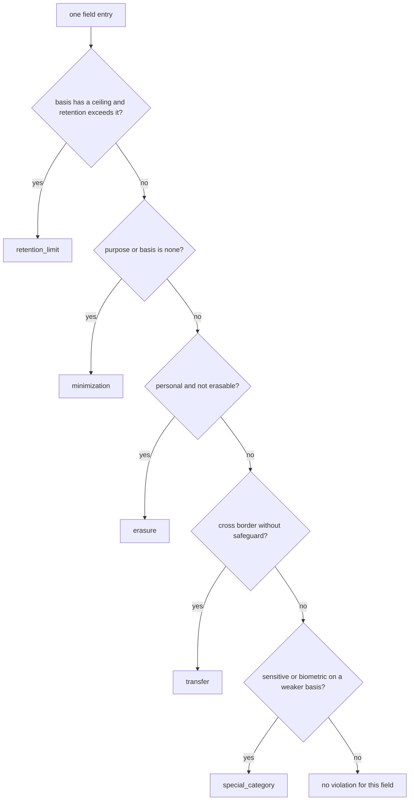
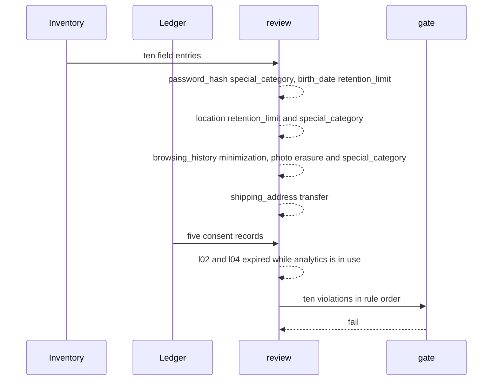

# 984 — Implement legal/privacy compliance checks for user data handling in platform.

> **Tier:** Master · **CTCI chapter:** Beyond — Software Engineering & Tooling
> **Task spec:** [984-implement-legal-privacy-compliance-checks-for-user-data-handling.md](../../../tasks/master/984-implement-legal-privacy-compliance-checks-for-user-data-handling.md)
> **Solutions:** [Python](../../../solutions/python/master/984-implement-legal-privacy-compliance-checks-for-user-data-handling/solution.py) ·
> [Java](../../../solutions/java/master/984-implement-legal-privacy-compliance-checks-for-user-data-handling/Solution.java) ·
> [JavaScript](../../../solutions/javascript/master/984-implement-legal-privacy-compliance-checks-for-user-data-handling/solution.js) ·
> [C#](../../../solutions/csharp/master/984-implement-legal-privacy-compliance-checks-for-user-data-handling/Solution.cs)

## 1. Problem restatement

**Input:** two things.

*A field inventory* — ten fields, each a named tuple
`Field(name, pii, purpose, basis, retention_days, cross_border, safeguard, erasable)`. Two examples:
`Field("email", "contact", "authentication", "contract", 730, True, "scc", True)` and
`Field("browsing_history", "identifier", "none", "none", 3650, False, "none", True)`.

*A consent ledger* — five `Consent(learner, purpose, granted, expires)` records, evaluated against a
fixed "today" of `TODAY = 60` days, with the set of purposes still being processed
`PURPOSES_IN_USE = ("authentication", "personalization", "analytics", "fulfilment")`.

**Output:** a report of `Violation(rule, article, subject, detail)` ordered by rule then subject, and a
gate that fails the release when the report is non-empty. Six rules, each mapped to the article it
enforces:

| Rule | Question it asks | Article |
| --- | --- | --- |
| `consent_expiry` | is a purpose still processed after its consent expired? | `Art.5(1)(d)` |
| `special_category` | is sensitive or biometric data held on a weaker basis than explicit consent? | `Art.9` |
| `retention_limit` | is the retention period inside the ceiling of its legal basis? | `Art.5(1)(e)` |
| `minimization` | was the field collected with a declared purpose and basis at all? | `Art.5(1)(c)` |
| `erasure` | can personal data be erased on request? | `Art.17` |
| `transfer` | does data leaving the region carry a transfer safeguard? | `Art.46` |

The retention ceilings are fixed by basis:
`RETENTION_LIMIT = {"consent": 365, "contract": 730, "legitimate_interest": 180, "explicit_consent": 365}`,
and the special categories are `SPECIAL_CATEGORY = ("sensitive", "biometric")`.

## 2. Intuition

The naive compliance check is a review meeting: a person reads the data catalogue, remembers the
policy, and signs off. It is unauditable, it does not scale, and it cannot run on every pull request.

The key insight is that **almost every privacy obligation is a local predicate over a single field or a
single consent record**. Once you phrase them that way, each rule is a one-line test, and the whole
audit becomes a scan:

```text
retention_limit   basis in ceilings  and  retention_days > ceiling[basis]
minimization      purpose == none    or   basis == none
erasure           pii != none        and  not erasable
transfer          cross_border       and  safeguard == none
special_category  pii in SPECIAL_CATEGORY and basis != explicit_consent
consent_expiry    record.expires < TODAY  and  purpose in PURPOSES_IN_USE
```

The second insight is that a violation is only useful if it is **self-explaining**: the finding carries
the rule, the article, the subject (`email`, `l02:analytics`) and a human-readable detail
(`365 days exceeds the legitimate_interest ceiling of 180`). That is what turns a failing gate into a
work item instead of a debate.



## 3. Algorithm

1. **Per-field predicates.** `field_violations(entry)` returns every rule that one field breaks, in
   rule order:
   * `retention_limit` when the field's basis has a ceiling and `retention_days` exceeds it (the detail
     quotes both numbers);
   * `minimization` when `purpose == "none"` **or** `basis == "none"`;
   * `erasure` when the data is personal (`pii != "none"`) and `erasable` is false;
   * `transfer` when the data crosses a border and the safeguard is `"none"`;
   * `special_category` when the class is sensitive or biometric and the basis is anything other than
     `explicit_consent`.
2. **Ledger predicate.** `consent_violations(consents, today, purposes_in_use)` returns a
   `consent_expiry` violation for every record whose `expires` is **strictly** before `today` while its
   purpose is still in use. A consent that expires exactly today is still current.
3. **Assemble and order.** `review(inventory, consents)` gathers raw triples
   `(rule, subject, detail)`, converts them into `Violation` rows carrying `ARTICLES[rule]`, and sorts
   by `(RULES.index(rule), subject)` so the report reads in policy order and, within a rule, by
   subject.
4. **Gate.** `gate(report)` is `"fail"` when the report is non-empty and `"pass"` otherwise; `counts`
   returns a per-rule tally with a zero for every rule that did not fire.

```text
procedure field_violations(entry)
    found ← empty list
    if entry.basis is a key of RETENTION_LIMIT and entry.retention_days > RETENTION_LIMIT[entry.basis] then
        append (retention_limit, entry.name, retention days exceed the ceiling) to found
    end
    if entry.purpose equals "none" or entry.basis equals "none" then
        append (minimization, entry.name, collected without a purpose and basis) to found
    end
    if entry.pii is not "none" and entry.erasable is false then
        append (erasure, entry.name, personal data that cannot be erased) to found
    end
    if entry.cross_border and entry.safeguard equals "none" then
        append (transfer, entry.name, leaves the region without a safeguard) to found
    end
    if entry.pii is in SPECIAL_CATEGORY and entry.basis is not "explicit_consent" then
        append (special_category, entry.name, held on the weaker basis) to found
    end
    return found
end
```

```text
procedure review(inventory, consents)
    raw ← empty list
    for each entry in inventory do
        extend raw with field_violations(entry)
    end
    extend raw with consent_violations(consents)
    report ← for each (rule, subject, detail) in raw create Violation(rule, ARTICLES[rule], subject, detail)
    return sorted report by (position of rule in RULES, subject), raw
end
```



A second, independent evaluator — `review_oracle` — walks the same records **rule by rule** instead of
field by field: for each rule it scans the whole inventory and records a bare rule name, and for
`consent_expiry` it delegates to the ledger predicate. The check requires the multiset of rules from
the oracle to equal the multiset from the real review, so an early-exit or a missing `elif` in either
version shows up immediately.

## 4. Worked example

Running the Python file prints:

```text
fields=10 consents=5 violations=10 gate=fail by_rule={consent_expiry:2, erasure:1, minimization:1, retention_limit:2, special_category:3, transfer:1}
hardened_violations=0 hardened_gate=pass articles=['Art.17', 'Art.46', 'Art.5(1)(c)', 'Art.5(1)(d)', 'Art.5(1)(e)', 'Art.9']
```

**Every planted violation, derived field by field** (`✓` marks the rule that fires):

| Field | Class | Purpose / basis | Days | Border / safeguard | Erasable | `retention` | `min` | `erasure` | `transfer` | `special` |
| --- | --- | --- | --- | --- | --- | --- | --- | --- | --- | --- |
| `user_id` | identifier | authentication / contract | `730` | no / none | yes | — | — | — | — | — |
| `email` | contact | authentication / contract | `730` | yes / `scc` | yes | — | — | — | — | — |
| `password_hash` | sensitive | authentication / **contract** | `730` | no / none | yes | — | — | — | — | ✓ |
| `birth_date` | identifier | personalization / consent | **`400`** | no / none | yes | ✓ | — | — | — | — |
| `device_id` | identifier | analytics / legitimate_interest | `180` | no / none | yes | — | — | — | — | — |
| `location` | sensitive | analytics / **legitimate_interest** | **`365`** | no / none | yes | ✓ | — | — | — | ✓ |
| `browsing_history` | identifier | **none / none** | `3650` | no / none | yes | — | ✓ | — | — | — |
| `photo` | **biometric** | authentication / **contract** | `730` | yes / `scc` | **no** | — | — | ✓ | — | ✓ |
| `shipping_address` | contact | fulfilment / contract | `400` | yes / **none** | yes | — | — | — | ✓ | — |
| `city` | none | personalization / consent | `365` | no / none | yes | — | — | — | — | — |

Eight field violations, matching the printed tally exactly: `special_category = 3`
(`password_hash`, `location`, `photo`), `retention_limit = 2` (`birth_date` at `400 > 365`,
`location` at `365 > 180`), `erasure = 1` (`photo`), `transfer = 1` (`shipping_address`),
`minimization = 1` (`browsing_history`).

**The ledger, record by record.** Two of the five consents are broken:

| Consent | Purpose in use? | Expires | Verdict |
| --- | --- | --- | --- |
| `l01:analytics` | yes | `400` | current — `400` is after today's `60` |
| `l02:analytics` | yes | `10` | **`consent_expiry`** — expired on day `10` while analytics is still processed |
| `l04:analytics` | yes | `20` | **`consent_expiry`** — same rule, different learner |
| `l03:marketing` | no | `100` | not reported: marketing is not in `PURPOSES_IN_USE` |
| `l01:marketing` | no | `30` | not reported, for the same reason |

Eight plus two is the printed `violations=10`, and the gate is `fail`. The gate passes only for the
hardened inventory: `COMPLIANT` re-derives every field with a legitimate purpose, an
`explicit_consent` basis for special categories, retention clamped to `min(days, ceiling)`, an `scc`
safeguard wherever data crosses a border, and `erasable = True` everywhere — `0` violations, `pass`.



## 5. Complexity

Let `F` be the number of fields, `C` the number of consent records, `R = 6` the number of rules and
`V` the number of violations found.

| Phase | Time | Space | Why the bound holds |
| --- | --- | --- | --- |
| `field_violations` | `O(1)` | `O(1)` | five independent comparisons per field |
| inventory scan | `O(F)` | `O(V)` | one call per field, plus the triples produced |
| `consent_violations` | `O(C)` | `O(V)` | one predicate per record |
| `review` build | `O(V)` | `O(V)` | one `Violation` per raw triple, article looked up in a map |
| `review` sort | `O(V log V)` | `O(V)` | the key is `(RULES.index(rule), subject)`, computed once per row |
| `counts` / `gate` | `O(V + R)` | `O(R)` | tally dictionary plus one emptiness test |
| `review_oracle` | `O(R * F + C)` | `O(V)` | rule-major traversal: each rule rescans the inventory |

With `F = 10` and `C = 5` the whole audit is a few dozen comparisons. The cost that matters is the one
you avoid: running this on every pull request turns a quarterly legal review into a per-change check,
and the per-rule traversal in the oracle is deliberately quadratic-ish so that it cannot share a bug
with the field-major implementation.

## 6. Pitfalls and edge cases

* **Boundaries are inclusive.** Retention of exactly `180` days on a `legitimate_interest` basis is
  compliant; `181` is not. A consent that expires exactly on `TODAY` is current; `TODAY - 1` is not.
  Both boundaries are asserted directly (`review((on_limit,), ())[0] == []`, and the consent pair
  `[TODAY]` versus `[TODAY - 1]`).
* **A basis with no ceiling is not a violation.** `browsing_history` has `basis == "none"`, which is
  absent from `RETENTION_LIMIT`, so the `retention_limit` rule does not fire even though its retention
  runs to `3650` days; only `minimization` catches it. Inventing a default ceiling would be a policy
  change made in code.
* **`special_category` is about the basis, not the retention.** `photo` is biometric on a `contract`
  basis: it is reported once for `special_category` and once for `erasure` — two findings, which the
  check asserts (`len(review((INVENTORY[7],), ())[0]) == 2`).
* **A safeguard clears the transfer rule but not the border.** `Field("dna", "biometric",
  "authentication", "explicit_consent", 365, True, "dpa", True)` produces **no** violations: cross
  border with a safeguard is fine, and biometric data on `explicit_consent` is fine.
* **A consent for a purpose nobody processes is dead weight, not a violation.** `marketing` records
  expired on days `100` and `30` are not reported, because the rule is purpose limitation — it only
  cares about purposes still in use.
* **No personal data means nothing to protect.** A field with `pii == "none"` on a
  `legitimate_interest` basis with `90` days of retention is clean, and `review((), ())` is clean, so
  the empty inventory and the no-PII inventory are both boundaries rather than error paths.
* **Every violation is fully populated.** The check requires `item.article == ARTICLES[item.rule]`,
  a non-empty `detail`, and the report order to match `RULES` — so a rule can never be reported without
  its article or in a position that hides it behind a less severe rule.
* **Reproducibility.** `review(INVENTORY, CONSENTS)` returns the same `(ordered, raw)` pair on every
  call, and the hardened review is stable too, which is what makes the gate usable as a build step.

## 7. Variants and follow-ups

* **Jurisdiction-specific rule packs.** The documented simplification is a hand-written inventory and
  one rule set; a real tool loads per-jurisdiction packs (GDPR, CCPA, LGPD) and evaluates the same six
  predicate shapes with different ceilings and articles.
* **Deletion workflows, not just flags.** `erasable` is a declaration; a full system needs the
  machinery behind it. The Java solution in this repository adds subject-rights tooling alongside the
  five field rules, the JavaScript solution audits a *processing* inventory keyed by system (with a
  DPIA rule for special-category data), and the C# solution classifies personal data from field names
  and enforces retention against record age rather than a declared period.
* **Where the inventory comes from.** Field metadata is usually produced by the same code that
  accesses the data; see
  [853-implement-fine-grained-access-control-and-auditing-for-database.md](../../../tasks/master/853-implement-fine-grained-access-control-and-auditing-for-database.md)
  for access control and audit trails over the store, and
  [983-implement-end-to-end-security-review-checklist-and-automated-sca.md](../../../tasks/master/983-implement-end-to-end-security-review-checklist-and-automated-sca.md)
  for the sibling gate that looks for credentials rather than personal data.
* **Consent as data.** Consent records are themselves personal data with their own retention: see
  [986-implement-open-dataset-packaging-and-licensing-automation-for-pr.md](../../../tasks/master/986-implement-open-dataset-packaging-and-licensing-automation-for-pr.md)
  for how a published dataset must carry licensing and attribution obligations, which is the same
  "declare the constraint, then check it mechanically" pattern.

## 8. Check yourself

<details><summary>Why is `retention_limit` keyed on the legal basis rather than on the data class?</summary>

Because the ceiling is a consequence of *why* the data is held: data held under a contract may
legitimately live longer (730 days here) than data held under legitimate interest (180 days). The rule
therefore fires only when the basis has a ceiling in `RETENTION_LIMIT`; a field whose basis is not in
the table (like `browsing_history`'s undeclared `none`) can only be caught by the minimisation rule,
and that is exactly what the tally shows — one `minimization`, no `retention_limit` for it.</details>

<details><summary>What makes `photo` produce exactly two violations?</summary>

Two independent predicates apply to the same row: `pii == "biometric"` with `basis == "contract"`
fails `special_category` (special-category data needs `explicit_consent`), and `erasable == False` with
`pii != "none"` fails `erasure`. The count is asserted as `len(review((INVENTORY[7],), ())[0]) == 2`,
so nobody can "fix" a failing rule by having one finding swallow the other.</details>

<details><summary>A consent expired on day `30` for `marketing`, but there is no finding. Why not?</summary>

Because purpose limitation is about purposes still being processed. `PURPOSES_IN_USE` covers
`authentication`, `personalization`, `analytics` and `fulfilment`, so processing that stopped is not a
violation — it is housekeeping. The two reported records (`l02:analytics` and `l04:analytics`) are the
ones where an expired consent sits under a purpose that is *still* being served.</details>

<details><summary>The gate is `fail` for the planted inventory and `pass` for the hardened one. What exactly does the hardened inventory change, field by field?</summary>

For every field it forces a declared purpose (`analytics` where the purpose was `none`), a basis of
`explicit_consent` for special categories and of `legitimate_interest` where the purpose had been
`none`, retention clamped to the ceiling of the resulting basis, an `scc` safeguard wherever data
crosses a border without one, and `erasable = True`. That is a concrete remediation list — which is the
point of making the report carry a `detail` per violation rather than a boolean.</details>
