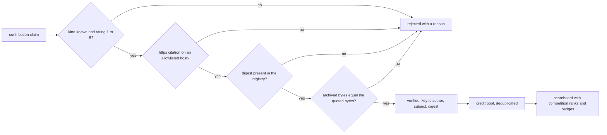
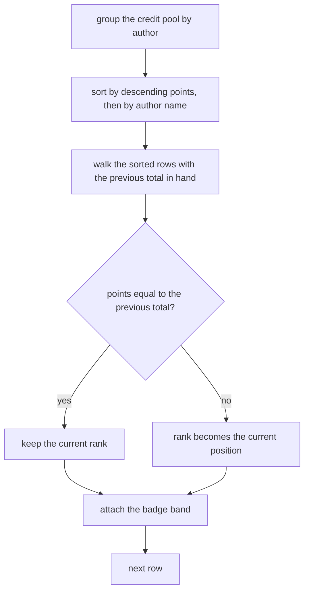
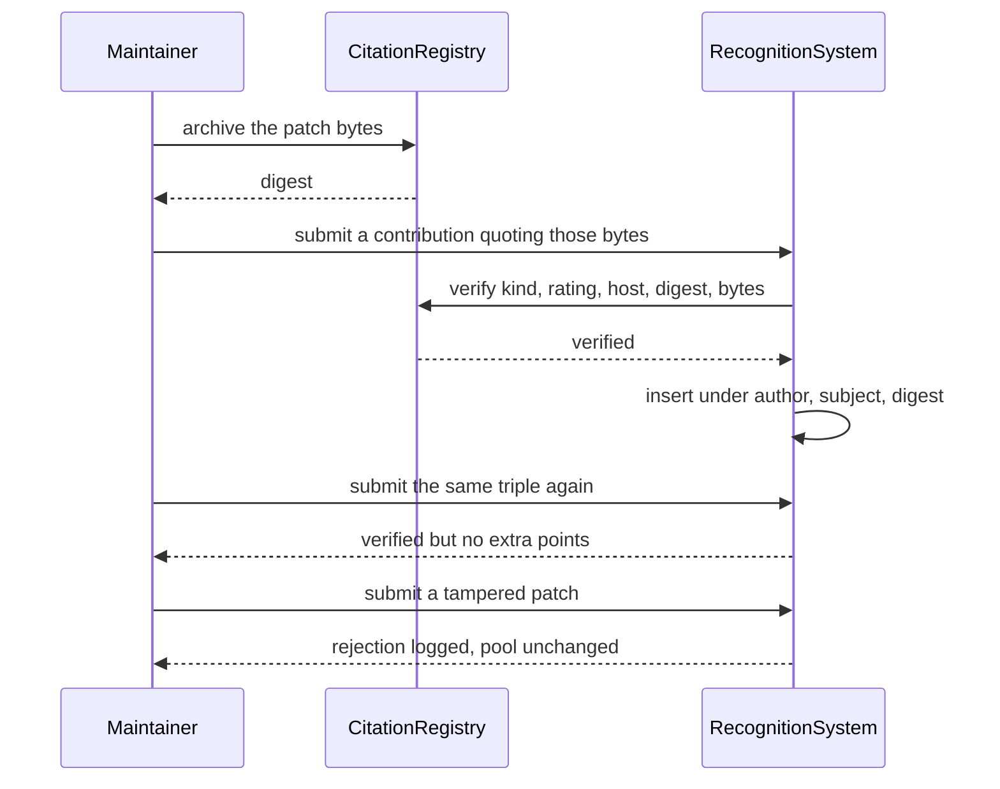

# 985 — Implement contribution recognition system with verified citations for authors.

> **Tier:** Master · **CTCI chapter:** Beyond — Software Engineering & Tooling
> **Task spec:** [985-implement-contribution-recognition-system-with-verified-citation.md](../../../tasks/master/985-implement-contribution-recognition-system-with-verified-citation.md)
> **Solutions:** [Python](../../../solutions/python/master/985-implement-contribution-recognition-system-with-verified-citation/solution.py) ·
> [Java](../../../solutions/java/master/985-implement-contribution-recognition-system-with-verified-citation/Solution.java) ·
> [JavaScript](../../../solutions/javascript/master/985-implement-contribution-recognition-system-with-verified-citation/solution.js) ·
> [C#](../../../solutions/csharp/master/985-implement-contribution-recognition-system-with-verified-citation/Solution.cs)

## 1. Problem restatement

**Input:** credited contributions, each a `Contribution(author, kind, subject, rating, source, artifact)`
where `artifact` is the *exact bytes* of the work (a patch, a review comment, an editorial) and
`source` is the citation URL that is supposed to prove authorship. Plus a `CitationRegistry` holding
the artifacts a maintainer actually archived, keyed by their SHA-256 digest.

**Output:** a verified scoreboard.

1. `submit(contribution)` → `True` only when the citation verifies; otherwise the claim is logged in
   `rejected` with a reason.
2. `total_points()` → the sum over **verified** contributions of `WEIGHTS[kind] * rating`.
3. `scoreboard()` → rows `{rank, author, points, badge}` ordered by descending points, with equal
   points sharing a competition rank.

The scoring constants are fixed:

| Kind | Weight | Points at rating 5 |
| --- | --- | --- |
| `code` | `5` | `25` |
| `design` | `4` | `20` |
| `review` | `3` | `15` |
| `docs` | `2` | `10` |

Badges are threshold bands, and `BADGES = ((40, "platinum"), (20, "gold"), (8, "silver"), (1, "bronze"))`
is scanned in order, so a total of `37` is `gold`, `8` is exactly `silver`, `7` is `bronze`, `0` is
`none`. Citations are only accepted from
`ALLOWED_HOSTS = ("github.com", "gitlab.com", "cracking-coding.dev")` over `https`.

## 2. Intuition

The naive recognition system trusts a self-reported submission: "I wrote the LRU cache, give me 25
points". Any leaderboard built on that is a leaderboard of confidence, and it will be gamed in the first
week.

The key insight is that **a claim is only a claim until it is tied to an immutable artifact**. The
system hashes the quoted artifact, requires the digest to be present in a registry of bytes a
maintainer really archived, and requires the citation to point at an allowlisted host. Two submissions
that quote the *same* bytes therefore collapse to the same key — `(author, subject, digest)` — and the
second one is verified but scores nothing.

That design gives three properties cheaply:

* **Tamper evidence.** One byte of difference changes the digest, so a doctored patch simply does not
  resolve to anything in the registry.
* **No credit inflation.** Points are a pure function of `(kind, rating)` on *verified* rows, so
  `total_points()` is always the sum over the verified pool — an invariant the solution re-checks after
  every mutation of a 32-element generated stream.
* **Fair ranking.** Equal totals share a rank and the next rank skips (`1, 1, 3, 4`), which is the
  standard competition ("1224") rule rather than an ordinal numbering that would arbitrarily order
  ties by name.



## 3. Algorithm

1. **Hash the artifact.** `sha256_text(artifact)` produces the citation digest; the registry archives
   the same way, so identical bytes have identical digests on both sides.
2. **Verify, in cheapest-first order.** `CitationRegistry.verify` checks, in this order: the kind is one
   of the four weights; the rating is an integer in `1..5`; the citation host is https and allowlisted;
   the digest exists in the registry; and the archived bytes equal the quoted bytes. The first failure
   returns `(False, reason)` with a specific message.
3. **Host parsing.** `host_allowed` strips the scheme, splits on `/`, then on `:`, and lower-cases the
   result, so `https://GitHub.com:443/a/b` parses to `github.com` while `http://…` fails outright.
4. **Submit.** `submit` logs every rejection as `(author, subject, reason)` and otherwise inserts into
   the credit pool under the deduplication key. Verified duplicates are still "verified" — they just
   do not add points.
5. **Aggregate.** `scoreboard` groups the pool by author, sums points, sorts by `(-points, author)`,
   and assigns a rank that only advances when the point total changes.
6. **Badge.** `badge_for(points)` walks the band table in descending threshold order and returns the
   first name whose threshold is met.

```text
procedure verify(contribution)
    if contribution.kind is not a key of WEIGHTS then return false and unknown kind end
    if contribution.rating < 1 or contribution.rating > 5 then return false and bad rating end
    if host_allowed(contribution.source) is false then return false and host problem end
    stored ← archived[contribution.digest]
    if stored is undefined then return false and digest was never archived end
    if stored is not contribution.artifact then return false and bytes differ end
    return true and verified
end
```

```text
function scoreboard(credit)
    totals ← empty map
    for each contribution in credit.values() do
        totals[contribution.author] ← totals[contribution.author] + contribution.points
    end
    ordered ← entries of totals sorted by descending points then ascending author
    rows ← empty list
    rank ← 0
    previous ← undefined
    for position, (author, points) in enumerate(ordered, from 1) do
        if points is not previous then
            rank ← position
            previous ← points
        end
        append {rank, author, points, badge: badge_for(points)} to rows
    end
    return rows
end
```



## 4. Worked example

The happy path submits four mixed contributions against four archived artifacts. Running the Python
file prints:

```text
verified=4 rejected=4 total_points=63 leader=ada
```

**The verified pool, recomputed by hand** (`WEIGHTS[kind] * rating`):

| Author | Kind | Subject | Rating | Points | Running total for the author |
| --- | --- | --- | --- | --- | --- |
| `ada` | `code` | `lru-cache` | `5` | `5 * 5 = 25` | `25` |
| `ada` | `review` | `review-77` | `4` | `3 * 4 = 12` | `37` |
| `grace` | `design` | `bubble-sort` | `5` | `4 * 5 = 20` | `20` |
| `linus` | `docs` | `editorial-42` | `3` | `2 * 3 = 6` | `6` |

`total_points()` is `37 + 20 + 6 = 63`, matching the printed value, and the scoreboard order is
`ada, grace, linus` because `37 > 20 > 6`. The badges come from the band table: `ada` at `37` is `gold`
(the `40` threshold is not met), and `linus` at `6` is `bronze` (the `8` threshold is not met but `1`
is).

**The tie case.** Four `docs` contributions at ratings `3, 3, 2, 1` produce totals `6, 6, 4, 2`. The
rank walk gives:

| Position | Author | Points | Previous total | Rank | Badge |
| --- | --- | --- | --- | --- | --- |
| 1 | `a` | `6` | — | `1` | `bronze` |
| 2 | `b` | `6` | `6` | `1` | `bronze` |
| 3 | `c` | `4` | `6` → differs | `3` | `bronze` |
| 4 | `d` | `2` | `4` → differs | `4` | `bronze` |

`[1, 1, 3, 4]` is checked against the independent formula
`rank = 1 + number of authors with strictly more points`, which is the definition of a competition
rank rather than an artefact of the loop.

**The rejected claims.** Four tampered or malformed submissions, each verified as *not* verified:

| Submitted source | Defect | Reason returned |
| --- | --- | --- |
| `https://github.com/mallory/x` with `patches["lru-cache"] + "# extra\n"` | the bytes gained a line | digest mismatch — either never archived or archived bytes differ |
| `http://github.com/mallory/x` | plain http | `host not allowlisted or not https` |
| `https://example.com/mallory/x` | host outside the allowlist | `host not allowlisted or not https` |
| `https://github.com/mallory/x` with rating `6` | rating outside `1..5` | `rating outside 1..5` |

All four land in `system.rejected`, and the verified pool is unchanged: `total_points()` is still `63`
and `len(system.credit)` is still `4`. A fifth submission — the identical `(ada, lru-cache, digest)`
triple — *verifies* but is deduplicated by `setdefault`, so the total stays `63`.



## 5. Complexity

Let `V` be the number of verified contributions, `A` the number of distinct authors, `N` the length of
an artifact and `B` the number of archived bytes.

| Phase | Time | Space | Why the bound holds |
| --- | --- | --- | --- |
| `sha256_text` | `O(N)` | `O(1)` extra | one pass, constant-size digest |
| `archive` | `O(N)` | `O(B)` | the registry keeps the bytes keyed by digest |
| `host_allowed` | `O(len(url))` | `O(1)` | two splits and a lower-case |
| `verify` | `O(len(url))` | `O(1)` | one tuple comparison for the bytes |
| `submit` | `O(len(url) + N)` | `O(V)` | dominated by the digest computation done in the constructor |
| `total_points` | `O(V)` | `O(1)` | one addition per verified row |
| `scoreboard` | `O(V + A log A)` | `O(A)` | group-by aggregation then a sort on at most `A` rows |
| generated-field loop | `O(K * V)` worst case | `O(V)` | the check recomputes the total after every mutation, which is deliberate |

The important complexity is the *attack* complexity: to inflate a score, an adversary must find bytes
whose SHA-256 digest is already archived **and** whose content differs — a second-preimage attack —
because duplicating the bytes only deduplicates, and fabricating a URL only fails the host test.

## 6. Pitfalls and edge cases

* **Verification order matters for the message, not the outcome.** `verify` checks the kind and the
  rating before the host and the digest, cheapest first; the check exercises the rating and host
  failures directly and asserts `len(system.rejected) == 4` after the four planted rejections.
* **A verified duplicate is still `True`.** `submit` returns `True` for a repeated triple — the claim
  is genuine — while `setdefault` prevents the points from being counted twice. The check asserts both
  halves (`submit(again)` is true **and** `total_points()` is unchanged), because "reject duplicates"
  would be wrong: the same author citing the same artifact twice is not fraud.
* **The badge band is inclusive at the bottom.** `badge_for(8) == "silver"` and `badge_for(7) ==
  "bronze"`; `badge_for(40) == "platinum"` and `badge_for(0) == "none"`. Ordering the table from the
  largest threshold down is what makes a single linear scan correct.
* **Rank skipping is a semantic choice.** With totals `6, 6, 4, 2` the ranks are `1, 1, 3, 4` — not
  `1, 1, 2, 3`. The independent oracle (`1 + count of strictly better authors`) is computed from a
  plain score dictionary, so the loop's `previous` bookkeeping is checked rather than trusted.
* **Host parsing handles ports and case.** The host is the part before the first `/` after the scheme,
  then before any `:`, lower-cased before the allowlist test; `https://gitlab.com/...` and
  `https://cracking-coding.dev/...` are both accepted by the planted submissions.
* **An unknown kind is rejected before the weights are consulted.** `verify` returns
  `unknown contribution kind` rather than a `KeyError`, which matters because `points` is a property
  that would otherwise explode on a malformed row.
* **An empty system is a boundary, not an error.** `scoreboard()` is `[]`, `total_points()` is `0` and
  `rejected` is empty — a fresh instance must render an empty leaderboard.
* **The running-total invariant over a generated stream.** Thirty-two contributions are produced from
  `splitmix64(2026, 32)` with author `author-(value % 7)` and kind `(value >> 16) % 4`, each archived
  before submission; after *every* insertion the solution re-derives the total from a group-by
  accumulator and compares. The final scoreboard must equal the accumulator exactly, and the leader
  must hold the maximum recomputed score.

## 7. Variants and follow-ups

* **Different evidence models.** The Java solution requires a claim to name the contribution, an
  excerpt and the digest of that excerpt, and weights by kind as `commit 3 / review 2 / edit 1`; the
  JavaScript solution requires at least one distinct citation that cites the very artifact the
  contribution claims; the C# solution chains every ledger entry into the previous one
  (`h_i = mix(h_{i-1} || id_i || author_i || kind_i)`), so a retro-active edit breaks the chain from
  that index onward. All three are the same insight — *tie credit to immutable evidence* — with a
  different integrity primitive.
* **Publication and licensing of what is credited.** Once contributions are recognised, the derived
  artefact has obligations; see
  [986-implement-open-dataset-packaging-and-licensing-automation-for-pr.md](../../../tasks/master/986-implement-open-dataset-packaging-and-licensing-automation-for-pr.md)
  for attribution and license compatibility in a published package.
* **Citations in editorial output.** Recognising a contribution and *citing* it in derived documents
  are two halves of one workflow; see
  [993-implement-academic-citation-generator-for-editorial-solutions-wi.md](../../../tasks/master/993-implement-academic-citation-generator-for-editorial-solutions-wi.md)
  for the bibliography side and
  [961-implement-mentoring-workflow-pairing-novices-with-maintainers-fo.md](../../../tasks/master/961-implement-mentoring-workflow-pairing-novices-with-maintainers-fo.md)
  for the maintainer workflow that reviews such claims.

## 8. Check yourself

<details><summary>Why is the deduplication key `(author, subject, digest)` rather than just the digest?</summary>

Because two different people can legitimately cite the same artifact: a reviewer and the author of a
patch both worked on `lru-cache`, and each is entitled to their own credit. The author identifies *who*
the points go to, the subject distinguishes the work item, and the digest pins the exact bytes. All
three together mean "this author proved this claim about this artifact", which is the unit that should
count once.</details>

<details><summary>A submission with a rating of `6` is rejected. What if the rating were `5` but the host were `http://`?</summary>

It would still be rejected, with a different reason: `verify` checks the host before the digest, and
`host_allowed` returns false for anything that does not start with `https://`. The reason string is part
of the recorded rejection tuple, so the log distinguishes "the claim is malformed" (bad rating, unknown
kind) from "the citation is not evidence" (host, digest, bytes).</details>

<details><summary>Where does the "reduce the search space" win come from, given that a submission is `O(1)`?</summary>

From making the *forgery* problem hard: an attacker who wants points either needs to be the author of
archived bytes (cheap) or needs to produce different bytes with an archived digest (a second-preimage
attack on SHA-256). Without the digest check, the only barrier would be the URL allowlist, which is
trivially satisfied by any GitHub URL.</details>

<details><summary>Why check the invariant after every insertion in the generated stream rather than once at the end?</summary>

Because a bug that loses or double-counts credit usually appears at a specific boundary — the first
duplicate, the first author to appear a second time, a kind whose weight is `5` rather than `2`. Checking
after every mutation localises the failure to the step that caused it, and the accumulator it compares
against is computed by a different code path (a nested dictionary of lists of ratings and a
`sum(sum(ratings) * WEIGHTS[kind])` fold).</details>
