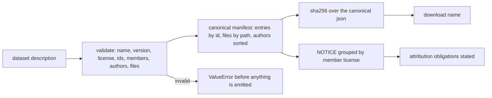
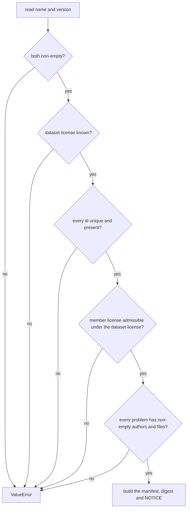
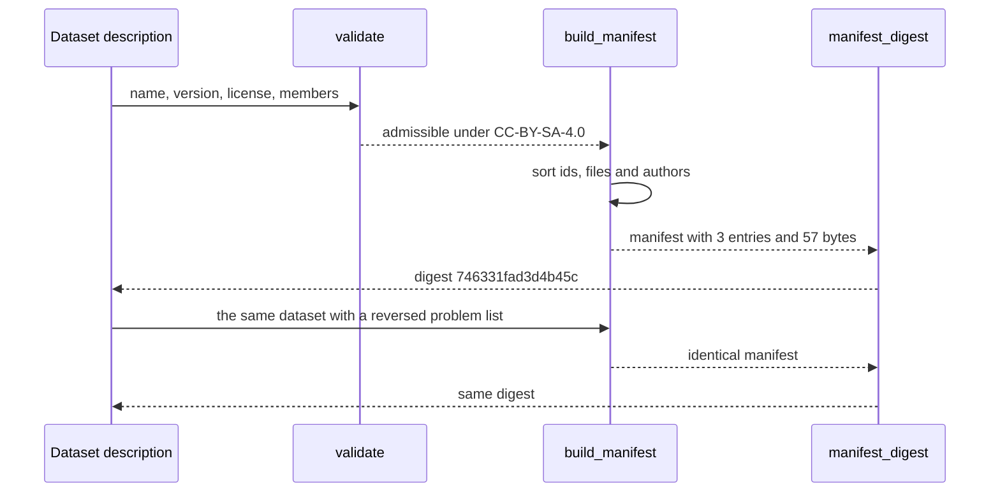

# 986 — Implement open dataset packaging and licensing automation for practice problems.

> **Tier:** Master · **CTCI chapter:** Beyond — Software Engineering & Tooling
> **Task spec:** [986-implement-open-dataset-packaging-and-licensing-automation-for-pr.md](../../../tasks/master/986-implement-open-dataset-packaging-and-licensing-automation-for-pr.md)
> **Solutions:** [Python](../../../solutions/python/master/986-implement-open-dataset-packaging-and-licensing-automation-for-pr/solution.py) ·
> [Java](../../../solutions/java/master/986-implement-open-dataset-packaging-and-licensing-automation-for-pr/Solution.java) ·
> [JavaScript](../../../solutions/javascript/master/986-implement-open-dataset-packaging-and-licensing-automation-for-pr/solution.js) ·
> [C#](../../../solutions/csharp/master/986-implement-open-dataset-packaging-and-licensing-automation-for-pr/Solution.cs)

## 1. Problem restatement

**Input:** a dataset description — a name, a version, the license the dataset itself is published under,
and a list of member problems, each with an SPDX-ish license, a list of authors and a map of file paths
to file contents:

```text
crack-pack 1.2.0        published under CC-BY-SA-4.0
  two-sum       MIT        Ada Lovelace                     statement.md, tests.py
  lru-cache     GPL-3.0    Grace Hopper, Ada Lovelace       statement.md, solution.py
  bubble-sort   CC-BY-4.0  Linus T                          statement.md, fixtures.json
```

**Output:** a package of three artefacts.

1. **A canonical manifest** — entries sorted by problem id, authors sorted, files sorted by path, each
   file carrying `bytes` and `sha256`; plus `total_bytes`.
2. **A digest** — SHA-256 over the canonical JSON serialisation of the manifest, which is the name of
   the download.
3. **A NOTICE file** — problems grouped by member license with one attribution line each, so the
   obligations of every input license are stated in the redistributed artefact.

Validation is part of the contract: an unlicensed member, an unknown license, a missing author list, a
duplicate id or an empty file map must raise `ValueError` *before* anything is published.

Compatibility is a hand-written table, dataset license to admissible member licenses, for example
`"CC-BY-SA-4.0": ("CC-BY-SA-4.0", "CC-BY-4.0", "CC0-1.0", "GPL-3.0", "MIT", "ISC", "BSD-3-Clause",
"Apache-2.0")` and `"MIT": ("MIT", "ISC", "BSD-3-Clause", "Apache-2.0", "CC0-1.0")` — the second one
does not include `GPL-3.0`, which is why a copyleft member cannot be folded into a permissive dataset.

## 2. Intuition

The naive packaging script tars a directory, writes a README by hand and hopes the licensing works out.
Two things then go wrong at publication time, and both are irreversible: a member with an incompatible
license is redistributed illegally, and an author whose work is included is not credited.

The key insight is that **both of those are properties of the canonical form of the data**, so they can
be checked mechanically before anything is emitted. Canonicalisation is the lever:

* sort the problems by id, the files by path and the authors by name — then *any* permutation of the
  input produces the same bytes, and therefore the same digest, and therefore the same download name;
* hash each file's bytes — then a tampered bundle is detectable without re-downloading the original;
* group the entries by their member license — then the NOTICE is generated from the same structure that
  was validated, not written twice by hand.

The compatibility rule is the licensing half of the same idea: it is a *relation* on (dataset license,
member license) pairs, and "GPL-3.0 member under an MIT dataset" is simply not in the relation. Checking
it is one dictionary lookup per member, and failing it is one `ValueError` per problem.



## 3. Algorithm

1. **Validate.** `validate(dataset)` raises `ValueError` for: a missing name or version; an unknown
   dataset license; a problem without an id; a duplicate id; an unknown member license; a member
   license not admissible under the dataset license; a missing or blank author list; a problem with no
   files.
2. **Canonicalise.** `build_manifest` sorts problems by id; for each problem it sorts the file map and
   computes `{"bytes": len(content), "sha256": sha256_text(content)}` per file, sorts the author list,
   and accumulates the per-entry byte count. The manifest holds `dataset`, `version`, `license`,
   `entries` and `total_bytes`.
3. **Serialise canonically.** `canonical_json` is `json.dumps(value, sort_keys=True,
   separators=(",", ":"), ensure_ascii=True)`; `manual_canonical` is a hand-written serializer with
   the same rules and no `json` import, used as the oracle for the digest.
4. **Digest.** `manifest_digest(manifest) = sha256_text(canonical_json(manifest))`.
5. **NOTICE.** `notice_text` emits the dataset header lines, then groups entries by member license,
   sorted by license, and prints `Redistributed under <license>:` followed by
   `  - <id> by <author1>, <author2>`. An empty dataset gets the line
   `This dataset contains no entries.`
6. **Verify.** `verify_package(packaged, current_files)` re-hashes the published bytes against the
   manifest and returns one `<id>/<path>` entry per mismatch, marking a missing file as such.

```text
procedure build_manifest(dataset)
    validate(dataset)
    entries ← empty list
    for each problem in dataset.problems sorted by id do
        files ← empty map
        for each path and content in problem.files sorted by path do
            files[path] ← { bytes: length of content, sha256: sha256_text(content) }
        end
        append { id: problem.id,
                 license: problem.license,
                 authors: sorted(problem.authors),
                 files: files,
                 bytes: sum of file byte counts } to entries
    end
    return { dataset: dataset.name, version: dataset.version, license: dataset.license,
             entries: entries, total_bytes: sum of entry byte counts }
end
```

```text
function notice_text(manifest)
    lines ← [ "Dataset: name version", "Dataset license: license" ]
    if manifest.entries is empty then
        append "This dataset contains no entries." to lines
        return lines joined by newline
    end
    groups ← entries grouped by their member license
    for each license in sorted order of groups do
        append "Redistributed under <license>:" to lines
        for each entry in groups[license] do
            append "  - <id> by <authors joined by comma>" to lines
        end
    end
    return lines joined by newline
end
```



## 4. Worked example

Running the Python file prints:

```text
entries=3 total_bytes=57 digest=746331fad3d4b45c
```

**The manifest, with sizes derived by hand.** Each file's byte count comes straight from
`len(content)`; file contents include the trailing newline:

| Entry (sorted by id) | License | Authors (sorted) | Files and byte counts | Entry bytes |
| --- | --- | --- | --- | --- |
| `bubble-sort` | `CC-BY-4.0` | `Linus T` | `statement.md` = `9` (`# Bubble\n`), `fixtures.json` = `3` (`{}\n`) | `12` |
| `lru-cache` | `GPL-3.0` | `Ada Lovelace`, `Grace Hopper` | `statement.md` = `6` (`# LRU\n`), `solution.py` = `16` (`class LRU: pass\n`) | `22` |
| `two-sum` | `MIT` | `Ada Lovelace` | `statement.md` = `10` (`# Two Sum\n`), `tests.py` = `13` (`assert solve\n`) | `23` |

`12 + 22 + 23 = 57` — the printed `total_bytes` — and the manifest's `total_bytes` must equal the sum
of the per-entry `bytes` fields, which the check asserts separately. Note that `lru-cache` has two
authors in the source but a **sorted** list in the manifest, and that `two-sum`'s file map is written in
one order and serialised in another.

**The NOTICE**, generated from the same canonical entries, with the groups sorted by license string
(`CC-BY-4.0` before `GPL-3.0` before `MIT`):

| Line | Content |
| --- | --- |
| `1` | `Dataset: crack-pack 1.2.0` |
| `2` | `Dataset license: CC-BY-SA-4.0` |
| `3` | `Redistributed under CC-BY-4.0:` |
| `4` | `  - bubble-sort by Linus T` |
| `5` | `Redistributed under GPL-3.0:` |
| `6` | `  - lru-cache by Ada Lovelace, Grace Hopper` |
| `7` | `Redistributed under MIT:` |
| `8` | `  - two-sum by Ada Lovelace` |

The attribution check is brute-forced from the *input* rather than the manifest: for each author, the
number of mentions in the NOTICE must equal the number of problems that list them, so `Ada Lovelace` is
mentioned twice (once for `two-sum`, once for `lru-cache`) and `Grace Hopper` once.

**Reproducibility.** Reversing the problem list and reordering the file map of `lru-cache` produces the
same `digest` and the same `notice`, because every structure is canonicalised. Changing a single
character of `two-sum/statement.md` to `# Two Sum (edited)\n` changes the digest, and the digest must
also equal `sha256_text(manual_canonical(manifest))` — the independent serializer that uses no `json`
module.

**Tamper detection.** `verify_package(packaged, current)` re-hashes the published files:

| Scenario | Result |
| --- | --- |
| the bundle as packaged | `[]` — clean |
| `lru-cache/solution.py` with `# sneaky\n` appended | `["lru-cache/solution.py"]` |
| a file missing from the download | reported with a `(missing)` suffix |



## 5. Complexity

Let `P` be the number of problems, `F` the files per problem, `N` the total bytes of all files, `A` the
authors per problem and `L` the length of the canonical JSON.

| Phase | Time | Space | Why the bound holds |
| --- | --- | --- | --- |
| `validate` | `O(P * (F + A))` | `O(P)` | one set insert per id and a couple of tuple lookups per member |
| sorting | `O(P log P + P * F log F + P * A log A)` | `O(P * F)` | three independent sorts over independent axes |
| hashing | `O(N)` | `O(P * F)` digests | SHA-256 is linear in the input bytes |
| `canonical_json` | `O(L)` | `O(L)` | one serialisation pass with sorted keys |
| `notice_text` | `O(P * F + P log P)` | `O(P * F)` | grouping by license plus one line per problem and file mention |
| `verify_package` | `O(N)` | `O(P * F)` | one re-hash per recorded file |
| package total | `O(N + P log P)` | `O(N)` | dominated by hashing every byte once |

The subtlety worth naming: the digest is over the **manifest**, not over the file bytes, so packaging is
`O(N)` for the hashing and `O(P log P)` for the ordering — but the guarantee *is* about the bytes,
because each entry's `sha256` is computed from them. That split is what lets the download be named by a
short digest while tamper detection stays byte-exact.

## 6. Pitfalls and edge cases

* **A copyleft member under a permissive dataset is refused.** Setting the dataset license to `MIT`
  while `lru-cache` stays `GPL-3.0` raises `ValueError` whose message mentions `GPL-3.0`; the solution
  never silently upgrades the outbound license.
* **Unknown licenses are refused on both sides.** `WTFPL` on a member raises `unknown license`, while
  `BSD-3-Clause` as the *dataset* license raises `unknown dataset license` — the compatibility table is
  the authority for both.
* **Attribution is required, and blank strings do not count.** An empty author list raises
  `ValueError` mentioning `attribution`, and the validator also rejects entries whose authors are not
  non-empty strings (`all(isinstance(a, str) and a.strip() ...)`), so `[" "]` is not attribution.
* **A duplicate id is a publication error.** Appending a copy of `two-sum` raises
  `duplicate problem id` — without that check the manifest would contain two entries with the same id
  and the NOTICE two attribution lines, silently over-counting bytes.
* **A problem with no files is refused.** `ValueError` mentions `no files`; an entry contributing zero
  bytes is far more likely to be a mistake in the input than a legitimate empty problem.
* **Canonicalisation is total.** `sort_keys=True, separators=(",", ":")` removes incidental whitespace
  and key ordering from the digest, so `package(shuffled)["digest"] == package(dataset)["digest"]` for
  any permutation of problems and file insertion orders.
* **The empty dataset is a legal boundary.** `{"problems": []}` packages cleanly with `entries == []`,
  `total_bytes == 0`, a 64-character digest distinct from the sample's, and a NOTICE ending in
  `This dataset contains no entries.`
* **A single-problem dataset must still be correct.** `solo` with one file of `# One\n` has
  `total_bytes == 7` and its own `Redistributed under MIT:` group — the trivial case is the one that
  catches an off-by-one in the grouping.

## 7. Variants and follow-ups

* **Real SPDX expressions.** A member license can be a whole expression (`MIT OR Apache-2.0`,
  `GPL-3.0-only WITH Classpath-exception-2.0`); the C# solution in this repository parses expressions
  with SPDX precedence (`AND` binds tighter than `OR`), checks each atom against a bundle policy and
  reports the smallest admissible alternative. The Java solution derives the outbound license as a
  *join* over ranks (`MIT 0 < Apache-2.0 and CC-BY-4.0 1 < CC-BY-SA-4.0 2 < GPL-3.0-only 3`) and
  refuses a bundle whose inputs outrank it; the JavaScript solution folds the declarations into one
  aggregate class (public domain, permissive, copyleft) and propagates share-alike.
* **Content-addressed storage.** Files live in memory here; a production packager stores blobs by
  `sha256` and rebuilds the manifest from the store, which also makes de-duplication across problems
  free. That is the same idea as offline bundling —
  [989-implement-offline-mode-packaging-so-learners-can-download-proble.md](../../../tasks/master/989-implement-offline-mode-packaging-so-learners-can-download-proble.md)
  — where identical fixture bytes are stored exactly once.
* **Who gets credit.** The NOTICE is an attribution requirement, which only works if contributions are
  traceable; see
  [985-implement-contribution-recognition-system-with-verified-citation.md](../../../tasks/master/985-implement-contribution-recognition-system-with-verified-citation.md)
  for the verification side.
* **Licensing in generated documents.** Packaging is one of several places a license or a citation must
  be emitted mechanically; see
  [993-implement-academic-citation-generator-for-editorial-solutions-wi.md](../../../tasks/master/993-implement-academic-citation-generator-for-editorial-solutions-wi.md)
  for the bibliography format that citations take in editorial output.

## 8. Check yourself

<details><summary>Why is the digest computed over the manifest and not over the concatenated file bytes?</summary>

Because the manifest is the part a downloader needs in order to verify anything: it holds every path,
size and hash. Digesting the manifest gives a short, order-independent name for the bundle *and* keeps
the byte-level check available through the per-file `sha256` values — which is what
`verify_package` uses. Digesting the raw concatenation would give the same tamper detection but no way
to tell *which* file changed.</details>

<details><summary>`lru-cache` has two authors but the manifest stores one string. How are both attributed?</summary>

The manifest stores a **sorted list** of authors (`["Ada Lovelace", "Grace Hopper"]`) — it is only the
NOTICE that joins them with `", "` on one line. The attribution check counts mentions per author from
the raw input and compares with the NOTICE text, so a version of the code that joined the list before
sorting it would produce `Grace Hopper, Ada Lovelace` and fail.</details>

<details><summary>What exactly does `manual_canonical` buy, given `json.dumps` already exists?</summary>

An independent implementation of the serialisation rules. The digest is only meaningful if the
canonical form is exactly reproducible, so the checks compare
`packaged["digest"] == sha256_text(manual_canonical(manifest))` — a recursive serializer that sorts keys
itself, emits `","` and `":"` with no whitespace, and stringifies non-strings — against the `json`-based
one. If someone changes the separators or drops `sort_keys`, the two diverge and the check fails.</details>

<details><summary>Reversing the problem list leaves the digest unchanged. What would break that property?</summary>

Anything that leaks input order into the canonical form: iterating `dataset["problems"]` without the
`key=lambda item: item["id"]` sort, using the file map's insertion order instead of `sorted(...)`,
relying on `json.dumps` without `sort_keys` (which would order the manifest's own keys by insertion), or
slicing the author list in input order. The checks pin all four axes: the same digest *and* the same
NOTICE for a reversed and re-keyed input.</details>
