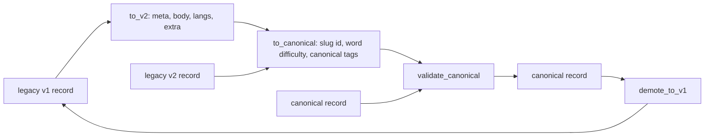
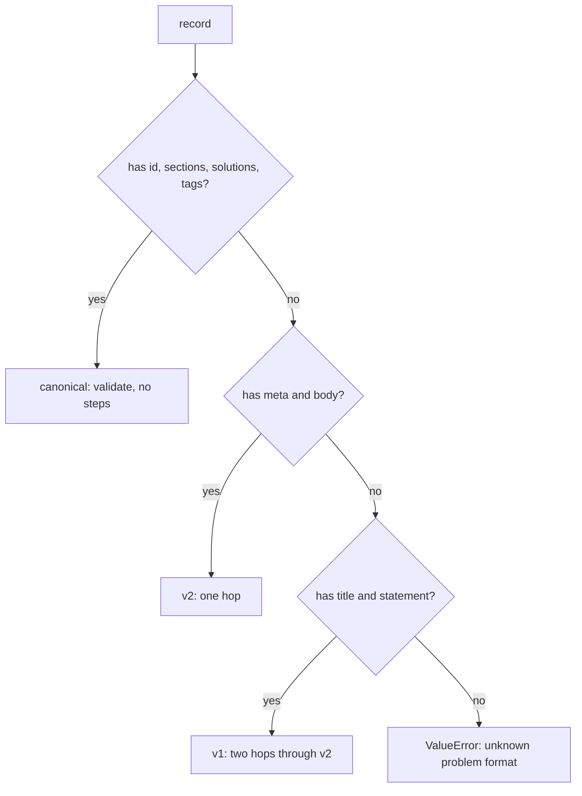
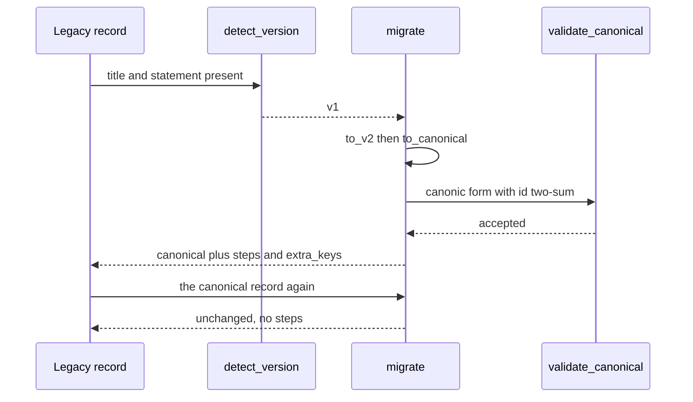

# 987 — Implement migration tools for older problem formats to new canonical schema.

> **Tier:** Master · **CTCI chapter:** Beyond — Software Engineering & Tooling
> **Task spec:** [987-implement-migration-tools-for-older-problem-formats-to-new-canon.md](../../../tasks/master/987-implement-migration-tools-for-older-problem-formats-to-new-canon.md)
> **Solutions:** [Python](../../../solutions/python/master/987-implement-migration-tools-for-older-problem-formats-to-new-canon/solution.py) ·
> [Java](../../../solutions/java/master/987-implement-migration-tools-for-older-problem-formats-to-new-canon/Solution.java) ·
> [JavaScript](../../../solutions/javascript/master/987-implement-migration-tools-for-older-problem-formats-to-new-canon/solution.js) ·
> [C#](../../../solutions/csharp/master/987-implement-migration-tools-for-older-problem-formats-to-new-canon/Solution.cs)

## 1. Problem restatement

**Input:** a legacy problem record. Three shapes exist and they are detected **structurally**, not by a
version field:

| Shape | Recognised by | Carries |
| --- | --- | --- |
| `v1` | has `title` and `statement` | flat fields, numeric difficulty `1..3` |
| `v2` | has `meta` and `body` | nested pairs, difficulty already a word |
| `canonical` | has all of `id`, `sections`, `solutions`, `tags` | the target schema |

The running example is a `v1` record:

```text
title "Two Sum", statement "Return the indices of two values summing to k.",
solution "def two_sum(xs, k): return (0, 1)\n", lang "python", difficulty 2, source "legacy-import-v0"
```

**Output:** the canonical record plus a report of what happened.

```text
{ "id": "two-sum", "title": "Two Sum", "difficulty": "medium", "tags": [],
  "sections": { "statement": "...", "solution": "def two_sum(xs, k): return (0, 1)\n" },
  "solutions": { "python": "def two_sum(xs, k): return (0, 1)\n" },
  "extra": { "source": "legacy-import-v0" } }
```

with `report = {from: "v1", steps: ["v1->v2", "v2->canonical"], extra_keys: ["source"]}`.

`CANONICAL_KEYS = ("id", "title", "difficulty", "tags", "sections", "solutions", "extra")` is the whole
contract, and `DIFFICULTIES = ("easy", "medium", "hard")` is the vocabulary the legacy scale maps onto
via `LEGACY_DIFFICULTY = {1: "easy", 2: "medium", 3: "hard"}`.

## 2. Intuition

The naive migration is a `sed` script that renames keys. It has two failure modes. It drops data the
target schema does not model (the `source` field above simply disappears, so provenance is lost), and it
cannot be re-run — running it twice turns `medium` into something invalid, because it has no notion of
"already migrated".

The key insight is to model the migration as a **chain of pure, step-wise hops** between versions:

```text
v1 --to_v2--> v2 --to_canonical--> canonical --(nothing)--> canonical
```

Three properties come out of that one design decision:

* **Replayable.** Each hop is a function of the record alone, so a migration can be re-run, replayed on
  a copy, or applied to a backlog in any order. `migrate` reports which hops ran, so "already canonical"
  is `steps == []`, and the fingerprint of the canonical record is unchanged by a second pass.
* **Lossless where it matters.** Keys the canonical schema does not model are not dropped; they are
  parked in an `extra` map (which becomes a first-class canonical key) and restored on demotion.
* **Convergent.** `v1` and `v2` inputs describing the same problem land on the *same* canonical record,
  because both routes funnel through `to_canonical`.

The id is derived rather than trusted: `id = slugify(title)`, and `validate_canonical` recomputes the
slug from the title and rejects a record whose `id` disagrees — the id is a function of the content, so
it can be checked instead of administered.



## 3. Algorithm

1. **Detect.** `detect_version` returns `"canonical"` when all of `id`, `sections`, `solutions`, `tags`
   are present; else `"v2"` when `meta` and `body` are present; else `"v1"` when `title` and `statement`
   are present; else raises `ValueError("unknown problem format: cannot detect version for keys ...")`
   listing the keys it did see.
2. **Hop v1 → v2.** `to_v2` pulls everything not in `V1_KEYS = ("title", "statement", "solution",
   "lang", "difficulty", "tags")` into `extras`; maps the numeric difficulty through
   `LEGACY_DIFFICULTY` with a default of `2`; splits `statement` and `solution` into `body`; carries
   `tags` through as a list; and builds `langs = {lang: solution}` when a solution exists, so a record
   without a solution produces an empty language map rather than an empty string entry.
3. **Hop v2 → canonical.** `to_canonical` derives `id = slugify(meta["title"])`, defaults the difficulty
   to `"medium"`, canonicalises tags, puts `statement` and `solution` under `sections`, copies `langs`
   into `solutions` and `extra` into `extra`.
4. **Slugify.** Lower-case; keep alphanumerics; collapse every other character into a single `-`; strip
   leading and trailing dashes. `"Two Sum"` becomes `"two-sum"`, `"Solo Problem"` becomes
   `"solo-problem"`.
5. **Canonicalise tags.** Strip, lower-case, drop empties, de-duplicate via a set, and sort — so
   `["Arrays", "arrays", " Two Pointers "]` becomes `["arrays", "two pointers"]`.
6. **Validate.** Every canonical key must be present, the difficulty must be in `DIFFICULTIES`, the id
   must equal `slugify(title)` and be non-empty, the tags must already be canonical, `sections` must hold
   exactly `statement` and `solution`, and every solution value must be a string.
7. **Demote.** `demote_to_v1` reverses the mapping for the fields v1 can express: it takes the
   alphabetically first language, inverts the difficulty scale, omits `tags` when empty, and merges
   `extra` back into the top level — which is why `demote_to_v1(canonical) == record`.

```text
procedure migrate(record)
    version ← detect_version(record)
    if version equals "canonical" then
        canonical ← a copy of each key in CANONICAL_KEYS
        validate_canonical(canonical)
        steps ← empty list
    else
        steps ← [ "v1->v2" ] if version equals "v1" else []
        intermediate ← to_v2(record) if version equals "v1" else record
        canonical ← to_canonical(intermediate)
        validate_canonical(canonical)
        append "v2->canonical" to steps
    end
    return { canonical: canonical,
             report: { from: version, steps: steps, extra_keys: sorted(canonical.extra) } }
end
```

```text
function slugify(title)
    out ← empty list
    for each char in lower-cased title do
        if char is alphanumeric then
            append char to out
        else if out is not empty and last of out is not "-" then
            append "-" to out
        end
    end
    return out joined and stripped of leading and trailing dashes
end
```



## 4. Worked example

Running the Python file prints:

```text
steps=v1->v2,v2->canonical extra_keys=source fingerprint=fdaaeec66fab0ac8
```

**The two hops, field by field.** `legacy_record()` is the `v1` input; the intermediate `v2` record is
never returned to the caller but it is what the second hop consumes:

| Stage | Structure |
| --- | --- |
| `v1` input | `title`, `statement`, `solution`, `lang`, `difficulty: 2`, `source` |
| after `to_v2` | `meta = {title: "Two Sum", difficulty: "medium"}`, `body = {statement, solution}`, `tags = []`, `langs = {python: …}`, `extra = {source: "legacy-import-v0"}` |
| after `to_canonical` | `id = "two-sum"`, `title`, `difficulty: "medium"`, `tags = []`, `sections = {statement, solution}`, `solutions = {python: …}`, `extra = {source: "legacy-import-v0"}` |

The three checks on that path are: the canonical record **equals** the hand-written expectation, the
reported `steps` are exactly `["v1->v2", "v2->canonical"]`, and `extra_keys == ["source"]` — the
provenance survived two hops that do not model it.

**Idempotence.** Feeding the canonical record back into `migrate` yields:

| Property | Observed |
| --- | --- |
| returned canonical | equal to the input, field for field |
| `report["steps"]` | `[]` — no hop ran |
| `fingerprint(canonical)` | identical to the original, since the fingerprint is `sha256(json.dumps(record, sort_keys=True))` |
| a third pass | still the same record |

**Convergence.** A hand-written `v2` record with the same content —
`meta = {title: "Two Sum", difficulty: "medium"}`, `body`, `tags = []`, `langs`, `extra` — migrates to
the *same* canonical record with `steps == ["v2->canonical"]`. Two different legacy shapes, one target.

**Losslessness.** `demote_to_v1(canonical)` returns the original dictionary exactly: `title`,
`statement`, `solution` from the first `solutions` entry, `lang` from that entry's key,
`difficulty = 2` from inverting `LEGACY_DIFFICULTY`, no `tags` key because the list is empty, and
`source` merged back from `extra`.

**Canonicalisation examples.**

| Input | Output | Rule exercised |
| --- | --- | --- |
| `tags = ["Arrays", "arrays", " Two Pointers "]` | `["arrays", "two pointers"]` | trim, lower-case, de-duplicate, sort |
| `difficulty = 1` | `"easy"` | legacy scale mapping |
| `difficulty = 3` | `"hard"` | legacy scale mapping |
| `{title: "Solo Problem", statement: "Add one.\n"}` | `id "solo-problem"`, `difficulty "medium"`, `tags []`, `solutions {}`, `sections.solution ""` | documented defaults for a minimal record |



## 5. Complexity

Let `K` be the number of keys in a record, `T` the number of tags and `S` the total size of the record's
values:

| Phase | Time | Space | Why the bound holds |
| --- | --- | --- | --- |
| `detect_version` | `O(K)` | `O(1)` | a handful of membership tests |
| `to_v2` | `O(K + T)` | `O(S)` | one pass over the keys plus a list copy of the tags |
| `canonical_tags` | `O(T log T)` | `O(T)` | set construction plus a sort |
| `slugify` | `O(len(title))` | `O(len(title))` | one character pass |
| `to_canonical` | `O(K + T log T)` | `O(S)` | dominated by the tag canonicalisation |
| `validate_canonical` | `O(S)` | `O(1)` extra | recomputes the slug and the tags and compares |
| `migrate` | `O(S log T)` | `O(S)` | two hops plus one fingerprint-free validation |
| `fingerprint` | `O(S)` | `O(S)` | `json.dumps(..., sort_keys=True)` then a hash |
| `demote_to_v1` | `O(S)` | `O(S)` | one dictionary rebuild |

For a problem record (`K` in the low tens, `S` in the low kilobytes) the whole migration is a few
microseconds, which is the point: `validate_canonical` is cheap enough to run on **every** record of a
backlog, and the report makes a partial migration observable. The alternative implementation in this
repository places the same idea in a registry: the Java file numbers the schema `v3` and detects the
format from the shape of the record, the JavaScript file pairs each step with the version it consumes
and produces so a path between any two versions can be planned, and the C# file parses flat
`key=value` and pipe-separated rows into the same canonical shape.

## 6. Pitfalls and edge cases

* **Detection is structural, so it is order-insensitive but not forgiving.** `migrate({"notes": "no
  recognisable keys"})` and `migrate({})` both raise `ValueError` naming the keys found; a record that
  happens to contain `title` but no `statement` is *not* v1.
* **A canonical record is validated, not trusted.** `migrate(dict(canonical, difficulty="impossible"))`
  raises `unknown difficulty`; `tags=["b", "a"]` raises about sorting; `tags=["Only", "only"]` raises
  about de-duplication; `sections={"statement": "x"}` raises about the missing `solution`; and
  `id="wrong-id"` raises because the slug recomputation disagrees.
* **`extra` is how unknown keys survive.** A v1 record with a `source` field must come out with
  `extra == {"source": "legacy-import-v0"}` and `extra_keys == ["source"]`. Dropping it silently is the
  failure mode the whole design guards against.
* **Defaults are explicit.** A minimal record (`title` and `statement` only) migrates with
  `difficulty = "medium"`, `tags = []`, `solutions = {}` and `sections["solution"] == ""`. The
  solution-to-language map is empty rather than containing a language with empty code.
* **The difficulty scale inverts cleanly.** `{name: level for level, name in LEGACY_DIFFICULTY.items()}`
  is the inverse map, so `demote_to_v1` produces `2` for `"medium"`; a canonical difficulty outside the
  three values can never reach demotion, because validation rejects it first.
* **The first language wins on demotion.** `next(iter(sorted(canonical["solutions"].items())),
  ("python", ""))` — an empty `solutions` map yields `("python", "")`, which is why the minimal record
  round-trips as `lang = "python"` and an empty solution.
* **`tags` is omitted from the demoted record when empty.** The demoted dict only gains a `tags` key
  when the canonical list is non-empty, which is exactly what makes `demote_to_v1(canonical) == record`
  hold for a record that had no tags at all.
* **Reproducibility.** `migrate` is a pure function of its input, and the fingerprint printed for the
  canonical record (`fdaaeec66fab0ac8` as the first 16 hex characters) is stable across runs because
  `json.dumps` is called with `sort_keys=True`.

## 7. Variants and follow-ups

* **Version registries and path planning.** With more than two legacy formats, the natural evolution is
  a registry of steps that each declare the version they consume and produce, and a planner that finds a
  path between any two versions or refuses an impossible one — that is exactly what the JavaScript
  solution in this repository implements, with generated formats also being refused rather than
  half-migrated.
* **Schema validation as data.** A JSON-Schema or Pydantic model would replace the hand-written
  `validate_canonical`; the checks (slug agreement, canonical tags, exact section keys) are the parts
  worth keeping either way.
* **Where canonical records go next.** A canonical record is what an offline bundle ships and what a
  dataset manifest records — see
  [989-implement-offline-mode-packaging-so-learners-can-download-proble.md](../../../tasks/master/989-implement-offline-mode-packaging-so-learners-can-download-proble.md)
  and
  [986-implement-open-dataset-packaging-and-licensing-automation-for-pr.md](../../../tasks/master/986-implement-open-dataset-packaging-and-licensing-automation-for-pr.md).
* **Migrating across repositories.** Once records carry a canonical version, keeping several repositories
  in sync becomes a dependency-management problem rather than a text problem;
  [988-implement-cross-repo-synchronization-and-dependency-management-t.md](../../../tasks/master/988-implement-cross-repo-synchronization-and-dependency-management-t.md)
  covers the semver constraints, lock and sync plan.

## 8. Check yourself

<details><summary>Why detect the version structurally instead of trusting a `version` field?</summary>

Because legacy records predate the field — that is what "legacy" means. `detect_version` keys off the
shape of the data (`title` + `statement` for v1, `meta` + `body` for v2, the four canonical container
keys for canonical), so old records migrate without being edited first, and a record that matches no
shape is reported with its actual keys instead of being guessed at.</details>

<details><summary>What makes the migration idempotent?</summary>

Two things: `detect_version` returns `"canonical"` for a canonical record, so `migrate` takes the
identity branch with `steps == []`; and the identity branch still calls `validate_canonical`, so a
corrupted canonical record is caught rather than passed through. The checks assert the returned record is
equal, the steps list is empty and `fingerprint` is unchanged across a second pass.</details>

<details><summary>`demote_to_v1(canonical) == record` is asserted. Why is that a strong statement about the schema?</summary>

Because it claims the two hops were *lossless for every field v1 can express*: title, statement,
solution, language, difficulty and the unknown `source` key all come back exactly. The two places where
information is genuinely lossy are documented instead of hidden — tags are lower-cased and sorted, and
only the first (alphabetically) language survives, because v1 has exactly one `lang` and `solution`.</details>

<details><summary>A v2 record and a v1 record describing the same problem converge. Why does the test care?</summary>

Because a migration that funnels every shape through `to_canonical` cannot drift: there is one
definition of the target schema and both routes call it. If the v1 route built the canonical record
itself (skipping the intermediate `meta`/`body` shape), the two routes could disagree on defaults like
`difficulty` or on the `sections` key names, and the divergence would only show up on real data.</details>
