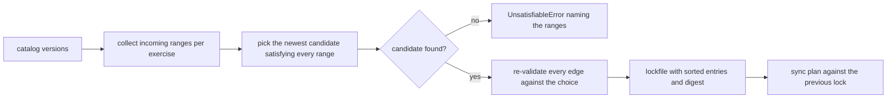
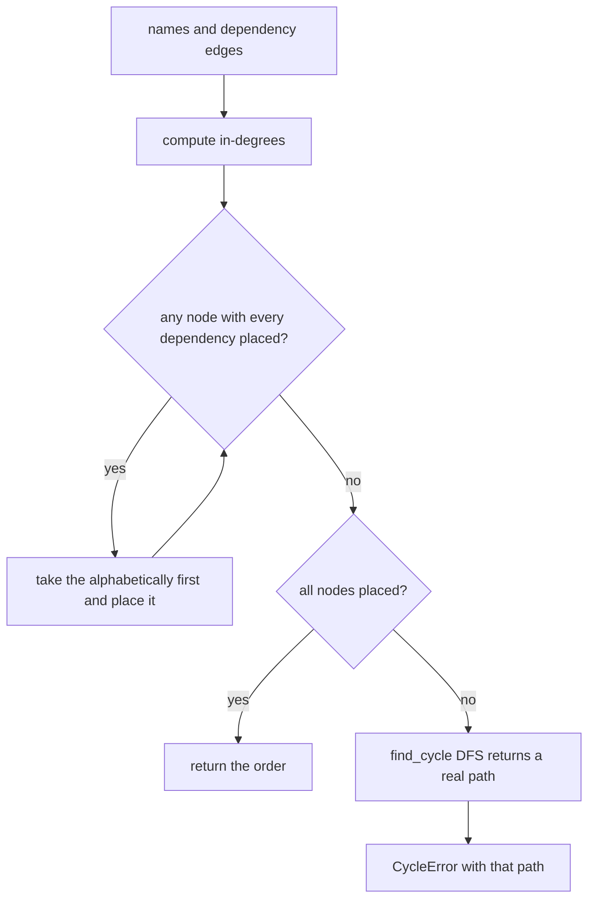
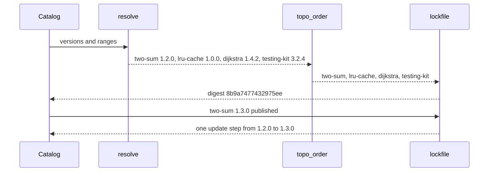

# 988 — Implement cross-repo synchronization and dependency management tool for exercises.

> **Tier:** Master · **CTCI chapter:** Beyond — Software Engineering & Tooling
> **Task spec:** [988-implement-cross-repo-synchronization-and-dependency-management-t.md](../../../tasks/master/988-implement-cross-repo-synchronization-and-dependency-management-t.md)
> **Solutions:** [Python](../../../solutions/python/master/988-implement-cross-repo-synchronization-and-dependency-management-t/solution.py) ·
> [Java](../../../solutions/java/master/988-implement-cross-repo-synchronization-and-dependency-management-t/Solution.java) ·
> [JavaScript](../../../solutions/javascript/master/988-implement-cross-repo-synchronization-and-dependency-management-t/solution.js) ·
> [C#](../../../solutions/csharp/master/988-implement-cross-repo-synchronization-and-dependency-management-t/Solution.cs)

## 1. Problem restatement

**Input:** a catalog of exercise repositories, each publishing versions, plus a dependency declaration
per exercise:

| Exercise | Repo | Versions | Depends on |
| --- | --- | --- | --- |
| `two-sum` | `algorithms/easy` | `1.0.0`, `1.2.0`, `2.0.0` | — |
| `lru-cache` | `algorithms/data-structures` | `0.9.0`, `1.0.0` | `two-sum >=1.0.0` |
| `dijkstra` | `algorithms/graphs` | `1.3.0`, `1.4.2` | `two-sum <2.0.0`, `lru-cache ^1.0.0` |
| `testing-kit` | `tooling/tests` | `3.1.0`, `3.2.4` | `two-sum ^1.0.0`, `dijkstra ~1.4.0` |

**Output:** four artefacts.

1. **A resolution** — the newest catalog version of each exercise that satisfies *every* incoming
   constraint, with each edge re-validated afterwards.
2. **A deterministic sync order** — dependencies before dependents, ties broken alphabetically, so two
   runs produce the same sequence.
3. **A lockfile** — entries sorted by exercise carrying a 12-hex-character `sha` derived from
   `sha256("<exercise>@<version>")`, plus a digest over the canonical JSON.
4. **A sync plan** — the add/update/remove steps that take one lock snapshot to another.

Failures are explicit: an unknown dependency is a `ValueError`, and an unsatisfiable version set or a
cycle are `UnsatisfiableError` / `CycleError` (both `ValueError` subclasses) naming the culprit.

## 2. Intuition

The naive updater bumps every exercise to its newest version. It breaks in the first real fleet, for two
reasons: an exercise may not be able to move to `2.0.0` because a *dependent* declared `<2.0.0`, and two
exercises that depend on each other cannot be synced in either order.

The key insight is **constraints, not versions**. Each dependency edge carries a semver range, so the
right question is not "what is newest?" but "what is the newest version that satisfies *all* the ranges
pointing at me?" That single change gives:

* **intersection, not maximisation** — `^1.0.0` and `<2.0.0` intersect at `1.0.0` and `1.2.0`, and the
  resolution picks `1.2.0`;
* **a second validation pass** — after resolution, every edge is re-checked against the chosen
  combination, so a bug in the choice loop cannot ship a lock file that violates a declaration;
* **determinism** — candidates are considered newest first and ready nodes are taken alphabetically, so
  the same catalog produces the same lock digest on every machine.

Order is the second half. A topological order of the dependency graph is the only order in which
dependency-first fetching is correct, and the same computation detects cycles: if no node is ready and
work remains, the graph has a cycle — and `find_cycle` reports the actual path, not just "a cycle
exists".



## 3. Algorithm

1. **Parse.** `parse_version("1.2.0")` splits on `.` and requires exactly three numeric parts, raising
   `ValueError("not a semantic version: ...")` otherwise; comparisons are plain tuple comparisons.
2. **Test a range.** `satisfies(version, spec)` handles caret (same major: `low <= v < (low0 + 1, 0,
   0)`), tilde (same minor: `low <= v < (low0, low1 + 1, 0)`), and the prefixes `>=`, `<=`, `>`, `<`,
   `=`, falling back to exact equality for a bare version.
3. **Collect constraints.** `resolve` builds `incoming[name]` from every declaration, rejecting a
   dependency that is not in the known set with `unknown exercise` in the message.
4. **Choose.** For each name, sort its catalog versions newest first and take the first candidate that
   satisfies every `(source, spec)` pair; if none exists, raise `UnsatisfiableError` listing
   `explanation, spec` for each incoming range.
5. **Re-validate.** Walk every edge again and raise `UnsatisfiableError("<x> wants <dep> <spec> but
   <version> was pinned")` if a chosen version violates a declaration.
6. **Order.** `topo_order` repeatedly takes the alphabetically first node whose dependencies are all
   placed; if no node is ready while work remains, `find_cycle` performs a DFS with grey/black colouring
   and returns the cycle path as `a -> c -> b -> a`.
7. **Lock.** `lockfile` emits entries sorted by exercise with `repo`, `version` and the truncated digest,
   plus a digest over `json.dumps(entries, sort_keys=True, separators=(",", ":"))`.
8. **Diff.** `sync_plan(current, new)` walks the sorted union of the lock snapshots and emits
   `add`, `remove` or `update` steps with `from` and `to`.

```text
procedure resolve(names, catalog, deps)
    incoming ← empty list per name
    for each name in names do
        for each (dependency, spec) in deps[name] do
            if dependency is not in incoming then
                raise ValueError naming both exercises
            end
            append (name, spec) to incoming[dependency]
        end
    end
    resolved ← empty map
    for each name in names do
        candidates ← catalog[name].versions parsed and sorted newest first
        chosen ← first candidate satisfying every spec in incoming[name]
        if chosen is undefined then
            raise UnsatisfiableError naming every incoming range
        end
        resolved[name] ← chosen
    end
    for each name in names do
        for each (dependency, spec) in deps[name] do
            if satisfies(resolved[dependency], spec) is false then
                raise UnsatisfiableError naming the pinned version
            end
        end
    end
    return resolved
end
```

```text
procedure topo_order(names, deps)
    needs ← for each name the sorted set of its dependency names
    order ← empty list
    placed ← empty set
    while length of order < length of names do
        ready ← sorted names whose dependencies are all in placed
        if ready is empty then
            raise CycleError with the path from find_cycle
        end
        append ready[0] to order and to placed
    end
    return order
end
```



## 4. Worked example

Running the Python file prints:

```text
order=two-sum,lru-cache,dijkstra,testing-kit digest=8b9a7477432975ee steps=1
```

**Resolution, range by range.** `incoming` for the four exercises in the sample graph:

| Exercise | Incoming ranges | Candidates (newest first) | Verdict |
| --- | --- | --- | --- |
| `two-sum` | `>=1.0.0` (from `lru-cache`), `<2.0.0` and `^1.0.0` (from `dijkstra` and `testing-kit`) | `2.0.0`, `1.2.0`, `1.0.0` | `2.0.0` fails `<2.0.0`; **`1.2.0`** satisfies all four |
| `lru-cache` | `^1.0.0` (from `dijkstra`) | `1.0.0`, `0.9.0` | **`1.0.0`** — `0.9.0` is outside the caret range |
| `dijkstra` | `~1.4.0` (from `testing-kit`) | `1.4.2`, `1.3.0` | **`1.4.2`** — same minor `1.4`, and `1.4.2 < 1.5.0` |
| `testing-kit` | none | `3.2.4`, `3.1.0` | **`3.2.4`** — unconstrained, so newest wins |

The intersection oracle in the checks is the same arithmetic written differently: over the versions
`1.0.0, 1.2.0, 2.0.0`, only `1.0.0` and `1.2.0` satisfy both `^1.0.0` and `<2.0.0`. Boundary cases are
pinned too: `=1.2.0` accepts `1.2.0` and rejects `1.2.1`; `>=1.2.0` accepts `1.2.0`; `<2.0.0` rejects
`2.0.0` exactly.

**Order.** Ready nodes are those whose dependencies are all placed:

| Iteration | Ready set | Chosen | Order |
| --- | --- | --- | --- |
| 1 | `{two-sum}` | `two-sum` | `two-sum` |
| 2 | `{lru-cache}` | `lru-cache` | `two-sum, lru-cache` |
| 3 | `{dijkstra}` | `dijkstra` | `two-sum, lru-cache, dijkstra` |
| 4 | `{testing-kit}` | `testing-kit` | `two-sum, lru-cache, dijkstra, testing-kit` |

That is the printed order, and it is the only order consistent with the edges:
`testing-kit` depends on `two-sum` and `dijkstra`, `dijkstra` on `two-sum` and `lru-cache`, and
`lru-cache` on `two-sum`. The check verifies all six edges by position and that a second call returns the
same list.

**Cycle reporting.** With `a → c`, `b → a`, `c → b`, no node is ever ready. `find_cycle` starts from
`a`, pushes `c`, then `b`, then sees `a` again in the grey colour, and returns
`[a, c, b, a]`, which is rendered as `a -> c -> b -> a` in the `CycleError` message — a path a human can
act on, rather than "a cycle exists".

**The lock and the plan.** `lockfile` sorts entries by exercise and hashes the canonical JSON, which
makes the digest independent of the order in which the exercises were resolved (the checks assert equal
digests for `names` and `reversed(names)`). Then:

| Scenario | `sync_plan` output |
| --- | --- |
| same lock twice | `[]` |
| `two-sum` publishes `1.3.0` | `[{"op": "update", "exercise": "two-sum", "from": "1.2.0", "to": "1.3.0"}]` — the printed `steps=1` |
| `testing-kit` is dropped from the fleet | `[{"op": "remove", "exercise": "testing-kit", "from": "3.2.4", "to": None}]` |
| `binary-search` is added | a single `add` step |



## 5. Complexity

Let `R` be the number of exercises, `V` the versions per exercise, `E` the number of dependency edges
and `P` the number of lock entries.

| Phase | Time | Space | Why the bound holds |
| --- | --- | --- | --- |
| `parse_version` / `satisfies` | `O(1)` | `O(1)` | three-component tuples and a constant number of comparisons |
| constraint collection | `O(R + E)` | `O(R + E)` | one pass over the declarations |
| candidate choice | `O(R * V log V + E * V)` | `O(R * V)` | sorting each version list, then testing each candidate against every incoming range |
| re-validation pass | `O(E)` | `O(1)` | one `satisfies` per edge |
| `topo_order` | `O(R^2 log R)` worst case | `O(R + E)` | each iteration scans and sorts the unplaced names |
| `topo_order` with a heap | `O((R + E) log R)` | `O(R + E)` | the optimisation the deterministic tie-break forgoes |
| `find_cycle` | `O(R + E)` | `O(R)` | a single DFS with three colours |
| `lockfile` | `O(P log P + P)` | `O(P)` | sort the entries, serialise, one hash |
| `sync_plan` | `O(P log P)` | `O(P)` | the sorted union of two snapshots |

The interesting complexity is not asymptotic but *combinatorial*: resolution is a greedy pass because
each exercise is resolved independently from constraints that only point at the *declarations* of its
dependents. A reader who wants the general case (backtracking version solving, as in SAT-based
resolvers) should note that this is the deliberate simplification the file documents — the shipped
variant is one greedy pass plus a validation pass, which is enough to make every declared range hold or
fail loudly.

## 6. Pitfalls and edge cases

* **Unknown dependencies fail closed.** `resolve(names, catalog(), {"lru-cache": [("ghost", "^1.0.0")]})`
  raises a `ValueError` mentioning `unknown exercise` — a typo must not silently drop an edge, because a
  dropped edge is precisely a repository that never syncs.
* **Unsatisfiable is a distinct error from unknown.** Two declarations that cannot intersect
  (`^1.0.0` and `=2.0.0`) raise `UnsatisfiableError` whose message names `two-sum`; a range outside the
  catalog (`>=3.0.0`) raises the same error naming the range. Both are `ValueError` subclasses, so a
  caller can catch the family or the specific case.
* **Caret and tilde are not the same range.** `^1.0.0` allows anything below `2.0.0`, `~1.4.0` allows
  anything below `1.5.0`. `dijkstra` resolving to `1.4.2` rather than `1.3.0` is a direct consequence of
  the tilde's upper bound.
* **Bounds are inclusive at the bottom and exclusive at the top.** `>=1.2.0` accepts `1.2.0`; `<2.0.0`
  rejects `2.0.0`, which is exactly why `two-sum` cannot take its newest version.
* **The lock digest is permutation-independent and idempotent.** Entries are sorted by exercise before
  serialisation, so `lockfile(reversed(names), ...)["digest"]` equals `lockfile(names, ...)["digest"]`,
  and calling it twice returns the same digest. The 12-character `sha` per entry is derived from
  `"<exercise>@<version>"`, so it changes when and only when the version does.
* **An unchanged lock produces an empty plan.** `sync_plan(first["by_exercise"], first["by_exercise"])`
  is `[]`, which is the property that makes the tool safe to run on a schedule.
* **A lone exercise is a boundary, not a special case.** `topo_order(["two-sum"], {})` is `["two-sum"]`,
  its lock has exactly one entry and `by_exercise == {"two-sum": "2.0.0"}` — unconstrained, so newest.
* **Cycle detection returns a path, and it terminates.** The DFS colouring marks nodes grey while on the
  stack and black on exit, so a back edge is detected exactly once and the returned slice
  `stack[stack.index(dependency):] + [dependency]` is a real cycle.

## 7. Variants and follow-ups

* **Different version-pinning philosophies.** The C# solution in this repository picks the *smallest*
  candidate satisfying every range (minimal version selection, as in Go modules) rather than the newest,
  and emits Kahn *layers* so each layer can be fetched in parallel. The Java solution pairs `repo`
  dependencies with a name-ordered ready queue and reports the cycle members. The JavaScript solution
  unions declarations from several repositories into one graph before resolving.
* **Parallel syncing.** Once the order is a set of layers, each layer can sync concurrently; only the
  layer boundaries are a barrier. With `R = 4` here there is one node per layer, which is why the order
  is linear.
* **What a sync actually ships.** The lockfile names versions; the artefacts behind them are packages —
  see
  [989-implement-offline-mode-packaging-so-learners-can-download-proble.md](../../../tasks/master/989-implement-offline-mode-packaging-so-learners-can-download-proble.md)
  for content-addressed bundles with digests, and
  [990-implement-reproducible-docker-images-for-canonical-environment-w.md](../../../tasks/master/990-implement-reproducible-docker-images-for-canonical-environment-w.md)
  for the image pinning that makes a resolved version reproducible.
* **Scheduling the sync.** A dependency tool is usually driven by CI — see
  [870-implement-continuous-integration-pipeline-for-large-scale-numeri.md](../../../tasks/master/870-implement-continuous-integration-pipeline-for-large-scale-numeri.md)
  for the pipeline that runs it, and
  [987-implement-migration-tools-for-older-problem-formats-to-new-canon.md](../../../tasks/master/987-implement-migration-tools-for-older-problem-formats-to-new-canon.md)
  for the schema migration that precedes an exercise being published at all.

## 8. Check yourself

<details><summary>Why does `two-sum` resolve to `1.2.0` when the catalog also holds `2.0.0`?</summary>

Because resolution is a constrained choice, not a maximisation. Four incoming ranges apply:
`>=1.0.0`, `<2.0.0`, `^1.0.0` (twice). `2.0.0` violates `<2.0.0` (the upper bound is exclusive) and
`^1.0.0` (different major), while `1.2.0` satisfies all four. The intersection oracle in the checks
computes the same answer independently, which is the point: the constraint set, not the candidate
order, decides.</details>

<details><summary>What is the second validation pass for, given that the choice loop already tests every range?</summary>

It defends the *combination*. The choice loop tests each exercise against the ranges declared by its
dependents, but a resolver bug (or a future change such as resolving in catalog order instead of name
order) could still emit a combination in which a declared edge does not hold — for instance if a range
were dropped while collecting `incoming`. Walking the edges afterwards and failing with
`"<x> wants <dep> <spec> but <version> was pinned"` makes the lock file's invariant checkable
independently of how it was produced.</details>

<details><summary>Why is the ready set consumed alphabetically instead of in catalog order?</summary>

Because the order must be a function of the graph, not of the input list. `names` is `sorted(catalog())`
in the shipped code, but a caller could pass any order, and `topo_order` results must still match — the
check asserts `sorted(order) == names` **and** `order == topo_order(names, deps)` for repeated calls, and
that the first two entries are `two-sum, lru-cache`. The lock digest has the same property, which is
what makes it comparable across machines.</details>

<details><summary>`find_cycle` returns `a -> c -> b -> a` for the planted cycle. Why report a path at all?</summary>

Because "there is a cycle" is not actionable on a fleet of exercise repositories: an engineer needs to
know which declarations to break. The DFS keeps the current stack and, on seeing an edge back into a
grey node, slices the stack from that node and appends the node again, so the returned sequence is a
closed walk — here `a` depends on `c`, `c` on `b`, and `b` back on `a`.</details>
