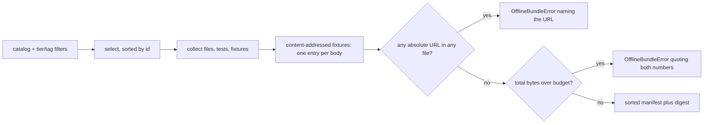
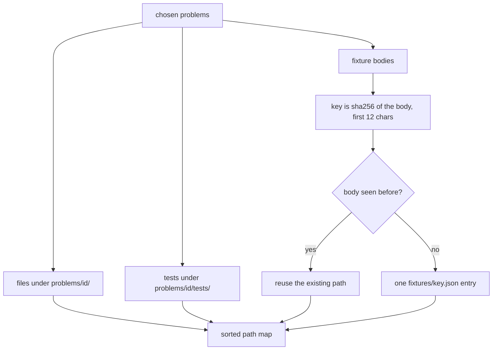
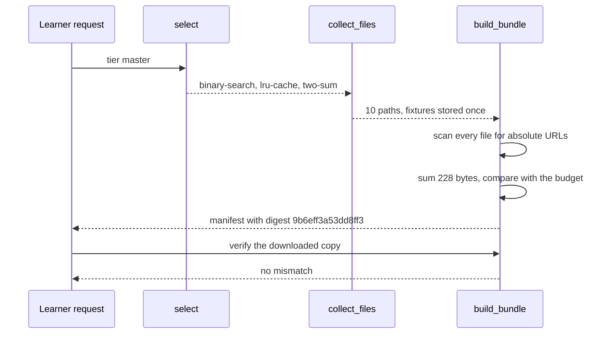

# 989 — Implement offline mode packaging so learners can download problem sets + tests.

> **Tier:** Master · **CTCI chapter:** Beyond — Software Engineering & Tooling
> **Task spec:** [989-implement-offline-mode-packaging-so-learners-can-download-proble.md](../../../tasks/master/989-implement-offline-mode-packaging-so-learners-can-download-proble.md)
> **Solutions:** [Python](../../../solutions/python/master/989-implement-offline-mode-packaging-so-learners-can-download-proble/solution.py) ·
> [Java](../../../solutions/java/master/989-implement-offline-mode-packaging-so-learners-can-download-proble/Solution.java) ·
> [JavaScript](../../../solutions/javascript/master/989-implement-offline-mode-packaging-so-learners-can-download-proble/solution.js) ·
> [C#](../../../solutions/csharp/master/989-implement-offline-mode-packaging-so-learners-can-download-proble/Solution.cs)

## 1. Problem restatement

**Input:** a catalog of practice problems, each with a tier, tags, files, tests and shared fixtures; a
selection expressed as a tier set and/or a tag set; and an optional byte budget.

```text
two-sum        master    arrays, hashing     files, tests, fixture "common"
lru-cache      master    design, hashing     files, tests, fixture "common"
bubble-sort    advanced  sorting             files, tests, fixture "common"
binary-search  master    search              files, tests, no fixtures
```

**Output:** a self-contained offline bundle.

1. **A manifest** — the selected problem ids, one entry per file with `path`, `sha256` and `bytes`, all
   sorted, plus `total_bytes` and a `digest` over the canonical manifest.
2. **The files themselves**, keyed by path.
3. **Refusals** — an `OfflineBundleError` when a bundled file still references the network (an offline
   learner could not fetch it) or when the bundle would exceed the byte budget.
4. **Verification** — `verify_bundle(bundle, current_files)` re-hashes a downloaded copy and reports
   every path that is missing or changed.

Fixture storage is content-addressed: the fixture key is the first 12 characters of the SHA-256 of the
fixture body, so three problems sharing one body contribute exactly one `fixtures/<key>.json` entry.

## 2. Intuition

The naive offline export copies the problem directories and zips them. It ships the same shared fixture
three times, it happily embeds a `https://…` URL that the offline learner cannot resolve, and it has no
answer to "did the download arrive intact?".

The key insight is that **everything an offline bundle needs can be expressed as one sorted map from path
to bytes**, and everything else is a check on that map:

* **Selection is a filter.** Tier and tag filters, sorted by problem id, so the same request always
  produces the same set.
* **Fixtures are content-addressed.** Identical bytes collapse to one path, so a shared fixture costs
  its size once, no matter how many problems reference it. The saving is exactly
  `(sharers - 1) * size_of_body` bytes.
* **The manifest is the bundle's identity.** Each file is hashed, the whole manifest is hashed, and the
  download is named by that digest — so a re-download can be checked path by path, and a partial
  transfer is visible rather than silent.
* **Offline is a *check*, not an intention.** Every file's text is scanned for an absolute URL before
  the bundle is sealed. A single `https://example.com/expected.json` inside a test file blocks the
  entire bundle, with the offending path and URL in the message.



## 3. Algorithm

1. **Select.** `select(problems, tiers, tags)` keeps a problem when its tier is in `tiers` (or `tiers`
   is empty) **and** its tag set intersects `tags` (or `tags` is empty), then sorts by problem id.
2. **Collect.** `collect_files(chosen)` builds the path map:
   `problems/<id>/<name>` for each file, `problems/<id>/tests/<name>` for each test, and one
   `fixtures/<key>.json` per distinct fixture body where `key = sha256_text(body)[:12]`.
3. **Hygiene.** For every path in sorted order, `NETWORK_REFERENCE` (`https?://[^\s)\"'<>]+`) is searched
   in the content; a hit raises `OfflineBundleError("<path> still references <url> over the network")`.
4. **Manifest.** Entries are `{"path", "sha256", "bytes"}` sorted by path; `total_bytes` is their sum;
   `problems` is the sorted id list; `digest = sha256_text(canonical(manifest))` where `canonical` is
   `json.dumps(..., sort_keys=True, separators=(",", ":"))`.
5. **Budget.** `total > budget` raises with both numbers, so the caller knows how far over the request
   is. The boundary is inclusive: a bundle that exactly fits builds.
6. **Verify.** `verify_bundle` walks the manifest entries, looks the path up in the downloaded copy, and
   reports `"<path> (missing)"` when absent or the plain path when the hash or the length disagrees.

```text
procedure build_bundle(problems, tiers, tags, budget)
    chosen ← select(problems, tiers, tags)
    files ← collect_files(chosen)
    for each path in sorted order of files do
        found ← NETWORK_REFERENCE.search(files[path])
        if found is not undefined then
            raise OfflineBundleError naming the path and the url
        end
    end
    entries ← for each path in sorted order { path, sha256_text(content), length of content }
    total ← sum of entry byte counts
    if budget is defined and total > budget then
        raise OfflineBundleError quoting total and budget
    end
    manifest ← { problems: ids of chosen, entries: entries, total_bytes: total }
    manifest.digest ← sha256_text(canonical(manifest))
    return { manifest: manifest, files: files }
end
```

```text
procedure collect_files(chosen)
    files ← empty map
    fixtures ← empty map
    for each problem in chosen do
        for each (name, content) in problem.files do
            files["problems/" + problem.id + "/" + name] ← content
        end
        for each (name, content) in problem.tests do
            files["problems/" + problem.id + "/tests/" + name] ← content
        end
        for each content in problem.fixtures.values() do
            fixtures[first 12 chars of sha256_text(content)] ← content
        end
    end
    for each (key, content) in fixtures do
        files["fixtures/" + key + ".json"] ← content
    end
    return files
end
```



## 4. Worked example

Building the master-tier bundle — `build_bundle(catalog, tiers=("master",))` — selects
`binary-search`, `lru-cache` and `two-sum` (sorted by id), and prints:

```text
problems=3 files=10 total_bytes=228 digest=9b6eff3a53dd8ff3
```

**Every byte accounted for.** File sizes come straight from `len(content)`; the fixture body is shared
by the two master problems that declare it, so it is stored once:

| Path | Bytes | Appears in |
| --- | --- | --- |
| `problems/binary-search/statement.md` (`# Binary Search\n`) | `16` | `binary-search` |
| `problems/binary-search/solution.py` (`def search(a, x): return -1\n`) | `28` | `binary-search` |
| `problems/binary-search/tests/test_search.py` (`from solution import search\n`) | `28` | `binary-search` |
| `problems/lru-cache/statement.md` (`# LRU Cache\n`) | `12` | `lru-cache` |
| `problems/lru-cache/solution.py` (`class LRU: pass\n`) | `16` | `lru-cache` |
| `problems/lru-cache/tests/test_lru.py` (`from solution import LRU\n`) | `25` | `lru-cache` |
| `problems/two-sum/statement.md` (`# Two Sum\n`) | `10` | `two-sum` |
| `problems/two-sum/solution.py` (`def two_sum(xs, k): return None\n`) | `32` | `two-sum` |
| `problems/two-sum/tests/test_two_sum.py` (`from solution import two_sum\n`) | `29` | `two-sum` |
| `fixtures/<key>.json` (`{"seed": 7, "cases": [1, 2, 3]}\n`) | `32` | shared by `lru-cache` and `two-sum` |

Nine problem files plus one fixture = the printed `files=10`, and `16 + 28 + 28 + 12 + 16 + 25 + 10 +
32 + 29 + 32 = 228` — the printed `total_bytes`.

**The de-duplication saving.** The oracle in the checks recomputes the total from the raw catalog rather
than the manifest: `per_problem` (the files and tests of the selected problems) plus one copy of the
shared body, which must equal `per_problem + sharers * len(body) - (sharers - 1) * len(body)`. With
`sharers = 2` the bundle saves exactly one body — `32` bytes — and the check asserts `sharers == 2` so
the arithmetic cannot pass by accident on a catalog where nothing is shared.

**Selection variants.**

| Request | Selected (sorted) | Why |
| --- | --- | --- |
| `tiers=("master",)` | `binary-search`, `lru-cache`, `two-sum` | tier filter |
| `tags=("hashing", "sorting")` | `bubble-sort`, `lru-cache`, `two-sum` | any-match union: `hashing` catches two problems, `sorting` catches `bubble-sort` |
| `tags=("no-such-tag",)` | — | empty, well-formed manifest with `total_bytes == 0` and a 64-character digest |

**Integrity and refusals.**

| Scenario | Result |
| --- | --- |
| the bundle re-downloaded unchanged | `verify_bundle` returns `[]` |
| `problems/two-sum/solution.py` with `# edited\n` appended | `["problems/two-sum/solution.py"]` |
| the fixture file deleted from the download | `["fixtures/<key>.json (missing)"]` |
| a test file containing `# expected from https://example.com/expected.json` | `OfflineBundleError` naming both the path and the URL |
| `budget = total_bytes` | builds; the digest equals the unbudgeted build |
| `budget = total_bytes - 1` | `OfflineBundleError` quoting `228` and `227` |



## 5. Complexity

Let `P` be the selected problems, `F` the files per problem (including tests), `N` the total bytes of the
bundle, `U` the number of distinct fixture bodies and `R` the entries in the manifest.

| Phase | Time | Space | Why the bound holds |
| --- | --- | --- | --- |
| `select` | `O(C log C)` | `O(P)` | one filter pass over the catalog plus a sort |
| `collect_files` | `O(P * F + N)` | `O(N)` | one dictionary insert per file, one hash per fixture body |
| network scan | `O(N)` | `O(1)` extra | a regex search per file over its own bytes |
| manifest build | `O(R log R + N)` | `O(R + N)` | sorting the paths, then hashing each file once |
| canonical serialise | `O(R * K)` | `O(R * K)` | `json.dumps` over `R` entries with `K` keys each |
| `verify_bundle` | `O(N)` | `O(R)` | one re-hash per recorded path |
| whole build | `O(N log R)` | `O(N)` | hashing every byte once plus one sort of the `R` paths |

For the shipped numbers the bundle is `10` files and `228` bytes; the interesting scaling axis is the
*distribution*, not the CPU: content addressing means a fixture referenced by `k` problems costs its
size once, and the budget check makes the packaging cost predictable before anything is emitted. The
sibling implementations in this repository take the same "self-contained, verifiable, bounded" idea in
three other directions: the Java solution computes the transitive closure of asset requirements and
re-checks it after every insertion, packing bundles in priority order within a per-bundle capacity; the
JavaScript solution keeps a problem and its tests atomic so they never straddle two chunks, counting
shared assets once per bundle that needs them; and the C# solution splits the manifest into fixed-size
chunks with a resumable downloader that keeps a chunk only after its hash verifies.

## 6. Pitfalls and edge cases

* **A network reference anywhere blocks the whole bundle.** The scan is per file and the error names the
  path and the URL; the check asserts the message mentions `network` **and** the full
  `https://example.com/expected.json` string, because a message that only says "offline violation" is
  not actionable.
* **De-duplication is by content, not by fixture name.** The path comes from the SHA-256 of the *body*,
  so two problems that call their fixture `common` share an entry, and two problems with different bytes
  get different entries.
* **The budget boundary is inclusive.** `budget == total_bytes` builds; `budget == total_bytes - 1`
  raises. The manifest's own `total_bytes` is the number quoted in both the print and the error, so the
  caller can request exactly what the build needs.
* **Empty selection is legal.** `build_bundle(catalog, tags=("no-such-tag",))` returns a manifest with
  no problems, no entries, `total_bytes == 0` and a well-formed 64-character digest, and
  `verify_bundle(empty, {})` is trivially clean.
* **A missing file and an edited file are reported differently.** The downloader-facing verification
  suite needs to distinguish them: a deleted path yields `"<path> (missing)"` while a corrupted one
  yields the plain path, and both are checked.
* **Order independence is by construction.** The catalog is sorted by id in `select` and by path in the
  manifest, and the fixture keys come from hashes, so building from `list(reversed(catalog))` produces
  the identical `digest` — the check asserts it rather than assuming it.
* **Tests travel with their problem.** Completeness is asserted for every selected id: at least one
  `problems/<id>/tests/…` path *and* at least one `problems/<id>/…` path must exist. A bundle that
  selects a problem but forgets its tests is useless offline and would otherwise pass a count-based
  check.
* **The digest covers the manifest, not the bytes.** The name of the download is stable across builds of
  the same selection, while per-file `sha256` values make byte-level verification possible afterwards —
  the same split as the dataset packager and the image builder.

## 7. Variants and follow-ups

* **Compression and chunking.** The documented simplification is an in-memory map instead of a tarball,
  with no compression step, so the byte counts are uncompressed. Chunked, resumable delivery over a flaky
  link is the C# solution's angle (fixed-size chunks, verify-then-keep, resume without re-downloading).
* **Capacity planning for a fleet.** When one bundle cannot hold the whole selection, the interesting
  problem becomes packing: the Java solution orders assets by priority and fills per-bundle capacity,
  while the JavaScript solution keeps atomic units together across chunk boundaries.
* **Where the problems come from.** The offline catalog is produced by the other tooling in this range:
  [986-implement-open-dataset-packaging-and-licensing-automation-for-pr.md](../../../tasks/master/986-implement-open-dataset-packaging-and-licensing-automation-for-pr.md)
  for licensing and attribution in a published set, and
  [987-implement-migration-tools-for-older-problem-formats-to-new-canon.md](../../../tasks/master/987-implement-migration-tools-for-older-problem-formats-to-new-canon.md)
  for the canonical record shape that a bundle should ship.
* **Reproducible environments, not just files.** An offline learner also needs a runnable toolchain; see
  [990-implement-reproducible-docker-images-for-canonical-environment-w.md](../../../tasks/master/990-implement-reproducible-docker-images-for-canonical-environment-w.md)
  for the digest-pinned image whose layers correspond to the harness a bundle expects, and
  [988-implement-cross-repo-synchronization-and-dependency-management-t.md](../../../tasks/master/988-implement-cross-repo-synchronization-and-dependency-management-t.md)
  for the version resolution that decides which exercise versions are packaged at all.

## 8. Check yourself

<details><summary>Why is the fixture key derived from the SHA-256 of the body rather than from the fixture name?</summary>

Because two problems may name the same fixture differently, and two fixtures may share a name but differ
in content. Hashing the body makes the key a function of the content alone: identical bodies collapse to
one entry (the `common` fixture of `lru-cache` and `two-sum`), and any difference in the bytes produces a
different path. The first 12 hex characters are used as the key, which is short enough to read and still
ample for a catalog of this size.</details>

<details><summary>The printed `total_bytes` is 228. How would it change if fixture de-duplication were removed?</summary>

The shared body of `32` bytes is referenced by two selected problems (`sharers == 2`), so a naive
packager would store it twice and total `228 + 32 = 260`. The check does not simply compare the manifest
against a constant: it recomputes `per_problem + sharers * len(shared_body)` **and**
`per_problem + len(shared_body)` from the raw catalog and requires both to relate to the manifest exactly
as `deduplicated == naive - (sharers - 1) * len(shared_body)`.</details>

<details><summary>Why does an edit to a bundled file produce a different report from a deletion?</summary>

Because the remedies differ. A hash or length mismatch means the file arrived corrupt or was modified
after download — re-download that path. A missing path means the transfer was incomplete — the whole
bundle should be retried or the missing entries refetched. `verify_bundle` therefore appends
`"<path> (missing)"` for absent content and the bare path otherwise, and both cases are asserted.</details>

<details><summary>What exactly does the bundle digest commit to?</summary>

The canonical JSON of the manifest: the selected problem ids, every `(path, sha256, bytes)` entry sorted
by path, and the total. Because `canonical()` sorts keys and removes whitespace, the digest is a function
of the *selection and contents* rather than of the build order — reversing the catalog leaves it
unchanged, while adding a byte to any bundled file changes it. The per-file hashes are what let a
downloader localise a mismatch afterwards.</details>
