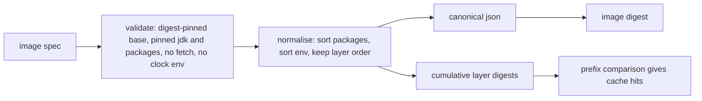
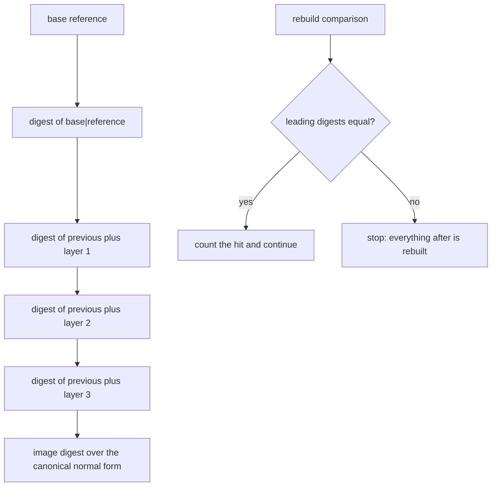
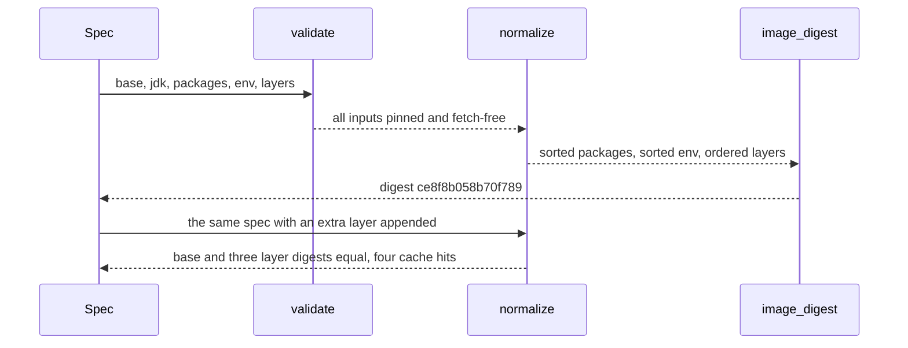

# 990 — Implement reproducible Docker images for canonical environment with JDK/test harness.

> **Tier:** Master · **CTCI chapter:** Beyond — Software Engineering & Tooling
> **Task spec:** [990-implement-reproducible-docker-images-for-canonical-environment-w.md](../../../tasks/master/990-implement-reproducible-docker-images-for-canonical-environment-w.md)
> **Solutions:** [Python](../../../solutions/python/master/990-implement-reproducible-docker-images-for-canonical-environment-w/solution.py) ·
> [Java](../../../solutions/java/master/990-implement-reproducible-docker-images-for-canonical-environment-w/Solution.java) ·
> [JavaScript](../../../solutions/javascript/master/990-implement-reproducible-docker-images-for-canonical-environment-w/solution.js) ·
> [C#](../../../solutions/csharp/master/990-implement-reproducible-docker-images-for-canonical-environment-w/Solution.cs)

## 1. Problem restatement

**Input:** an image spec — a base reference, a JDK distro and build, a package list, environment
variables, layers and a test harness:

```text
base       eclipse-temurin:21.0.4_7-jdk@sha256:6b3a4c9d…2233   (digest-pinned)
jdk        temurin 21.0.4+7
packages   curl 8.5.0-2, python3 3.12.3-1, ca-certificates 20240203
env        JAVA_HOME=/opt/java/openjdk, PYTHONUNBUFFERED=1
layers     apt, jdk, harness
harness    entrypoint /opt/harness/run.sh, script "#!/bin/sh\njava -version\nexec python3 -m pytest \"$@\"\n"
```

**Output:** a normal form, an image digest, cumulative layer digests and a manifest.

1. `normalize(spec)` → the canonical form used for hashing.
2. `image_digest(spec)` → SHA-256 over the canonical JSON of the normal form.
3. `layer_digests(spec)` → the base digest then one digest per layer, each chained over its predecessor.
4. `rebuild_cache_hits(previous, spec)` → how many leading digests an incremental rebuild can reuse.
5. `build_manifest(spec)` → base, JDK, packages, layers, harness (recorded by digest) and both digest
   lists.

Validation is a hard gate: an unpinned base, JDK or package, a duplicate package, a network fetch inside
a layer, or a wall-clock environment variable raises `ReproducibilityError`.

## 2. Intuition

The naive image build is a Dockerfile with `apt-get install curl` and `FROM eclipse-temurin:21-jdk`. Two
builds of that file a week apart produce different images: the base tag moved, the package version moved,
and a `BUILD_DATE` variable baked the wall clock into the metadata.

The key insight is that **reproducibility is a property of a normal form, and the normal form only exists
if every input is pinned**. Two things follow:

* **Pinning is validation, not documentation.** Base images must carry `@sha256:<64 hex>`; JDK builds and
  package versions must match an exact-version pattern; env keys that name a build timestamp are refused
  outright; and a layer command containing `http://` or `https://` is refused, because fetching during
  the build makes the result depend on what is being served that day. Failing the build is cheaper than
  discovering the drift months later.
* **Then order stops mattering where it should and keeps mattering where it shouldn't.** Packages and
  environment variables are *sets*, so they are sorted before hashing — the same logical image must hash
  the same whichever order they were written in. Layers are a *sequence*: an `apt` layer before the
  `jdk` layer is a different image from the reverse, so they keep their order in the normal form and
  therefore in the digest.

The cumulative layer digests are the operational payoff: `digest[i]` depends on every layer up to `i`, so
appending a layer reuses the entire prefix, while changing the first layer invalidates everything after
it — which is exactly the cache semantics a builder needs to report.



## 3. Algorithm

1. **Validate.** `validate(spec)` checks, in order: `DIGEST_REFERENCE = @sha256:[0-9a-f]{64}$` against the
   base reference; `PINNED_VERSION = ^\d+(\.\d+)*([-+][A-Za-z0-9.]+)*$` against the JDK version; every
   package name unique and every package version pinned; every env key not in
   `FORBIDDEN_ENV = ("BUILD_TIMESTAMP", "BUILD_TIME", "BUILD_DATE")` (compared upper-cased); and no
   `http://` or `https://` inside any layer command.
2. **Normalise.** `normalize` calls `validate` first, then produces a flat dictionary: `base` is the
   reference string, `jdk` is `"<distro>-<version>"`, `packages` is a list of `"<name>=<version>"`
   **sorted by name**, `env` is a dictionary built in **sorted key order**, `layers` is a list of
   `"<name>: <command>"` in declaration order, and `harness` records the entrypoint plus the
   **SHA-256 of the script** rather than its text.
3. **Canonicalise and hash.** `canonical` is `json.dumps(value, sort_keys=True, separators=(",", ":"),
   ensure_ascii=True)`; `image_digest = sha256_text(canonical(normalize(spec)))`.
4. **Chain the layers.** `layer_digests` starts with `sha256("base|" + base)` and then, for each layer in
   order, `sha256(previous_digest + "|" + layer)`. The list has `len(layers) + 1` entries.
5. **Reuse.** `rebuild_cache_hits(previous, spec)` walks the two digest lists in lockstep and counts the
   leading equal entries, stopping at the first difference.
6. **Manifest.** `build_manifest` restates the normal form and adds `layer_digests` and `digest`.
7. **Round-trip.** `from_normalized(normalized, script_text)` rebuilds a spec from the normal form — it
   splits `"<distro>-<version>"`, each `"<name>=<version>"` and each `"<name>: <command>"` — which is how
   the checks prove the normal form loses nothing that affects the digest.

```text
procedure normalize(spec)
    validate(spec)
    return { base: spec.base.ref,
             jdk: spec.jdk.distro + "-" + spec.jdk.version,
             packages: [ name + "=" + version for each package sorted by name ],
             env: map of the env entries in sorted key order,
             layers: [ name + ": " + command for each layer in declaration order ],
             harness: { entrypoint: spec.harness.entrypoint,
                        script: sha256_text(spec.harness.script) } }
end
```

```text
function layer_digests(spec)
    normalized ← normalize(spec)
    digests ← [ sha256_text("base|" + normalized.base) ]
    for each layer in normalized.layers do
        append sha256_text(last of digests + "|" + layer) to digests
    end
    return digests
end
```



## 4. Worked example

Running the Python file prints:

```text
digest=ce8f8b058b70f789 layers=3 cache_hits=4 jdk=temurin-21.0.4+7
```

**The normal form of the shipped spec**, which is what gets hashed:

| Field | Normalised value | Why it is in this shape |
| --- | --- | --- |
| `base` | `eclipse-temurin:21.0.4_7-jdk@sha256:6b3a…2233` | the digest reference, taken verbatim |
| `jdk` | `temurin-21.0.4+7` | distro and exact build fused into one string |
| `packages` | `["ca-certificates=20240203", "curl=8.5.0-2", "python3=3.12.3-1"]` | sorted by name, so declaration order cannot matter |
| `env` | `{"JAVA_HOME": "/opt/java/openjdk", "PYTHONUNBUFFERED": "1"}` | built in sorted key order |
| `layers` | `["apt: apt-get install -y curl python3", "jdk: copy /opt/java/openjdk", "harness: copy /opt/harness"]` | sequence preserved |
| `harness.script` | the SHA-256 of the script text | recorded by digest, so the manifest never embeds code |

The checks pin this shape twice: a reversed package list and a re-ordered env dictionary produce the
**same** `image_digest` and an identical `normalize` result, while a **reversed layer list** produces a
different digest. And `from_normalized(normalize(spec), harness_script())` rebuilds a spec whose digest
equals the original, so the normal form is a faithful encoding.

**The closed-form oracle for the minimal spec.** Before trusting the digest machinery, the solution
hand-writes the expected canonical text for `minimal_spec()` (no packages, no layers, a one-line harness)
and asserts both `canonical(normalize(minimal)) == expected_text` and
`image_digest(minimal) == sha256_text(expected_text)`. The only value the check cannot spell out
literally is the harness digest, which is fixed as the independent constant
`MINIMAL_HARNESS_SHA256 = "306c6ca7…717cb"` — the SHA-256 of `"#!/bin/sh\nexit 0\n"`.

**Cache reuse**, computed over the two cumulative digest lists:

| Rebuild scenario | Comparison | Hits |
| --- | --- | --- |
| `spec` with an `extra` layer appended | base digest equal, then `apt`, `jdk`, `harness` all equal | `4` — the base plus all three layers |
| `spec` with the layer list reversed | the base digest matches, the first layer digest differs | `1` — only the base |
| a brand-new spec | possibly nothing matches | `0` |

The printed `cache_hits=4` is the first row: appending a layer is the cheap, incremental case, and the
reversed case is the expensive one — exactly the "cache invalidates from the first changed layer" rule a
real builder implements.

**Refusals**, each with its own message:

| Spec change | Error mentions |
| --- | --- |
| `base.ref = "eclipse-temurin:21-jdk"` | `digest-pinned` |
| `base.ref = "eclipse-temurin:21@sha256:abc"` (short digest) | `digest-pinned` |
| `jdk.version = "latest"` | `pinned` |
| `curl` with `version = "latest"` | `curl` |
| two `curl` packages | `duplicate package` |
| a layer command with `curl -O https://example.com/jdk.tgz` | `network` |
| `env = {"BUILD_TIMESTAMP": "2026-10-16T12:00:00Z"}` | `BUILD_TIMESTAMP` |



## 5. Complexity

Let `P` be the number of packages, `E` the env entries, `L` the layers, `K` the spec size and `H` the
harness script length:

| Phase | Time | Space | Why the bound holds |
| --- | --- | --- | --- |
| `validate` | `O(P + E + L + K)` | `O(P)` | one regex per package version, plus set membership |
| `normalize` | `O(P log P + E log E + L + H)` | `O(P + E + L)` | two sorts, one hash of the harness script |
| `canonical` | `O(K)` | `O(K)` | one JSON serialisation with sorted keys |
| `image_digest` | `O(K)` | `O(K)` | linear hash |
| `layer_digests` | `O(L * K)` | `O(L)` | each chained digest hashes the previous digest plus one layer text |
| `rebuild_cache_hits` | `O(L)` | `O(L)` | lockstep comparison of two digest lists |
| `build_manifest` | `O(L * K + K)` | `O(L + P + E)` | the layer chain dominates |
| `from_normalized` | `O(P + L + E)` | `O(K)` | one split per reconstructed entry |

The asymptotics are uninteresting at this size (`P = 3`, `E = 2`, `L = 3`); the *decision* is what
matters. Sorting packages and env is `O(P log P)`, but it converts two common sources of non-determinism
into invariance; keeping layers ordered costs nothing and preserves the semantics a builder's cache
depends on. The sibling implementations sharpen specific edges: the Java solution checks that identical
builds are bit-identical and refuses tag-only bases and timestamped layers; the JavaScript solution
models the image as a Merkle tree of layers and reports reuse of the common prefix; the C# solution
measures the reusable cache size as exactly the total size of the leading layers that two builds share.

## 6. Pitfalls and edge cases

* **A base tag is not a pin.** `eclipse-temurin:21-jdk` is refused and so is a truncated
  `@sha256:abc`: the regex requires exactly 64 lower-case hex digits at the end of the reference. Tags
  move; digests do not.
* **`latest` is not a version.** The JDK build and every package version must match
  `^\d+(\.\d+)*([-+][A-Za-z0-9.]+)*$`, which accepts `21.0.4+7` and `8.5.0-2` and rejects `latest`.
* **Duplicate packages are refused before they are sorted.** Two `curl` entries are a mistake even if
  they agree on the version; the check uses two different versions to make the intent obvious.
* **A fetch inside a layer breaks reproducibility.** The error message for a layer containing
  `https://example.com/jdk.tgz` mentions `network`, and the guidance is to vendor the input — an image
  whose content depends on a remote server is not a canonical environment.
* **Wall-clock variables are refused, not scrubbed.** `FORBIDDEN_ENV` catches `BUILD_TIMESTAMP`,
  `BUILD_TIME` and `BUILD_DATE` case-insensitively, because a build that sets one changes its own
  metadata on every run.
* **The harness is recorded by digest.** `build_manifest(...)["test_harness"]["script"]` is
  `sha256_text(harness_script())`, not the script text: the manifest identifies the harness without
  embedding it, so a change to the harness changes the image digest without changing the manifest's
  shape.
* **The minimal image is a legal boundary.** `minimal_spec()` has no packages and no layers;
  `build_manifest(minimal)["packages"] == []`, `["layers"] == []` and
  `image_digest(minimal) == image_digest(minimal_spec())`. An empty package set must hash stably rather
  than fall into a different code path.
* **Round-tripping is asserted, not assumed.** Because `normalize` fuses the JDK distro and version into
  one string, `from_normalized` has to split on the **first** `-`; the round-trip check
  (`image_digest(round_trip) == digest`) is what catches a mistake in that parsing.

## 7. Variants and follow-ups

* **Real layer hashing.** The documented simplification is declarative layers instead of executed
  filesystem changes, so sizes and real contents are out of scope. A production builder hashes each
  layer's diff (the classic `sha256(previous_layer_id + "|" + diff)`) and stores the mapping in a
  content-addressed registry — the chaining here is the same shape with the filesystem left out.
* **Merkle trees over layers.** The JavaScript solution models the image as a Merkle structure, which
  makes "which layers are shared" a matter of comparing subtrees instead of prefixes; both give the same
  cache-hit answer for the append and reverse cases above.
* **Cache economics.** Knowing the *number* of reusable layers is the first question; the second is how
  many bytes they represent, which is what the C# solution computes by summing the leading layers two
  builds share.
* **What runs inside the image.** The canonical image exists to run a test harness deterministically;
  the harness itself, and the benchmark or grading job that drives it, are covered by
  [991-implement-benchmark-suite-across-machines-and-store-historical-p.md](../../../tasks/master/991-implement-benchmark-suite-across-machines-and-store-historical-p.md)
  and
  [992-implement-reproducible-random-seed-protocol-for-benchmarking-fai.md](../../../tasks/master/992-implement-reproducible-random-seed-protocol-for-benchmarking-fai.md),
  while the platform-level analogue of "same input, same result" is
  [981-implement-reproducible-deployment-of-full-platform-via-infra-as.md](../../../tasks/master/981-implement-reproducible-deployment-of-full-platform-via-infra-as.md).

## 8. Check yourself

<details><summary>Why are packages sorted but layers kept in order?</summary>

Because they are different kinds of data. A package list is a set: `curl` before `python3` is the same
image as `python3` before `curl`, so any order-dependence in the digest would be a false difference.
Layers are a sequence: `apt-get install` must run before the files it installs are copied, so a
reordered layer list is a genuinely different image — and the check asserts exactly that asymmetry
(`image_digest(permuted) == digest` for packages/env, `image_digest(reordered) != digest` for layers).</details>

<details><summary>How do the cumulative layer digests produce a cache-hit count?</summary>

`layer_digests` returns `L + 1` digests: the base first, then one per layer chained over its
predecessor. Two builds share a layer if and only if their digest at that position matches, because the
chain means any earlier change propagates forward. Walking the two lists in lockstep and counting equal
leading entries gives the number of reusable steps — `4` when a layer is appended (base plus three
layers) and `1` when the layer list is reversed (only the base survives).</details>

<details><summary>Why is the harness script stored as a digest rather than as text?</summary>

Two reasons: the manifest stays small and free of executable content, and the identity of the harness
becomes part of the image digest without the manifest having to carry a copy that could drift. A
reviewer who wants the script itself fetches it from the repository; the manifest only needs to say
"the harness whose SHA-256 is this".</details>

<details><summary>What is the point of the hand-written canonical text for the minimal spec?</summary>

It is an oracle for the normal form itself. Every other check compares two values produced by the same
functions, so a systematically wrong normalisation (a missing `sort_keys`, a colon instead of an equals
sign, the harness text instead of its hash) would pass them all. Writing out the expected JSON by hand —
with the harness digest pinned as an independent constant — is the one place where the canonical form is
asserted against something the code did not compute.</details>
