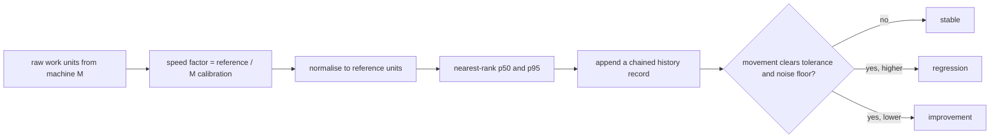
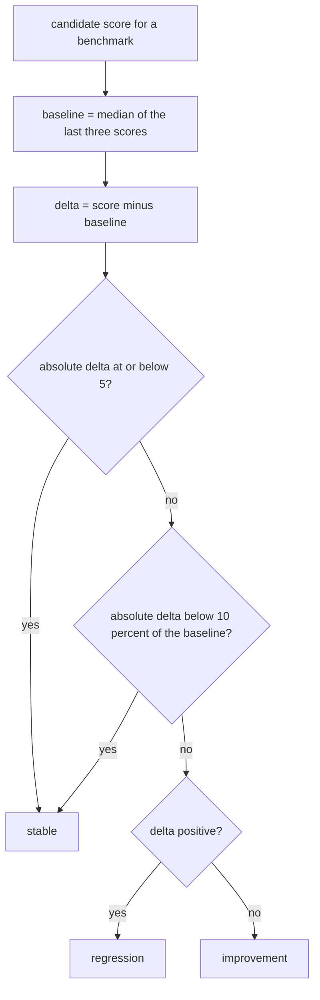
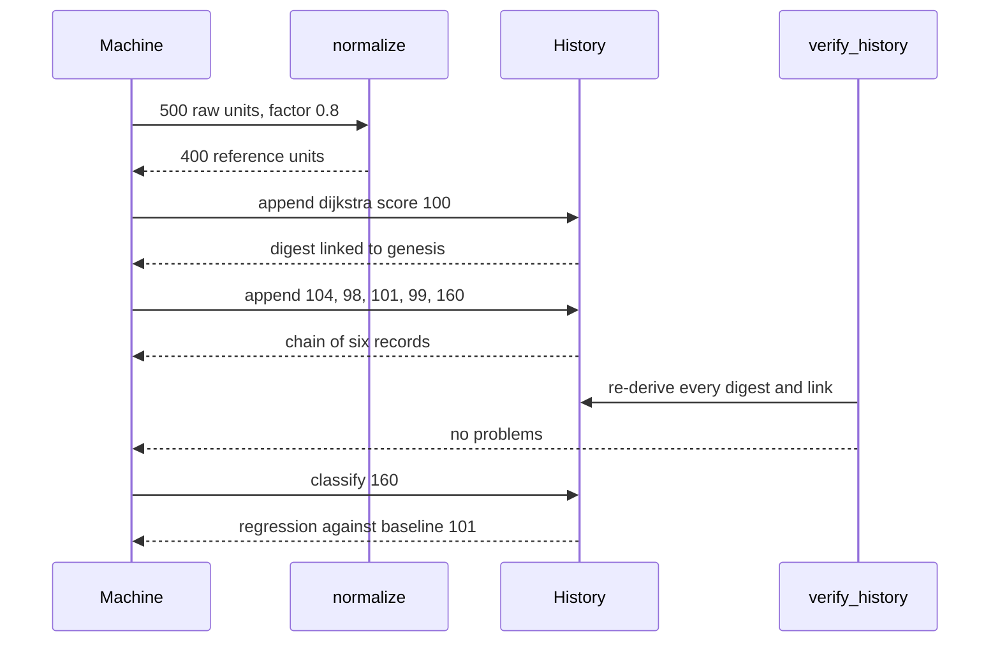

# 991 — Implement benchmark suite across machines and store historical performance.

> **Tier:** Master · **CTCI chapter:** Beyond — Software Engineering & Tooling
> **Task spec:** [991-implement-benchmark-suite-across-machines-and-store-historical-p.md](../../../tasks/master/991-implement-benchmark-suite-across-machines-and-store-historical-p.md)
> **Solutions:** [Python](../../../solutions/python/master/991-implement-benchmark-suite-across-machines-and-store-historical-p/solution.py) ·
> [Java](../../../solutions/java/master/991-implement-benchmark-suite-across-machines-and-store-historical-p/Solution.java) ·
> [JavaScript](../../../solutions/javascript/master/991-implement-benchmark-suite-across-machines-and-store-historical-p/solution.js) ·
> [C#](../../../solutions/csharp/master/991-implement-benchmark-suite-across-machines-and-store-historical-p/Solution.cs)

## 1. Problem restatement

**Input:** benchmark runs recorded on different machines, plus a calibration reference.

```text
reference  ci-reference  8 cores   calibration 1000
machines   fast-laptop  12 cores   calibration  500      factor 2.0
           slow-vm       2 cores   calibration 1250      factor 0.8
benchmarks two-sum, lru-cache, dijkstra
```

Each run supplies raw work units for one benchmark. A machine's **speed factor** is
`reference_calibration / machine_calibration`, and a raw measurement is normalised by that factor
before it is compared with anything else.

**Output:** normalised samples, a summary, a historical record and a verdict.

1. `normalize(samples, factor)` → samples scaled onto the reference machine.
2. `summarize(samples)` → `{count, min, max, p50, p95}` with nearest-rank percentiles.
3. `History.append(benchmark, machine, score)` → a linked record whose digest covers its own body plus
   its predecessor's digest.
4. `History.classify(benchmark, score)` → `"improvement"`, `"regression"` or `"stable"`.
5. `verify_history(records)` → every broken link or mismatched digest.

The classification constants are `TOLERANCE = 0.10` (ten percent relative) and `NOISE_FLOOR = 5`
(absolute work units).

## 2. Intuition

The naive benchmark dashboard compares raw numbers across machines. It reports that a laptop is "three
times faster" because a cheaper machine burned fewer work units for the same work, and it pages someone
when the compiler's own caching changed the number by two units.

The key insight is that **a measurement is only comparable after it has been expressed in reference
units**. If a machine needs `calibration` units to do a fixed reference workload, then every unit it
burns is worth `reference_calibration / machine_calibration` reference units. Normalising first, then
summarising, makes equal logical performance produce *identical* numbers on every machine — the shipped
constants are chosen so the factors are exact decimals (`2.0` and `0.8`) and the arithmetic stays
integer-exact.

The second insight is that **history needs to be tamper-evident and change reporting needs hysteresis**:

* an append-only chain (`prev` = the previous record's digest, `digest` = hash of the record body)
  makes a rewritten score detectable without a database, because the chain stops verifying from the
  edited record onward;
* a movement is only reported when it clears **both** a relative tolerance (`10%`) and an absolute noise
  floor (`5` units), which is how 3 units of jitter stay `stable` while a 60% jump is a `regression`.



## 3. Algorithm

1. **Calibrate.** `speed_factor(machine)` returns `reference_calibration / machine_calibration` and
   raises `ValueError` for a non-positive calibration. The reference machine has factor exactly `1.0`.
2. **Normalise.** `normalize(samples, factor)` returns `[int(round(sample * factor))]`. The check also
   computes an independent integer oracle (`sample * 1000 // 1250` for the slow machine) to prove the
   normalisation is exactly the reference-unit conversion, not a floating-point approximation to it.
3. **Percentile.** `percentile(samples, pct)` sorts the samples and returns the
   `ceil(pct% * n)`-th smallest, computed as `-(-n * pct // 100)` so the ceiling is exact in integers. It
   raises `ValueError` for an empty set and for `pct` outside `(0, 100]`.
4. **Summarise.** `summarize` reports `count`, `min`, `max`, `p50` and `p95` — the nearest-rank p95 of a
   12-sample set is its maximum, which is the point of using a defined rank rather than interpolation.
5. **Append.** `History.append` writes a record `{seq, benchmark, machine, score, prev, digest}` where
   `prev` is the previous record's digest (or the literal `"genesis"` for the first) and `digest` is
   `sha256(canonical(body))` with `seq` included. The record's `prev` is therefore fixed *before* the
   digest is computed, so the chain is a pure function of the append order.
6. **Baseline.** `History.baseline(benchmark, window=3)` takes the last three scores and returns their
   median — `percentile(recent, 50)` when the count is odd, and the integer mean of the two middle
   values when it is even.
7. **Classify.** `classify` computes `delta = score - base` and returns `"stable"` when
   `abs(delta) <= floor` **or** `abs(delta) < tolerance * base`; otherwise `"regression"` for a positive
   delta and `"improvement"` for a negative one.
8. **Verify.** `verify_history` re-derives both invariants per record: `seq == index` and
   `prev == previous digest`, reported as `broken chain`; and
   `sha256(canonical(body without digest)) == digest`, reported as `digest mismatch`.

```text
function percentile(samples, pct)
    if samples is empty then raise ValueError for the empty sample set end
    if pct <= 0 or pct > 100 then raise ValueError for the out-of-range percentile end
    ordered ← sorted samples
    rank ← ceiling of (length of ordered * pct / 100)
    return ordered[rank − 1]
end
```

```text
procedure append(history, benchmark, machine, score)
    previous ← last record digest of history, or "genesis" when history is empty
    record ← { seq: count of history, benchmark, machine, score, prev: previous }
    record.digest ← sha256_text(canonical(record))
    append record to history
    return record.digest
end
```



## 4. Worked example

Running the Python file prints:

```text
machines=2 records=6 suite_score=310 p95=91
```

**Normalisation invariance.** Three machines report the same logical performance in their own units; the
factor maps each onto the reference machine:

| Machine | Calibration | Factor | Raw samples | Normalised |
| --- | --- | --- | --- | --- |
| `ci-reference` | `1000` | `1.0` | `400` × 5 | `400` × 5 |
| `fast-laptop` | `500` | `2.0` | `200` × 5 | `400` × 5 |
| `slow-vm` | `1250` | `0.8` | `500` × 5 | `400` × 5 |

All three normalised lists are identical, which the check asserts by requiring the set of tuples to have
size `1`, and the slow-machine row is independently recomputed as `500 * 1000 // 1250 = 400` — integer
arithmetic, no floating point.

**Percentiles over a fixed 12-sample set.** `samples = [37, 12, 88, 64, 5, 91, 23, 55, 70, 41, 19, 77]`
sorted is `[5, 12, 19, 23, 37, 41, 55, 64, 70, 77, 88, 91]`:

| Requested | Rank `ceil(n * pct / 100)` | Value | Note |
| --- | --- | --- | --- |
| `p50` | `6` | `41` | the sixth smallest |
| `p90` | `11` | `88` | the eleventh smallest |
| `p95` | `12` | `91` | equals the maximum at this sample size |
| `p100` | `12` | `91` | the maximum by definition |

`summarize(samples)` is therefore `{count: 12, min: 5, max: 91, p50: 41, p95: 91}` — hand-checkable,
which is exactly why nearest-rank percentiles are used instead of an interpolating definition. The
single-sample boundary follows from the same formula: `summarize([123])` has
`p50 == p95 == min == max == 123`.

**The history chain.** Six `dijkstra` scores are appended on the reference machine:
`100, 104, 98, 101, 99, 160`. Each record stores `seq`, `benchmark`, `machine`, `score`, `prev` and its
own digest, so:

| Check | Observation |
| --- | --- |
| a fresh chain | `verify_history` returns `[]` |
| sequence numbers | `[0, 1, 2, 3, 4, 5]` — contiguous by construction |
| linkage | `records[3]["prev"] == records[2]["digest"]` |
| rewriting `records[4]["score"]` to `4` without re-hashing | `["4: digest mismatch"]` |
| forging `records[2]["prev"] = "genesis"` | a `broken chain` problem is reported |

**Classification.** The baseline is the median of the last three scores, `[101, 99, 160]`, which is
`101`:

| Candidate score | Delta from `101` | Floor `5` | Tolerance `10.1` | Verdict |
| --- | --- | --- | --- | --- |
| `100` | `-1` | inside | — | `stable` |
| `103` | `+2` | inside | — | `stable` |
| `160` | `+59` | cleared | cleared | `regression` |
| `60` | `-41` | cleared | cleared | `improvement` |

Note that `103` is stable not because it is small in relative terms (`2%`), but because it never clears
the absolute floor; and `160` clears both gates. Asking for a benchmark with no history raises
`ValueError` mentioning `no history`.

**The suite score.** Two machines record runs that describe the same logical performance:
`ci-reference` records `[300, 320, 310]`, `fast-laptop` records `[150, 160, 155]`. After normalisation
both summaries are identical, and `suite_score` is the integer mean of the per-machine p50s —
`(310 + 310) // 2 = 310`, the printed value.



## 5. Complexity

Let `S` be the samples in a run, `N` the records in the history, `W` the baseline window (`3`) and `C`
the canonical-JSON length of a record:

| Phase | Time | Space | Why the bound holds |
| --- | --- | --- | --- |
| `speed_factor` | `O(1)` | `O(1)` | one division |
| `normalize` | `O(S)` | `O(S)` | one multiply and round per sample |
| `percentile` | `O(S log S)` | `O(S)` | the sort dominates; the rank arithmetic is `O(1)` |
| `summarize` | `O(S log S)` | `O(S)` | four order statistics over one sorted copy |
| `append` | `O(C)` | `O(C)` | serialising and hashing the record body, plus the list append |
| `scores` | `O(N)` | `O(N)` | one filtered pass |
| `baseline` | `O(W log W)` | `O(W)` | a constant-size window |
| `classify` | `O(W log W)` | `O(W)` | the baseline plus three comparisons |
| `verify_history` | `O(N * C)` | `O(N)` | one canonical serialisation and hash per record |

The design keeps the expensive operation cheap and the cheap operation exact: percentiles are `O(S log
S)` because sorting is unavoidable for an exact answer, while appending and classifying are
constant-window operations. The substantive engineering trade is in the constants — a `10%` tolerance
and a `5`-unit floor turn a noisy series into a signal an engineer can act on, and the alternative
solutions in this repository attack the same problem from the measurement side: the Java file makes
cross-machine normalisation produce identical numbers and checks that medians are exact at the
even-count boundary, the JavaScript file normalises using a *simulated* clock precisely because a real
timer cannot be reproduced, and the C# file re-derives median and mean-absolute-deviation against a
naive insertion-sort oracle and asserts byte-identical history on replay.

## 6. Pitfalls and edge cases

* **A non-positive calibration is a hard error.** `speed_factor(machine("broken", 0, 1))` raises
  `ValueError` mentioning `non-positive calibration`; dividing by zero or returning `inf` would silently
  poison every later comparison.
* **Nearest rank is defined by a ceiling, not by interpolation.** `p95` of twelve samples is the
  maximum, and `percentile([4, 4, 4], 95)` is `4`. Interpolating would produce `91.0`-style fractional
  values that cannot be compared with integer work units.
* **Out-of-range percentiles and empty sets are errors.** `percentile([], 50)` raises about the `empty
  sample set` and `percentile([1], 0)` / `percentile([1, 2], 101)` raise mentioning `outside
  (0, 100]`.
* **The even-count median is the integer mean of the two middle values.** `baseline` uses the mean only
  when the count is even, so a three-element window returns a real sample; the check pins
  `classify("dijkstra", 100) == "stable"` and `classify("dijkstra", 103) == "stable"` against the
  baseline `101`.
* **The noise floor is checked first, and *either* gate suppresses the signal.**
  `abs(delta) <= floor or abs(delta) < tolerance * base` → `stable`. A tolerance-only rule would report
  a 9-unit regression on a 50-unit baseline as a 18% regression; the floor stops that.
* **A rewritten score breaks exactly one record.** Editing `records[4]["score"]` yields
  `["4: digest mismatch"]` and nothing else, because the record's own body was re-hashed; only a change
  that also re-links its successors would move the failure downstream.
* **A forged link is a different failure.** Setting `records[2]["prev"] = "genesis"` produces a `broken
  chain` problem, so the two invariants are reported distinctly — the first says "this record's content
  changed", the second says "this record is not connected to the chain".
* **An empty benchmark set is a boundary.** `classify` on an unknown benchmark raises, but
  `normalize([])` and a single-sample `summarize` are legal: a one-sample run is its own min, max, p50
  and p95.

## 7. Variants and follow-ups

* **Real timing and its irreducible noise.** The documented simplification is explicit work units
  instead of a wall clock, because a clock cannot be reproduced; the JavaScript solution normalises with
  a simulated timer for the same reason, and the C# solution adds median-absolute-deviation so the
  noise estimate travels with each measurement.
* **Where the seeds come from.** A benchmark whose inputs are drawn at random cannot be compared across
  machines unless the draws are reproducible — see
  [992-implement-reproducible-random-seed-protocol-for-benchmarking-fai.md](../../../tasks/master/992-implement-reproducible-random-seed-protocol-for-benchmarking-fai.md)
  for the seed derivation and the fairness evidence that goes with it.
* **Where the runs execute.** Cross-machine comparison is only meaningful if the environment is the
  same — see
  [990-implement-reproducible-docker-images-for-canonical-environment-w.md](../../../tasks/master/990-implement-reproducible-docker-images-for-canonical-environment-w.md)
  for the digest-pinned image and
  [900-implement-full-featured-reproducible-research-platform-with-hard.md](../../../tasks/master/900-implement-full-featured-reproducible-research-platform-with-hard.md)
  for artifact provenance, and
  [851-implement-latency-slash-throughput-tradeoff-benchmarks-for-vario.md](../../../tasks/master/851-implement-latency-slash-throughput-tradeoff-benchmarks-for-vario.md)
  for the latency-versus-throughput variant of the same measurement discipline.

## 8. Check yourself

<details><summary>Why does normalising with `reference_calibration / machine_calibration` make two machines comparable?</summary>

Because the calibration expresses the *same fixed workload* in each machine's own unit of cost. A unit
of cost on a machine that needs `500` units for the reference workload is worth twice a unit on the
reference machine, hence the factor `1000 / 500 = 2.0`. Multiplying raw samples by the factor converts
them into reference units, so equal logical performance produces identical numbers — the check asserts
that all three machines' normalised vectors are the same tuple, and verifies the slow machine's row
against integer arithmetic.</details>

<details><summary>The baseline for the six-score history is `101`. Why the median of the last three rather than the mean or the last score?</summary>

`baseline` keeps a `window = 3` and takes the median of the most recent scores: `[101, 99, 160]` → `101`.
The last score would make a single outlier the new normal, and the mean would let one huge value drag the
baseline up (`120`) so that a genuine regression hides behind it. The median of a small window is robust
to one bad run while still tracking real drift.</details>

<details><summary>What exactly does the digest of a history record cover?</summary>

The record body *including* `seq`, `benchmark`, `machine`, `score` and `prev`, but excluding `digest`
itself — `sha256_text(canonical(body))` where `canonical` sorts keys. Because `prev` is part of the body,
the chain is committed: changing a record's score changes its digest, which breaks the `prev` link of the
next record, so `verify_history` reports a `digest mismatch` at the edited index and the linkage failure
afterwards.</details>

<details><summary>A score of `103` against a baseline of `101` is reported as `stable`. Is the tolerance too loose?</summary>

No — the noise floor is doing its job. The rule is `abs(delta) <= 5 or abs(delta) < 0.10 * base`, i.e.
*a movement must clear both gates* to be reported. Two units on a workload of about a hundred is well
inside run-to-run variation, and reporting it would train reviewers to ignore the dashboard. The check
pins all four cases (`100`, `103`, `160`, `60`) so the constants cannot be quietly relaxed.</details>
