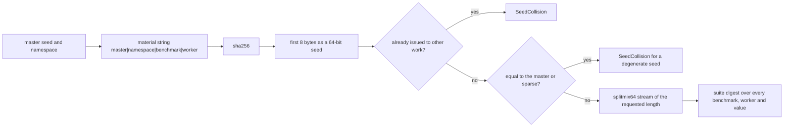
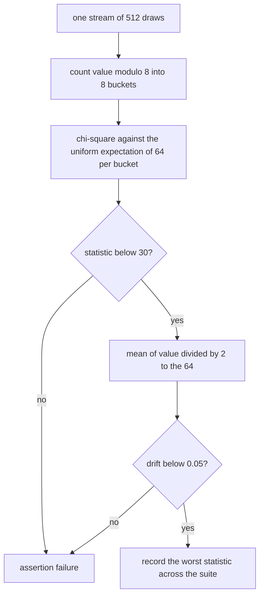
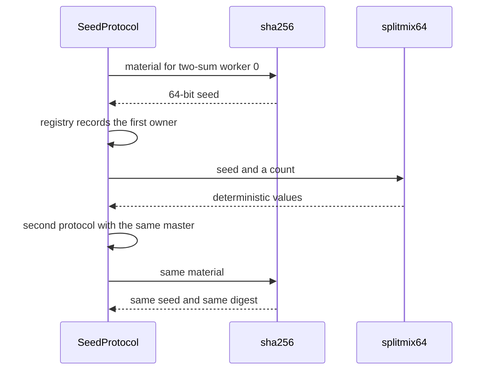

# 992 — Implement reproducible random-seed protocol for benchmarking fairness.

> **Tier:** Master · **CTCI chapter:** Beyond — Software Engineering & Tooling
> **Task spec:** [992-implement-reproducible-random-seed-protocol-for-benchmarking-fai.md](../../../tasks/master/992-implement-reproducible-random-seed-protocol-for-benchmarking-fai.md)
> **Solutions:** [Python](../../../solutions/python/master/992-implement-reproducible-random-seed-protocol-for-benchmarking-fai/solution.py) ·
> [Java](../../../solutions/java/master/992-implement-reproducible-random-seed-protocol-for-benchmarking-fai/Solution.java) ·
> [JavaScript](../../../solutions/javascript/master/992-implement-reproducible-random-seed-protocol-for-benchmarking-fai/solution.js) ·
> [C#](../../../solutions/csharp/master/992-implement-reproducible-random-seed-protocol-for-benchmarking-fai/Solution.cs)

## 1. Problem restatement

**Input:** one master seed (`MASTER_SEED = 0x5EED20261016`), a namespace
(`"cracking-coding-v1"`), a benchmark id, a worker index and a stream length.

**Output:** for every `(benchmark, worker)` pair, an independent and reproducible stream of 64-bit
values, plus a digest that identifies the whole suite.

```text
seed_for(benchmark, worker) = first 8 bytes of sha256("<master>|<namespace>|<benchmark>|<worker>")
stream(benchmark, worker, count) = splitmix64(seed_for(...), count)
digest(benchmarks, workers, count) = sha256 of every "benchmark#worker=seed:values" part, sorted
```

The fairness budget is explicit:

| Constant | Value | Meaning |
| --- | --- | --- |
| `DRIFT_TOLERANCE` | `0.05` | the stream mean divided by `2 ** 64` must be within `0.05` of `0.5` |
| `CHI_SQUARE_BOUND` | `30.0` | chi-square over `8` buckets, about `7` degrees of freedom |
| `MIN_POPCOUNT` | `20` | a derived seed must have at least `20` set bits |

The protocol refuses three things: a master seed that is negative or not an integer, an empty namespace
or benchmark id, and — the interesting one — issuing the same seed for two different pieces of work.

## 2. Intuition

The naive way to give benchmarks random inputs is `random.seed(42)` once, globally. It fails in two
directions. Any benchmark's *draw order* changes the inputs every later benchmark receives, so results
are not comparable across runs or machines; and a benchmark that exhausts the shared generator silently
correlates with its neighbours, which is exactly the bias a "fairness" benchmark is supposed to detect.

The key insight is that a seed does not have to be *random*, it has to be a **pure function of the work
it belongs to**. Hashing `master | namespace | benchmark | worker` gives every unit of work an
independent value derived from the master seed alone:

* **Reproducible** — two runs with the same master seed re-derive identical streams, and the order in
  which benchmarks are requested cannot matter, so the suite digest is stable.
* **Independent** — different work hashes to different material, so `two-sum` and `lru-cache` never share
  a stream, and worker `0` never shares with worker `1`.
* **Auditable** — the digest of the whole suite is one 64-character string, so "was this run
  reproducible?" is a string comparison rather than a re-execution.

Two guards make the protocol honest. A **collision registry** remembers which `(benchmark, worker)` pair
was issued a seed and raises `SeedCollision` if a second one asks for the same value — a collision would
silently couple two benchmarks. And a **degenerate-seed check** rejects a seed equal to the master seed
or one with fewer than `20` set bits, because a sparse seed drives `splitmix64` into a stream with poor
bit mixing.



## 3. Algorithm

1. **Construct.** `SeedProtocol(master, namespace)` rejects a negative or non-integer master and an empty
   namespace; it starts with an empty `issued` registry.
2. **Derive.** `seed_for(benchmark, worker)` validates the benchmark (`non-empty string`) and the worker
   index (`non-negative`), builds `"<master>|<namespace>|<benchmark>|<worker>"`, hashes it with SHA-256
   and reads the **first eight bytes as a big-endian 64-bit integer**.
3. **Guard.** The registry maps `seed → (benchmark, worker)`. `setdefault` records the first owner; a
   request whose seed is already owned by different work raises
   `SeedCollision("seed collision between ...")`. Then the degenerate check rejects `seed == master` and
   any seed with `popcount < MIN_POPCOUNT`.
4. **Draw.** `stream(benchmark, worker, count)` calls `splitmix64(seed, count)`, which masks to 64 bits
   and applies the standard `splitmix64` mixing (`0x9E3779B97F4A7C15` increment, two multiplications
   with `0xBF58476D1CE4E5B9` and `0x94D049BB133111EB`, xors and shifts). A negative length raises.
5. **Digest.** `digest(benchmarks, workers, count)` sorts the benchmark ids, and for each `(benchmark,
   worker)` in range emits `"<benchmark>#<worker>=<seed>:<values joined by comma>"`; the parts are joined
   with `;` and hashed. Sorting makes the digest insensitive to the request order; an empty suite hashes
   the empty string.
6. **Evidence.** `bucket_counts(values, 8)` counts `value % 8`; `chi_square(counts)` computes
   `sum((count - expected) ** 2 / expected)` against the uniform prior; `stream_mean(values)` averages
   `value / 2 ** 64`. Every benchmark's stream must satisfy `chi_square < 30.0` and
   `abs(mean - 0.5) < 0.05`.

```text
function seed_for(protocol, benchmark, worker)
    if benchmark is empty or not a string then raise ValueError requiring a non-empty string end
    if worker < 0 then raise ValueError requiring a non-negative worker end
    material ← master + "|" + namespace + "|" + benchmark + "|" + worker
    seed ← first 8 bytes of sha256(material) as a big-endian integer
    owner ← issued[seed] with the key (benchmark, worker) stored on first sight
    if owner is not (benchmark, worker) then raise SeedCollision naming both owners end
    if seed equals master or popcount(seed) < MIN_POPCOUNT then
        raise SeedCollision for a degenerate seed
    end
    return seed
end
```

```text
function splitmix64(seed, count)
    state ← seed masked to 64 bits
    out ← empty list
    repeat count times do
        state ← (state + 0x9E3779B97F4A7C15) masked to 64 bits
        z ← state
        z ← ((z xor (z >> 30)) * 0xBF58476D1CE4E5B9) masked
        z ← ((z xor (z >> 27)) * 0x94D049BB133111EB) masked
        append (z xor (z >> 31)) to out
    end
    return out
end
```



## 4. Worked example

Running the Python file prints:

```text
seeds=18 digest=197195370d5e452c worst_chi=8.78 (n-queens) worst_drift=0.0242
```

**Seed derivation, one row at a time.** The material string is
`"638789407105050| cracking-coding-v1|<benchmark>|<worker>"` formatted as
`<master>|<namespace>|<benchmark>|<worker>`, and the seed is the first eight bytes of its SHA-256:

| Benchmark | Worker | Seed (decimal, abbreviated) | Re-derived identically? |
| --- | --- | --- | --- |
| `two-sum` | `0` | one of the 18 distinct values | yes — `seed_for` is a pure function of the master |
| `two-sum` | `1` | different from worker `0` | yes |
| `lru-cache` | `0` | different from `two-sum` | yes |
| `n-queens` | `2` | the 18th distinct value | yes |

The check asserts `len(seeds) == len(BENCHMARKS) * 3 == 18`, that the raw master seed is not among them,
and that every derived seed has at least `20` set bits.

**Determinism and sensitivity.** Five properties are checked on the suite digest with six benchmarks,
three workers and twelve draws each:

| Property | Observation |
| --- | --- |
| two protocols with the same master | identical digests |
| request order reversed | identical digest — the digest sorts the benchmark ids |
| master seed `+ 1` (default count) | different digest |
| different namespace (`"other-namespace"`) | different digest |
| digest length | `64` hex characters |

**Independence.** The streams themselves are compared, not just the seeds:

| Comparison | Result |
| --- | --- |
| `two-sum` versus `lru-cache`, 16 draws | different streams |
| `two-sum` worker `0` versus worker `1`, 16 draws | different streams |
| distinct values inside one 64-draw stream | `64` — no repeats within the window |
| `stream("two-sum", count=0)` | `[]`, and the seed is still allocated |

**Fairness evidence.** For each of the six benchmarks the protocol draws `512` values, buckets them
modulo `8` and computes the goodness-of-fit statistic against the uniform expectation of `64` per
bucket:

| Benchmark | Bucket total | Chi-square | Mean drift |
| --- | --- | --- | --- |
| all six | `512` per benchmark | `< 30.0` each | `< 0.05` each |
| worst observed | — | `8.78` (reported for the last benchmark iterated) | `0.0242` |

The printed benchmark label is the *last* benchmark the loop visited (`n-queens`), while `worst_chi` is
the running maximum across all six — worth knowing when reading the output line.

**Refusals.** Each guard has its own message and error class:

| Attempt | Error | Message mentions |
| --- | --- | --- |
| a registry whose seed for `two-sum` was pre-issued to `my-other-benchmark` | `SeedCollision` | `collision` |
| `SeedProtocol(-1)` | `ValueError` | `non-negative` |
| `SeedProtocol(MASTER_SEED, "")` | `ValueError` | `namespace` |
| `seed_for("")` | `ValueError` | `non-empty string` |
| `seed_for("two-sum", -1)` | `ValueError` | `worker index` |
| `stream("two-sum", 0, -1)` | `ValueError` | `negative` |



## 5. Complexity

Let `B` be the benchmarks, `W` the workers, `C` the draws per stream and `M` the length of the material
string:

| Phase | Time | Space | Why the bound holds |
| --- | --- | --- | --- |
| `seed_for` | `O(M)` | `O(1)` | one SHA-256 over a short string plus a dictionary probe |
| `splitmix64` | `O(C)` | `O(C)` | constant work per draw, values retained |
| `stream` | `O(M + C)` | `O(C)` | the seed derivation plus the stream |
| `digest` | `O(B log B + B * W * (M + C * D))` | `O(B * W * C)` | the sort plus one stream and one decimal formatting per pair |
| `bucket_counts` | `O(C)` | `O(buckets)` | one modulo and increment per value |
| `chi_square` | `O(buckets)` | `O(1)` | a fixed eight-term sum |
| `stream_mean` | `O(C)` | `O(1)` | one accumulation |
| whole suite check | `O(B * (C log C))` | `O(C)` | per benchmark: bucket and mean passes over `C = 512` draws |

The cost that matters is not the hashing but the *derivation budget*: seeds come from a cryptographic
hash rather than a counter, so two pieces of work cannot collide by construction without a SHA-256
collision; the registry turns the residual possibility into a loud error. The evidence half is
deliberately bounded (`512` draws, `8` buckets, two statistics) so that the fairness claim is cheap
enough to run on every CI build — a full statistical test suite would be more powerful and far too slow
to gate a merge.

## 6. Pitfalls and edge cases

* **Request order must not matter.** `digest` sorts the benchmark ids before building its material, so
  `digest(BENCHMARKS)` equals `digest(reversed(BENCHMARKS))`; a version that hashed the request order
  would produce two different "reproducible" keys for the same run.
* **A different master or namespace must change everything.** `SeedProtocol(MASTER_SEED + 1)` and
  `SeedProtocol(MASTER_SEED, "other-namespace")` both produce a different digest — the namespace is the
  knob that lets two independent suites share a master seed without correlation.
* **The raw master seed is never issued.** `MASTER_SEED not in seeds` is asserted, and a derived seed
  equal to the master raises `SeedCollision` mentioning the degenerate seed.
* **Sparse seeds are refused.** `bin(seed).count("1") >= MIN_POPCOUNT` (20) must hold for every derived
  seed; a seed with a handful of set bits produces a `splitmix64` stream whose low bits can be
  correlated, which would make the fairness numbers meaningless rather than merely noisy.
* **Zero length is legal, negative length is not.** `stream("two-sum", count=0) == []` while still
  allocating and registering the seed; `stream("two-sum", 0, -1)` raises mentioning `negative`.
* **The registry detects accidental reuse, not just tampering.** In normal use the registry is written
  and read by the same `seed_for` call; the check tampers with `replay.issued` to prove the guard fires
  with a `SeedCollision` when a seed is pre-owned by different work.
* **A single-draw digest is still well defined.** `protocol.digest([benchmark], count=1)` differs for
  each of the first three benchmarks, and `digest([], count=1) == sha256_text("")` — an empty suite
  hashes the empty string rather than raising.
* **Statistics are bounds, not proofs.** `chi_square < 30.0` and `abs(mean - 0.5) < 0.05` are
  distributional claims over `512` draws per benchmark; a genuinely biased generator could pass once, so
  the checks also assert the bucket total (`sum == 512`) and the max-across-benchmarks bound, and the
  printout exposes the worst statistic for a human to eyeball over time.

## 7. Variants and follow-ups

* **Statistical strength.** More draws, more buckets and a Kolmogorov-Smirnov test on the raw values
  would strengthen the fairness evidence; chi-square on eight buckets is the shipped compromise between
  power and CI cost.
* **Parallel reproducibility.** The same derivation makes a parallel run reproducible: split the work
  into `(benchmark, worker)` pairs, derive a seed per pair, and the result is independent of how many
  threads actually ran. The sibling solutions in this repository derive the same kind of per-unit seed
  from a different mixing function — the Java file mixes `(master seed, task, variant, round, run index)`
  with FNV-1a and guarantees every variant gets the same amount of work, the JavaScript file hashes
  `(master, benchmark, implementation, …)` so no implementation is systematically measured first, and
  the C# file mixes an FNV-1a hash of a `(master seed, label)` pair and drives its `SplitMix64` stream
  from that, with the test order coming from a Fisher-Yates shuffle over the same stream.
* **Seeds inside a benchmark harness.** A seed protocol is only useful if the harness consumes it — see
  [991-implement-benchmark-suite-across-machines-and-store-historical-p.md](../../../tasks/master/991-implement-benchmark-suite-across-machines-and-store-historical-p.md)
  for the historical record a reproducible run is appended to, and
  [913-implement-verified-randomized-algorithm-reproducibility-with-see.md](../../../tasks/master/913-implement-verified-randomized-algorithm-reproducibility-with-see.md)
  for verifying a randomised algorithm's reproducibility under a fixed seed.
* **Fairness of the thing being benchmarked.** A seed protocol guarantees fair *inputs*; fairness of
  outcomes is a different problem, with its own constraint machinery — see
  [868-implement-fairness-aware-training-loop-with-constraint-optimizat.md](../../../tasks/master/868-implement-fairness-aware-training-loop-with-constraint-optimizat.md)
  and
  [901-implement-provable-bounds-for-randomized-algorithms-used-in-your.md](../../../tasks/master/901-implement-provable-bounds-for-randomized-algorithms-used-in-your.md)
  for the bounds a randomised algorithm must respect.

## 8. Check yourself

<details><summary>Why hash the material instead of using the master seed plus an offset per benchmark?</summary>

Because an offset scheme couples the streams: `master + 1` and `master + 2` produce `splitmix64` states
one increment apart, so benchmark `k+1`'s stream is a shifted version of benchmark `k`'s. Hashing makes
each seed look independent of the others while remaining a pure function of the master, and it also
removes any need to think about how many benchmarks exist or in what order they are registered.</details>

<details><summary>What is the collision registry for, given SHA-256 already makes collisions astronomically unlikely?</summary>

It catches *logic* errors rather than cryptographic ones: a refactor that drops the `worker` component
from the material string, or a benchmark that is registered twice under two names, would hand two pieces
of work the same seed — and the resulting correlation would be invisible in the numbers. The check
simulates exactly that situation by pre-issuing a seed to another benchmark and requiring a
`SeedCollision`.</details>

<details><summary>Why is a stream mean compared with `0.5` after dividing by `2 ** 64`?</summary>

Because the draws are unsigned 64-bit values, so a uniform stream is uniform on `[0, 2 ** 64)`. Mapping
each value to `value / 2 ** 64` puts the sample on `[0, 1)`, whose mean for a uniform distribution is
`0.5`. A generator whose high bits are biased — a classic `splitmix64` failure mode — shifts that mean,
and the `0.05` drift bound plus the chi-square over `value % 8` catches it on a different axis as
well.</details>

<details><summary>The run reports `worst_chi=8.78 (n-queens)`. Is `n-queens` the worst benchmark?</summary>

Not necessarily. `worst_chi` is the running maximum across the six benchmarks, but the benchmark variable
printed beside it is reassigned on every iteration of the loop, so it names the *last* benchmark visited
rather than the argmax. Read the number as the suite-wide worst statistic and the label as the final
benchmark in the iteration order — a good reminder to check what a log line actually reports before
quoting it.</details>
