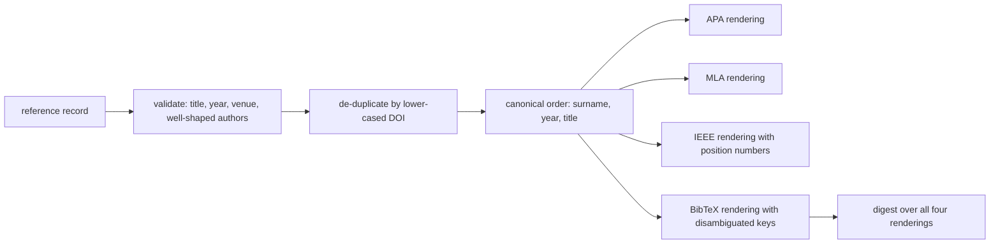
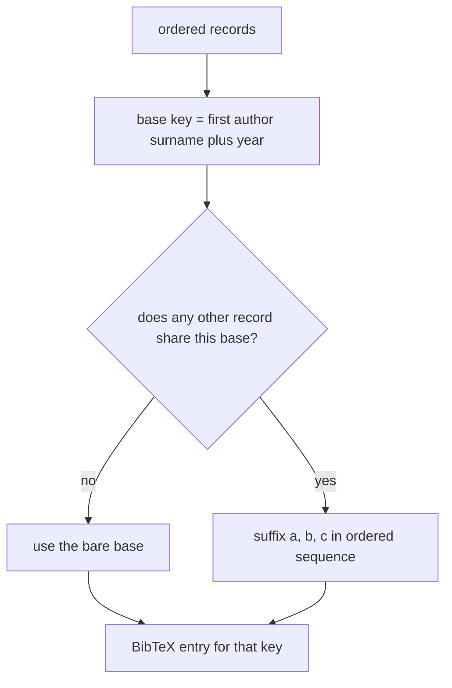
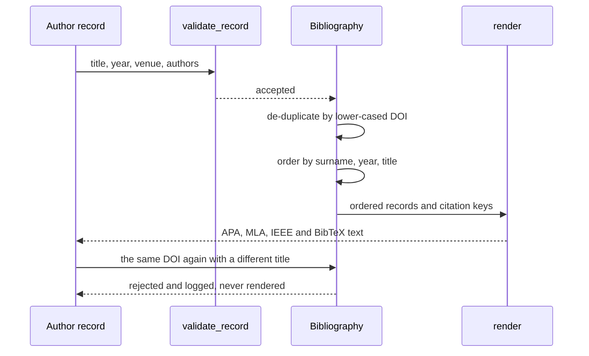

# 993 — Implement academic citation generator for editorial solutions with references.

> **Tier:** Master · **CTCI chapter:** Beyond — Software Engineering & Tooling
> **Task spec:** [993-implement-academic-citation-generator-for-editorial-solutions-wi.md](../../../tasks/master/993-implement-academic-citation-generator-for-editorial-solutions-wi.md)
> **Solutions:** [Python](../../../solutions/python/master/993-implement-academic-citation-generator-for-editorial-solutions-wi/solution.py) ·
> [Java](../../../solutions/java/master/993-implement-academic-citation-generator-for-editorial-solutions-wi/Solution.java) ·
> [JavaScript](../../../solutions/javascript/master/993-implement-academic-citation-generator-for-editorial-solutions-wi/solution.js) ·
> [C#](../../../solutions/csharp/master/993-implement-academic-citation-generator-for-editorial-solutions-wi/Solution.cs)

## 1. Problem restatement

**Input:** reference records. A record must carry a `title`, a `year`, a `venue`, and at least one
author with **both** a `given` and a `family` name; `volume`, `pages` and `doi` are optional:

```text
title  "Notes on the Analytical Engine"
year   1843        venue "Scientific Memoirs"        doi "10.1/abc"
volume "3"         pages "666-731"
authors  Ada Lovelace, Grace Hopper
```

**Output:** a bibliography that renders those records in four styles and de-duplicates them.

1. `add(record)` → validates, then rejects a repeat of an already-known DOI (case-insensitively).
2. `ordered()` → one canonical order, `(first author's surname, year, title)`.
3. `cite_keys()` → the BibTeX citation keys, derived from that same order.
4. `render(style)` → the APA, MLA, IEEE or BibTeX text; `digest()` covers all four renderings.

A citation key is `<surname><year>`, and it gets an `a`/`b`/`c` suffix **only** when the same first
author publishes more than once in the same year.

## 2. Intuition

The naive implementation generates each citation style independently, in whatever order the records
happen to arrive. It then produces a printed workbook whose IEEE numbers do not match the BibTeX keys,
and two reports of the same bibliography that differ because the input was a set.

The key insight is that **every style is a rendering of one canonical order**. Sort once, by
`(surname, year, title)`, and then:

* IEEE numbering is the *position* in that order, so `[1]` is always the earliest work;
* BibTeX keys are derived from that order too, so `lovelace1842a` and `lovelace1842b` reflect the
  alphabetical order of the two colliding titles rather than the order the records were added;
* the digest covers the four renderings in a fixed style order, so "same bibliography" is one string
  comparison.

The second insight is that **a citation is a structured claim that must be either complete or
rejected**. `validate_record` insists on title, year, venue and at least one properly-shaped author, so
a citation can never be rendered with a missing year or a surname-only author that would silently
become an empty initial. And because styles have their own quoting rules — BibTeX is brace-delimited,
MLA quotes the title — `sanitize` neutralises braces, converts double quotes to single ones and trims,
which is what keeps both styles parseable.



## 3. Algorithm

1. **Sanitise.** `sanitize(text)` replaces `{` with `(`, `}` with `)`, `"` with `'` and strips
   surrounding whitespace, so a title like `Curly {braces} and "quotes"` becomes
   `Curly (braces) and 'quotes'` in every style.
2. **Initials.** `initials(given)` splits on whitespace and hyphens and returns `X.` per part joined by
   spaces — `"Ada"` becomes `A.`, and a hyphenated given name produces two initials.
3. **Validate.** `validate_record` requires `title`, `year`, `venue` and `authors`, and every author
   must have both `family` and `given`, otherwise `ValueError`.
4. **Author lists, per style.**
   * APA: `"Lovelace, A., & Hopper, G."` — `Family, I.`, comma-separated, the last joined with `&`.
   * MLA: the first author is inverted (`Family, Given`), the rest are `Given Family`, joined with
     `and` (an Oxford `, and` before the last).
   * IEEE: `I. Family` for everyone, the last joined with `and`.
5. **Entries, per style.**
   * APA — `Authors (year). Title. Venue, volume, pages.` plus ` https://doi.org/<doi>`.
   * MLA — `Authors. "Title." Venue, vol. V, YEAR, pp. P.` with the optional parts omitted when absent.
   * IEEE — `[n] Authors, "Title," Venue, vol. V, pp. P, year.`
   * BibTeX — `@article{key,` then fields sorted alphabetically (`author`, `doi`, `journal`, `pages`,
     `title`, `volume`, `year`) as `  name = {value}` lines joined with commas, then `}`.
6. **De-duplicate.** `add` validates first, then compares the lower-cased DOI against every stored
   record; a repeat is appended to `self.duplicates` and returns `False` without storing anything.
7. **Order.** `ordered()` sorts by `(first author's family lower-cased, year, title lower-cased)`.
8. **Keys.** `cite_keys()` builds a base `<family><year>` per ordered record; a base that occurs once is
   used bare, otherwise each record gets `base + chr(ord("a") + index)` in ordered sequence.
9. **Render and digest.** `render(style)` raises `ValueError` for an unsupported style; `digest()` hashes
   `"\n".join("<style>|<rendering>")` over `STYLES = ("APA", "MLA", "IEEE", "BibTeX")`.

```text
function cite_keys(bibliography)
    ordered ← bibliography.ordered()
    bases ← [ lower(first author family) + year for each record in ordered ]
    seen ← empty map, keys ← empty map
    for each (record, base) in pairs(ordered, bases) do
        if count of base in bases equals 1 then
            keys[record.title] ← base
            continue
        end
        index ← seen[base] or 0
        seen[base] ← index + 1
        keys[record.title] ← base + character("a" + index)
    end
    return keys
end
```

```text
function bibtex_entry(record, key)
    fields ← map with author, title, journal and year
    for each optional in (volume, pages, doi) do
        if record has that field then add it to fields end
    end
    body ← join ",\n" of "  " + name + " = {" + fields[name] + "}" for name sorted
    return "@article{" + key + ",\n" + body + "\n}"
end
```



## 4. Worked example

Running the Python file prints:

```text
records=6 styles=4 duplicates=1 digest=474c194da314eb8e
```

**Exact renderings of the two-author record**, asserted byte for byte by the solution:

| Style | Rendered text |
| --- | --- |
| APA | `Lovelace, A., & Hopper, G. (1843). Notes on the Analytical Engine. Scientific Memoirs, 3, 666-731. https://doi.org/10.1/abc` |
| MLA | `Lovelace, Ada, and Grace Hopper. "Notes on the Analytical Engine." Scientific Memoirs, vol. 3, 1843, pp. 666-731.` |
| IEEE | `[1] A. Lovelace and G. Hopper, "Notes on the Analytical Engine," Scientific Memoirs, vol. 3, pp. 666-731, 1843.` |
| BibTeX | `@article{lovelace1843,` then `  author = {Lovelace, Ada and Hopper, Grace},`, `  doi = {10.1/abc},`, `  journal = {Scientific Memoirs},`, `  pages = {666-731},`, `  title = {Notes on the Analytical Engine},`, `  volume = {3},`, `  year = {1843}` then `}` |

Each of those is a single `check(...)` in the file, so any drift in punctuation, ordering or the
optional-field handling fails the build rather than quietly changing a printed workbook.

**The canonical order and the IEEE numbers**, over the six-record `alpha` library:

| Position | Record | Why it is here |
| --- | --- | --- |
| `1` | Babbage, 1832, `Difference Engine` | surname `babbage`, earliest year |
| `2` | Babbage, 1837, `On Engines` | same surname, later year |
| `3` | Lovelace, 1842, `Another Sketch` | surname `lovelace`, year `1842`, title sorts before `Sketch` |
| `4` | Lovelace, 1842, `Sketch` | same surname and year, later title |
| `5` | Zuse, 1941, `Plankalkuel` | surname `zuse` |
| `6` | Hopper, 1952, `Compiling Routines` | surname `hopper`, latest year |

The earliest entry leads both the order and the numbering: the check requires the first IEEE line to
start with `[1] A. Babbage,`.

**Citation keys**, derived from that same order:

| Record | Base | Key | Why |
| --- | --- | --- | --- |
| `Difference Engine` | `babbage1832` | `babbage1832` | unique base |
| `On Engines` | `babbage1837` | `babbage1837` | unique base |
| `Plankalkuel` | `zuse1941` | `zuse1941` | unique base |
| `Compiling Routines` | `hopper1952` | `hopper1952` | unique base |
| `Another Sketch` | `lovelace1842` | `lovelace1842a` | two records share the base; first in order gets `a` |
| `Sketch` | `lovelace1842` | `lovelace1842b` | second gets `b` |

**De-duplication and sanitisation.** Adding `dict(primary, title="A Verbatim Reprint", doi="10.1/ABC")`
returns `False`, appends `"10.1/abc"` to `duplicates`, leaves the record count unchanged and — the part
worth asserting — the reprint title does **not** appear in `render("APA")`. A title containing
`Curly {braces} and "quotes"` renders with balanced braces in BibTeX (`(braces)` appears, and the brace
counts are equal) and with single quotes in MLA (`'quotes'` present, `"quotes"` absent).



## 5. Complexity

Let `N` be the records, `A` the authors per record, `K` the number of citation keys and `T` the total
rendered length:

| Phase | Time | Space | Why the bound holds |
| --- | --- | --- | --- |
| `sanitize` / `initials` | `O(len(text))` | `O(len(text))` | one pass with a handful of replacements |
| `validate_record` | `O(A)` | `O(1)` | field presence plus one check per author |
| `add` | `O(N * len(doi))` | `O(1)` | compares the lower-cased DOI against every stored record |
| `ordered` | `O(N log N * A)` | `O(N)` | the sort key touches the first author and the title |
| `cite_keys` | `O(N^2)` | `O(N)` | `bases.count(base)` is a scan per record, plus the suffix table |
| `render` | `O(T)` | `O(T)` | string assembly per entry |
| `digest` | `O(T)` | `O(T)` | one join over the four renderings, then a hash |
| whole bibliography | `O(N^2 + T)` | `O(N + T)` | the key computation dominates for large bibliographies |

For a real editorial bibliography (`N` in the tens) the quadratic key pass is irrelevant; a
`Counter(bases)` would make it `O(N)`, and the trade-off is deliberate — the shipped version keeps the
key logic to two comprehensions so the a/b/c order is obvious from the code. The interesting design
choice is not the asymptotics but the *single order*: one sort drives numbering, keys and the printed
sequence, which is the property every rendering check is really testing. The sibling implementations
extend the same idea along different axes: the Java file also emits in-text markers such as
`(Knuth & Bentley, 1986)` and `(Cormen et al., 2009)` with web access dates, the JavaScript file keys
citations both numerically and by author-year with a/b disambiguation, and the C# file validates per
entry type and escapes special characters in its BibTeX-ish record.

## 6. Pitfalls and edge cases

* **Both given and family are mandatory.** An author with only `{"family": "B"}` raises
  `ValueError` mentioning `given and family`; a surname-only author would otherwise render as an empty
  initial in APA and IEEE.
* **`authors` may not be empty.** A record with `"authors": []` raises mentioning `authors`, and a
  record without a `year` (or `title`, or `venue`) raises mentioning that field — the message names the
  missing field and the record title (or `<untitled>`).
* **De-duplication is by DOI and case-insensitive.** `"10.1/ABC"` collides with `"10.1/abc"`, and the
  reported duplicate is the lower-cased form. Records *without* a DOI are never de-duplicated, which is
  a deliberate gap: two untitled-by-DOI reprints of the same paper are indistinguishable from two
  different papers.
* **The rendered order is one order for everything.** `ordered()` sorts by `(surname.toLowerCase(),
  year, title.toLowerCase())`, and the IEEE number, the BibTeX key suffix and the printed sequence all
  come from it, so a reviewer can never see two orders in one document.
* **Key suffixes follow the order, not the insertion order.** `Another Sketch` sorts before `Sketch` and
  therefore takes the `a` suffix; the checks pin the full key mapping rather than the suffix characters
  alone.
* **Only colliding bases get suffixes.** `babbage1832` and `babbage1837` differ, so both stay bare even
  though the same author appears twice — the suffix is about the *base*, not the author.
* **Unknown styles are refused.** `render("Chicago")` raises `ValueError` mentioning
  `unsupported style`; there is no silent fallback to a default style.
* **Sanitisation is neutralising, not escaping.** Braces become parentheses and double quotes become
  single quotes in all fields, so the BibTeX entry's brace counts match and MLA never contains a
  raw `"quotes"` pair inside its own quoted title.
* **Empty and single-record boundaries.** `empty.render("APA") == ""`, `empty.cite_keys() == {}`, and
  `empty.digest()` equals the SHA-256 of the four bare `"<style>|"` lines — an empty bibliography still
  has a well-defined digest. A lone record renders `[1] G. Hopper, …` in IEEE.

## 7. Variants and follow-ups

* **More styles and in-text markers.** APA, MLA, IEEE and BibTeX are the shipped four; a real editorial
  toolkit also needs in-text forms (`(Knuth, 1997)`, `(Knuth & Bentley, 1986)`, `(Cormen et al.,
  2009)`) and per-entry-type validation — both of which the Java and C# solutions in this repository
  implement, with BibTeX field escaping on top.
* **Author-list truncation.** The documented simplification prints author lists in full, with no
  `et al.` cutoff; a style-accurate generator truncates after a per-style threshold and switches to
  `et al.`.
* **Where the citations come from.** Recognising a contribution is the input side of the same workflow
  — see
  [985-implement-contribution-recognition-system-with-verified-citation.md](../../../tasks/master/985-implement-contribution-recognition-system-with-verified-citation.md)
  for verified citations and
  [994-implement-editorial-writing-assistant-that-drafts-explanations-p.md](../../../tasks/master/994-implement-editorial-writing-assistant-that-drafts-explanations-p.md)
  for the editorial draft the bibliography accompanies.
* **Licensing in generated documents.** A generated bibliography sits next to generated licence notices
  — see
  [986-implement-open-dataset-packaging-and-licensing-automation-for-pr.md](../../../tasks/master/986-implement-open-dataset-packaging-and-licensing-automation-for-pr.md)
  for attribution and compatibility in a published dataset.

## 8. Check yourself

<details><summary>Why do the IEEE numbers and the BibTeX keys both come from `ordered()`?</summary>

Because a reader who checks a claim in the body text follows it either to a numbered list or to a key,
and the two must refer to the same work. Deriving both from the single sort key
`(first author's surname, year, title)` makes that structural: there is no second ordering to drift.
The check asserts `alpha.render("IEEE").splitlines()[0].startswith("[1] A. Babbage,")` and the complete
key mapping, so both halves are pinned.</details>

<details><summary>`Another Sketch` gets `lovelace1842a` and `Sketch` gets `lovelace1842b`. Why not in insertion order?</summary>

Because the ordered sequence is the only stable tie-break: `Another Sketch` sorts before `Sketch`
alphabetically, so it comes first in `ordered()` and takes index `0` in the suffix table. Sorting the
suffixed keys by "who was added first" would make the bibliography depend on the order records were
loaded, which is exactly the class of non-reproducibility the single canonical order eliminates.</details>

<details><summary>What does `sanitize` change, and why does it apply to the venue as well as the title?</summary>

It replaces `{`→`(`, `}`→`)`, `"`→`'` and trims. Venues are quoted or braced in the same styles as
titles (`journal = {Scientific Memoirs}`, `"Scientific Memoirs,"`), so an unbalanced brace or an
unescaped quote in a venue would break a rendering exactly as it would in a title. Because the
replacement is applied at render time, the stored record keeps its original text — the manifest is
sanitised, the archive is not.</details>

<details><summary>Adding a record with a DOI already present returns `False` but does not raise. Why that choice?</summary>

Because a duplicate is a normal event in bibliography assembly — the same paper gets imported twice from
two databases — and the caller wants to continue with the rest of the batch. The record is logged in
`duplicates` so the import can be reported, and the check asserts both halves: the return value is
`False` **and** the duplicate never appears in `render("APA")`. A raise would force every caller to wrap
the call in a `try`.</details>
