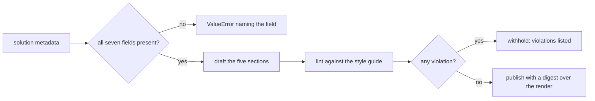
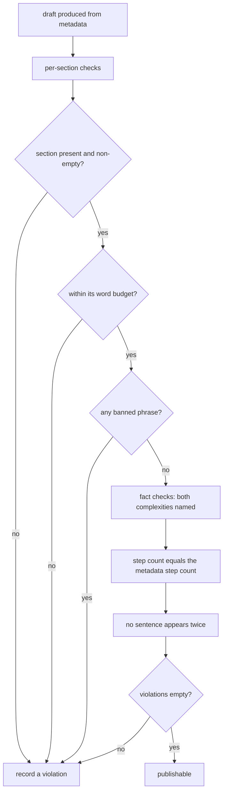
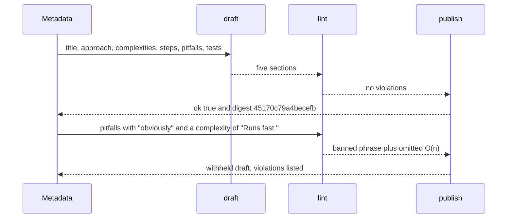

# 994 — Implement editorial writing assistant that drafts explanations per solution.

> **Tier:** Master · **CTCI chapter:** Beyond — Software Engineering & Tooling
> **Task spec:** [994-implement-editorial-writing-assistant-that-drafts-explanations-p.md](../../../tasks/master/994-implement-editorial-writing-assistant-that-drafts-explanations-p.md)
> **Solutions:** [Python](../../../solutions/python/master/994-implement-editorial-writing-assistant-that-drafts-explanations-p/solution.py) ·
> [Java](../../../solutions/java/master/994-implement-editorial-writing-assistant-that-drafts-explanations-p/Solution.java) ·
> [JavaScript](../../../solutions/javascript/master/994-implement-editorial-writing-assistant-that-drafts-explanations-p/solution.js) ·
> [C#](../../../solutions/csharp/master/994-implement-editorial-writing-assistant-that-drafts-explanations-p/Solution.cs)

## 1. Problem restatement

**Input:** a solution's metadata — the facts an editorial is written from:

```text
title "Two Sum"        approach "scan once with a hash map"
time_complexity "O(n)" space_complexity "O(n)"
steps  ["Build a hash map of values",
        "Look up the complement of each element",
        "Return the pair of indices"]
pitfalls ["Do not reuse one index twice", "Duplicates must still be matched"]
tests  12
```

**Output:** a five-section draft, a lint report, and a publish decision.

1. `draft(meta)` → the sections `summary`, `approach`, `complexity`, `pitfalls`, `verification`.
2. `lint(draft, meta)` → every style-guide violation the draft commits.
3. `publish(meta)` → `{draft, violations, ok, digest}`, where `ok` is `violations == []`.
4. `render(draft)` → the markdown the digest covers.

The style guide is a small constant table:

| Section | Word budget | Produced from |
| --- | --- | --- |
| `summary` | `40` | title and approach |
| `approach` | `120` | the numbered walkthrough steps |
| `complexity` | `40` | the two complexity strings |
| `pitfalls` | `80` | the pitfall bullets |
| `verification` | `40` | the scenario-test count |

plus `BANNED = ("obviously", "trivially", "everyone knows", "just ")` and the seven mandatory metadata
fields in `REQUIRED = ("title", "approach", "time_complexity", "space_complexity", "steps", "tests",
"pitfalls")`.

## 2. Intuition

The naive assistant generates prose and hopes. Two things then go wrong: the draft claims a complexity
the code does not have (or forgets to mention one entirely), and the walkthrough has three steps while
the solution has four — a mismatch a reader notices immediately and a maintainer does not.

The key insight is that **a draft can be derived from verified facts and then checked mechanically
against the same facts**. The metadata is the source of truth: the walkthrough is literally the numbered
list of `steps`, the complexity section must *contain* both complexity strings, and the verification
section quantifies the test count. Linting then re-reads the draft and asks whether it is consistent
with the metadata it was built from:

* **budgets** — a section over its word count is reported, not truncated;
* **banned filler** — `obviously`, `trivially`, `everyone knows`, `just ` are reported by section;
* **required facts** — both complexity strings must appear in the complexity section;
* **step count** — the enumerated items in the walkthrough must equal `len(meta["steps"])`;
* **duplicates and emptiness** — no section may be blank, and no sentence may appear twice.

The last piece is what makes the output publishable rather than merely generated: `publish` returns
`ok = not violations`, so a draft that fails the guide is *reported* instead of shipped, and the
caller can route it back to the author.



## 3. Algorithm

1. **Require the facts.** `draft` raises `ValueError("solution metadata is missing '<field>'")` for any
   field of `REQUIRED` that is absent, before producing anything.
2. **Assemble the sections** from templates, with no generation and no sampling:
   * `summary` — `"Solution for <title>: <approach>."`
   * `approach` — `"<n>. <step>"` for every step, joined by spaces, numbered from `1`.
   * `complexity` — `"Runs in <time> time and uses <space> extra space."`
   * `pitfalls` — `"- <pitfall>"` for every pitfall, joined by spaces.
   * `verification` — `"Covered by <tests> scenario tests."`
3. **Lint, section by section.** For each of `SECTIONS`: report a missing section, an empty section, a
   budget overrun (reported with the budget and the actual count) and every banned phrase found in the
   *lower-cased* text (reported with the phrase stripped of trailing spaces).
4. **Lint the required facts.** Both `meta["time_complexity"]` and `meta["space_complexity"]` must
   appear verbatim in the complexity section, else `"complexity section omits <value>"`.
5. **Lint the walkthrough.** `re.findall(r"(?:^| )(\d+)\. ", draft["approach"])` counts the enumerated
   items; a mismatch reports both numbers —
   `"walkthrough lists 1 steps but the solution has 3"`.
6. **Lint duplication.** `SENTENCE = re.compile(r"[^.;]+[.;]")` splits the concatenation of all sections
   into sentences, lower-cases and trims them, and any sentence occurring more than once is reported
   once (`for sentence in sorted(set(found))`).
7. **Publish.** `publish` returns the draft, the violations, `ok` and `digest(render(draft))`, where
   `render` writes `## <Section>` headings in `SECTIONS` order followed by the section text — so the
   digest changes when any section's words change.

```text
procedure lint(draft, meta)
    problems ← empty list
    for each section in SECTIONS do
        if section is not in draft then append "section … is missing" and continue end
        text ← draft[section]
        if text is blank then append "section … is empty" end
        if count of words in text > BUDGETS[section] then
            append "section … exceeds its budget" with both numbers
        end
        for each phrase in BANNED do
            if phrase is in lower-cased text then append "uses the banned phrase" end
        end
    end
    for each required in (meta.time_complexity, meta.space_complexity) do
        if required is not in draft.complexity then append "complexity section omits …" end
    end
    listed ← the numbered items found in draft.approach
    if length of listed is not length of meta.steps then append "walkthrough lists …" end
    for each sentence occurring more than once in all sections do
        append "duplicate sentence …"
    end
    return problems
end
```

```text
function render(draft)
    parts ← empty list
    for each section in SECTIONS do
        append ("## " + title case of section) to parts
        append draft[section] to parts
    end
    return join parts with newline
end
```



## 4. Worked example

Running the Python file prints:

```text
sections=5 words=60 digest=45170c79a4becefb ok=True
```

**The draft, section by section, with its word count.** The word regex is `[A-Za-z0-9'\-]+`, so a
standalone `-` bullet marker counts as a word and `O(n)` counts as two tokens (`O` and `n`):

| Section | Text | Words | Budget |
| --- | --- | --- | --- |
| `summary` | `Solution for Two Sum: scan once with a hash map.` | `10` | `40` |
| `approach` | `1. Build a hash map of values 2. Look up the complement of each element 3. Return the pair of indices` | `21` | `120` |
| `complexity` | `Runs in O(n) time and uses O(n) extra space.` | `11` | `40` |
| `pitfalls` | `- Do not reuse one index twice - Duplicates must still be matched` | `13` | `80` |
| `verification` | `Covered by 12 scenario tests.` | `5` | `40` |

`10 + 21 + 11 + 13 + 5 = 60`, the printed total, and every section is comfortably inside its budget —
which is why `ok=True`.

**The verification the draft gets, independently of the linter:**

| Property | Observation |
| --- | --- |
| sections produced | exactly `sorted(draft) == sorted(SECTIONS)` |
| the walkthrough enumerates every step once | `draft["approach"].startswith("1. Build a hash map")` and it contains three `". "` separators |
| both complexities named | `"O(n) time"` and `"O(n) extra space"` are present |
| digest equals the render | `published["digest"] == digest(assistant.render(draft))` |
| each step appears exactly once in the render | `rendered.count(step) == 1` for all three steps |
| the render is a heading plus a body per section | `len(rendered.splitlines()) == 2 * len(SECTIONS) == 10` |
| determinism | `assistant.publish(meta) == published` |

**Every violation the linter can report**, each checked on a mutated draft:

| Mutation | Reported problem |
| --- | --- |
| `summary` padded to exactly `40` words | none — the boundary is inclusive |
| `summary` padded to `41` words | `section summary exceeds its 40-word budget (41 words)` |
| `pitfalls` gains `- obviously this is fast` | `section pitfalls uses the banned phrase 'obviously'` |
| `complexity` replaced with `Runs fast.` | `complexity section omits O(n)` |
| `approach` reduced to one step | `walkthrough lists 1 steps but the solution has 3` |
| `pitfalls` set to `- Match duplicates. - Match duplicates.` | `duplicate sentence 'match duplicates.'` |
| metadata without `steps` | `ValueError` — `solution metadata is missing 'steps'` |
| `bare` metadata with `steps = []` | the draft has an empty `approach` section, so `"approach is empty"` is reported and `ok` is `False` |

Note the sentence comparison is case-insensitive and punctuation-preserving: `SENTENCE` captures up to
the terminating `.` or `;`, and each captured sentence is trimmed and lower-cased before the duplicate
scan, which is why the two `Match duplicates.` bullets collide.



## 5. Complexity

Let `S = 5` sections, `W` the words in the draft, `T` the metadata strings, `N` the steps and `V` the
sentences:

| Phase | Time | Space | Why the bound holds |
| --- | --- | --- | --- |
| `draft` | `O(T + N)` | `O(T + N)` | pure template assembly over the metadata |
| per-section lint | `O(S * W)` | `O(1)` | the word regex and the banned-phrase scan are linear per section |
| complexity check | `O(len(draft))` | `O(1)` | two substring tests |
| step-count check | `O(len(approach))` | `O(N)` | one regex over the walkthrough |
| duplicate scan | `O(V log V)` | `O(V)` | build the sentence list, sort the unique set, count occurrences |
| `render` | `O(W)` | `O(W)` | heading plus body per section |
| `publish` | `O(W log V)` | `O(W)` | drafting, linting and one in-memory render per call |

The lint is deliberately `O(W)` per rule rather than a single clever pass: each rule is a separate,
readable check that reports its own message, and the draft is a few dozen words. The substantive design
choice is that linting is a **separate pass over the produced text** rather than a set of guards inside
`draft` — so a human who edits the draft by hand can run `lint` on the edited version, which is exactly
what the checks do for the padding, filler, complexity and duplicate cases. The sibling implementations
choose different assembly strategies for the same guard: the Java file groups outline points into the
canonical sections, de-duplicates them and sorts them by priority before phrasing, the JavaScript file
picks phrasing by the task's tags, and the C# file selects a phrasing variant per section from a seeded
`splitmix64` stream so identical facts always produce an identical draft.

## 6. Pitfalls and edge cases

* **The budget boundary is inclusive.** Exactly `BUDGETS["summary"] = 40` words is accepted; `41` is
  reported with both numbers. The check builds those two drafts explicitly, so an off-by-one in the
  comparison is caught.
* **A `-` bullet marker counts as a word.** `pitfalls` reports `13` words although it contains eleven
  words of prose, because the word regex admits a bare hyphen. Anything that assumes
  "words = prose words" will be one or two off — which is why a budget of `80` for two bullets is not
  as roomy as it looks.
* **Banned phrases are matched case-insensitively and `just ` has a trailing space.** The phrase list
  includes `"just "` (with the space) so that `justify` is not flagged, and the comparison uses the
  lower-cased section text.
* **Complexity is checked by substring, not by equality.** The section must *contain*
  `meta["time_complexity"]` and `meta["space_complexity"]`; a draft that says `Runs in O(n log n) time`
  passes for an `O(n)` solution, which is a real limitation of the shipped rule and precisely why the
  exact-string checks (`"O(n) time" in draft["complexity"]`) live in the test harness as well.
* **The step count is counted from the text.** `re.findall(r"(?:^| )(\d+)\. ", approach)` only counts
  items that are preceded by a space or the start of the section, so renaming the numbering style
  silently changes the count — a walkthrough written as `Step 1` would be reported as zero steps.
* **An empty walkthrough is a publishable refusal, not an error.** `steps = []` drafts an empty
  `approach` section; the linter reports `approach is empty` and `publish` returns `ok = False` rather
  than raising, so the assistant can present the problem to the author.
* **Missing metadata raises before drafting.** `draft` filters `REQUIRED` up front, so a missing
  `steps` key fails with the field name instead of a `KeyError` deeper in the template.
* **Determinism covers the digest.** `publish(meta) == published` on a second call, and editing one step
  changes the digest — the digest is over the rendered markdown, so it is sensitive to exactly the text
  a reader sees.

## 7. Variants and follow-ups

* **Phrasing variants.** The documented simplification is rule-based assembly with no language model and
  one template per section; a richer assistant picks among several phrasings — by tags (JavaScript), by
  priority-sorted outline points (Java), or deterministically from a seeded stream (C#) — while keeping
  the same fact-checking lint.
* **Fact provenance.** The C# solution's templates declare which fact ids they consume, so a template
  cannot silently ignore a verified fact; that is the natural next step after "the draft must name both
  complexities".
* **Where the facts come from.** Complexity, step lists and test counts are extracted from the solution
  itself; see
  [973-implement-automated-hint-generator-using-solved-solution-decompo.md](../../../tasks/master/973-implement-automated-hint-generator-using-solved-solution-decompo.md)
  and
  [974-implement-step-by-step-solution-explainer-generator-using-ast-of.md](../../../tasks/master/974-implement-step-by-step-solution-explainer-generator-using-ast-of.md)
  for the decomposition and AST-based explainer halves of the same pipeline.
* **The draft as a trace.** Once an editorial is written, learners want the algorithm stepped through —
  see
  [995-implement-interactive-visualization-generator-for-algorithm-step.md](../../../tasks/master/995-implement-interactive-visualization-generator-for-algorithm-step.md)
  for the frame model that turns a walkthrough into a playable trace.

## 8. Check yourself

<details><summary>Why does `lint` re-read the draft instead of validating the metadata it was built from?</summary>

Because the draft is the artefact that gets published — and a human may edit it. Every rule is a claim
about the *text*: no section over budget, no banned phrase, both complexities present, the enumerated
items matching the solution, no repeated sentence. Running `lint` on an edited draft is exactly how the
checks exercise the rules (padding the summary, injecting `obviously`, replacing the complexity line),
which would be impossible if the rules were guards inside `draft`.</details>

<details><summary>The printed word count is 60, but the pitfalls section has eleven words of prose. Where do the other two come from?</summary>

The `-` bullet markers. `WORD = re.compile(r"[A-Za-z0-9'\-]+")` includes the hyphen, so each leading
`- ` contributes one token: `11 + 2 = 13` for that section, and `10 + 21 + 11 + 13 + 5 = 60` overall.
`O(n)` contributes two tokens (`O` and `n`) for the same reason — the regex splits on the parentheses.</details>

<details><summary>A draft says `Runs in O(n log n) time and uses O(n) extra space` for a solution whose time complexity is `O(n)`. Does the lint catch it?</summary>

Not this lint: the rule is a substring test, `required in complexity`, and `"O(n)"` is a substring of
`"O(n log n) time"`, so the section passes. The harness catches the *missing* case (`Runs fast.` fails
for `O(n)`) and the exact rendering of the real draft, but a wrong-but-superset complexity string slips
through. Fixing it means parsing complexity classes rather than matching strings.</details>

<details><summary>What exactly does `publish` return when the linter finds a violation?</summary>

The same four keys — `draft`, `violations`, `ok`, `digest` — with `ok = False` and a non-empty
`violations` list. Nothing is raised, so a caller can show the author the draft and the reasons side by
side, which is what the check on `bare` metadata demonstrates: an empty walkthrough yields
`ok = False` and a violation mentioning `approach is empty`.</details>
