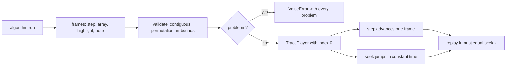
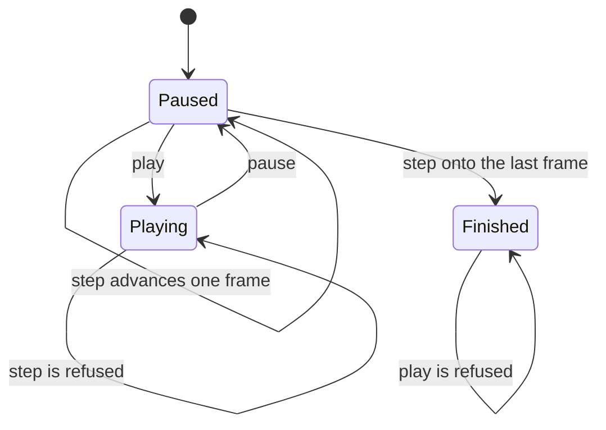
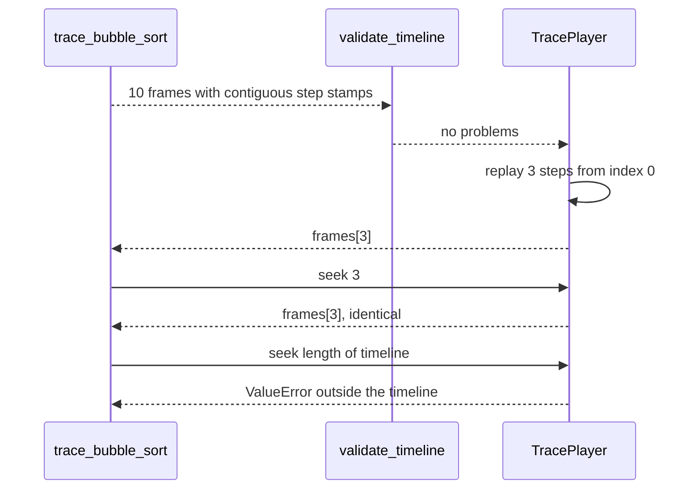

# 995 — Implement interactive visualization generator for algorithm steps (trace player).

> **Tier:** Master · **CTCI chapter:** Beyond — Software Engineering & Tooling
> **Task spec:** [995-implement-interactive-visualization-generator-for-algorithm-step.md](../../../tasks/master/995-implement-interactive-visualization-generator-for-algorithm-step.md)
> **Solutions:** [Python](../../../solutions/python/master/995-implement-interactive-visualization-generator-for-algorithm-step/solution.py) ·
> [Java](../../../solutions/java/master/995-implement-interactive-visualization-generator-for-algorithm-step/Solution.java) ·
> [JavaScript](../../../solutions/javascript/master/995-implement-interactive-visualization-generator-for-algorithm-step/solution.js) ·
> [C#](../../../solutions/csharp/master/995-implement-interactive-visualization-generator-for-algorithm-step/Solution.cs)

## 1. Problem restatement

**Input:** an algorithm run to instrument — the shipped tracer covers bubble sort and binary search —
and, for the player, a timeline of frames.

A frame is `{step, array, highlight, note}`: the step index, the *whole* array as a tuple, the cells to
highlight, and a note (`"start"`, `"compare"`, `"swap"` or `"probe"`). Binary-search frames additionally
carry the `low` and `high` bounds of that probe.

**Output:** a playable trace.

1. `trace_bubble_sort(values)` → one frame per comparison, plus a start frame.
2. `trace_binary_search(values, target)` → one frame per probe, plus the located index (or `None`).
3. `validate_timeline(frames)` → every defect that would make seeking lie.
4. `TracePlayer(frames)` → `play`, `pause`, `step`, `seek` and `replay` over a validated timeline.
5. `timeline_digest(frames)` → a digest over `step|array|highlight|note` for every frame.

The player's state rules are strict: stepping is only legal while paused, `play` is illegal on an
already-playing player or at the final frame, and `seek` is refused outside the timeline.

## 2. Intuition

The naive visualiser re-runs the algorithm and animates it. The moment the learner drags the progress
bar backwards, the animation must re-execute from the start — so scrubbing is `O(n)` per frame, and any
nondeterminism in the algorithm shows up as a flicker.

The key insight is that **a frame is a complete description of one moment, so the timeline is data**.
Once the frames are recorded, playback is array indexing: `seek(k)` is `frames[k]`, and stepping forward
is `index += 1`, both `O(1)` — no re-execution, no dependence on the algorithm's internals.

That only works if the timeline is *consistent*, and consistency is three properties that can be checked
before the first frame is drawn:

1. **contiguity** — `frames[i]["step"] == i`, so a seek target is a frame index;
2. **permutation** — every frame's array is a permutation of the start state, so no step invents or
   destroys an element (a swap that drops a value would render as a plausible-looking wrong answer);
3. **in-bounds highlights** — every highlighted index points inside the array, so a renderer can colour
   cells without a guard.

With those three checked, **step versus seek equivalence** is the interactive guarantee worth asserting:
replaying `k` steps from the start must land on exactly the frame `seek(k)` returns, which is what makes
the scrub bar and the play button agree.



## 3. Algorithm

1. **Instrument.** `trace_bubble_sort` walks the shrinking unsorted prefix, emitting one frame per
   comparison; a swap frame shows the array *after* the swap with both cells highlighted, a compare frame
   shows the array unchanged. If a pass performs no swap the loop breaks early. `frame(0, values, (),
   "start")` is emitted first, so a timeline of `C` comparisons has `C + 1` frames.
2. **Instrument the search.** `trace_binary_search` sorts the input, then emits one `"probe"` frame per
   iteration carrying `low`, `high` and the probed `middle`; it returns `(frames, found)` where `found`
   is the located index or `None`.
3. **Validate.** `validate_timeline` returns a list of problems: `"timeline is empty"` for no frames;
   `"frame i is stamped j"` when `step != index`; `"frame i is not a permutation of the start state"`
   when `sorted(array)` differs from the sorted start state; and `"frame i highlights a cell outside the
   array"` when any highlight is negative or past the end.
4. **Digest.** `timeline_digest` joins `"<step>|<array>|<highlight>|<note>"` per frame with `;` and
   hashes the result, so two runs of the same input produce the same digest and a different input does
   not.
5. **Diff.** `diff(left, right)` brute-force compares positions and returns the indices whose value
   changed — an oracle for "which cells did this run actually touch".
6. **Play.** `TracePlayer.__init__` validates and raises `ValueError("invalid timeline: ...")` listing
   every problem; otherwise it holds `frames`, `index = 0` and `playing = False`. `play` refuses when
   already playing or already finished; `pause` refuses when not playing; `step` refuses while playing
   and raises `IndexError` at the last frame; `seek` rejects targets outside `[0, len(frames))`;
   `replay(count)` seeks to `0` and steps `count` times.

```text
function validate_timeline(frames)
    problems ← empty list
    if frames is empty then return [ "timeline is empty" ] end
    expected ← sorted contents of the first frame array
    for index, item in enumerate(frames) do
        if item.step is not index then append "frame index is stamped item.step" end
        if sorted(item.array) is not expected then append "frame index is not a permutation" end
        if any cell in item.highlight is outside 0 .. length(item.array) − 1 then
            append "frame index highlights a cell outside the array"
        end
    end
    return problems
end
```

```text
procedure step(player)
    if player.playing then raise RuntimeError requiring a pause end
    if player.index + 1 >= length(player.frames) then raise IndexError for the last frame end
    player.index ← player.index + 1
    return player.frames[player.index]
end

procedure replay(player, count)
    seek(player, 0)
    repeat count times do step(player) end
    return player.frames[player.index]
end
```



## 4. Worked example

Tracing `values = [5, 1, 4, 2, 8]` produces ten frames; the run prints:

```text
frames=10 swaps=4 probes=4 found=12 digest=f79c207334a2bd91
```

**The bubble-sort timeline, frame by frame.** The outer loop runs `end = 4, 3, 2` and stops early because
the third pass swaps nothing:

| Frame | `step` | Array after the frame | Highlight | Note |
| --- | --- | --- | --- | --- |
| `1` | `0` | `[5, 1, 4, 2, 8]` | `()` | `start` |
| `2` | `1` | `[1, 5, 4, 2, 8]` | `(0, 1)` | `swap` (5 > 1) |
| `3` | `2` | `[1, 4, 5, 2, 8]` | `(1, 2)` | `swap` (5 > 4) |
| `4` | `3` | `[1, 4, 2, 5, 8]` | `(2, 3)` | `swap` (5 > 2) |
| `5` | `4` | `[1, 4, 2, 5, 8]` | `(3, 4)` | `compare` (5 < 8) |
| `6` | `5` | `[1, 4, 2, 5, 8]` | `(0, 1)` | `compare` (1 < 4) |
| `7` | `6` | `[1, 2, 4, 5, 8]` | `(1, 2)` | `swap` (4 > 2) |
| `8` | `7` | `[1, 2, 4, 5, 8]` | `(2, 3)` | `compare` (4 < 5) |
| `9` | `8` | `[1, 2, 4, 5, 8]` | `(0, 1)` | `compare` (1 < 2) |
| `10` | `9` | `[1, 2, 4, 5, 8]` | `(1, 2)` | `compare` (2 < 4) |

Four swaps and five compares make nine comparison frames plus the start frame: `10`, the printed count.
The swap count is checked against an independent oracle — `count_inversions` — because bubble sort
performs exactly one swap per inverted pair, and `[5, 1, 4, 2, 8]` has four inversions
(`(5,1)`, `(5,4)`, `(5,2)`, `(4,2)`). The last frame equals `sorted(values)`, every intermediate frame is
a permutation of the start state, and `diff(frames[0], frames[-1])` returns `[0, 1, 3]` — the positions
that actually changed.

**The binary-search probes.** Searching for `13` in `1..16` (`n = 16`):

| Probe | `low` | `high` | `middle` | Value | Note |
| --- | --- | --- | --- | --- | --- |
| `1` | `0` | `15` | `7` | `8` | too small, raise `low` |
| `2` | `8` | `15` | `11` | `12` | too small, raise `low` |
| `3` | `12` | `15` | `13` | `14` | too large, lower `high` |
| `4` | `12` | `13` | `12` | `13` | found at index `12` |

Four probes — the printed `probes=4`, `found=12` — against a bound of
`ceil(log2(n + 1)) + 1 = ceil(log2 17) + 1 = 6`. A miss (`target = 100`) uses five probes against
`ceil(log2 17) = 5` and returns `None`, and the final frame of a hit highlights the located index.

**Validation and the player.** Tampering is detected rather than animated:

| Tamper | `validate_timeline` reports | `TracePlayer` |
| --- | --- | --- |
| frame `2`'s array has its last element replaced by `99` | `is not a permutation of the start state` | raises `invalid timeline` |
| frame `3`'s `step` set to `99` | `frame 3 is stamped 99` | raises `invalid timeline` |
| `TracePlayer([])` | `timeline is empty` | raises `invalid timeline` |

And the interactive guarantees: `player.replay(1)`, `player.replay(3)` and `player.replay(5)` each equal
`timeline[1]`, `timeline[3]` and `timeline[5]` — stepping and seeking agree — while
`seek(len(timeline))` and `seek(-1)` raise about being `outside the timeline`, and `step()` at the last
frame raises `IndexError`. The state machine adds `pause` before `play` (RuntimeError), a second `play`
(`already playing`), a `step` while playing (`pause the player before stepping`) and a `play` at the end
(`already finished`).



## 5. Complexity

Let `N` be the array length, `C` the comparisons the sort performs, `P` the probes a search performs and
`F` the frames:

| Phase | Time | Space | Why the bound holds |
| --- | --- | --- | --- |
| `frame` | `O(N)` | `O(N)` | the array is snapshotted as a tuple per frame |
| `trace_bubble_sort` | `O(C * N)` | `O(C * N)` | one copy of the array per frame, plus the sort's own comparisons |
| `count_inversions` | `O(N^2)` | `O(1)` | double loop over pairs |
| `trace_binary_search` | `O(N log N + P)` | `O(P * N)` | one sort, then a frame per probe |
| `validate_timeline` | `O(F * N log N)` | `O(N)` | each frame's array is sorted to compare with the start state |
| `timeline_digest` | `O(F * N)` | `O(F * N)` | the joined body is linear in the frames |
| `TracePlayer.step` / `seek` | `O(1)` | `O(1)` | array indexing — the whole point of the design |
| `replay(k)` | `O(k)` | `O(1)` | `k` constant-time steps |

The asymmetry is the design: recording is `O(C * N)` because every frame carries a full snapshot, while
playback is `O(1)` because a frame is addressed by index. That trade is what makes scrubbing feel
instantaneous, and it also explains why production generators compress: the JavaScript solution stores
only per-frame *deltas* and walks the trace with an undo log, the C# solution stores keyframes every `K`
steps plus deltas and reconstructs any frame by loading the nearest keyframe, and the Java solution
tracks the sorted prefix or partition window instead of the whole array. All three keep the same
contract — a frame addressed by index must be reproducible — which is what `validate_timeline` and the
step-versus-seek check enforce here.

## 6. Pitfalls and edge cases

* **A single-element and an empty input each produce exactly one frame.** `trace_bubble_sort([7])` is one
  frame whose array is `(7,)`; `trace_bubble_sort([])` is one frame whose array is `()` — the outer loop
  `range(len(array) - 1, 0, -1)` never runs. `trace_binary_search([], 1)[1] is None`, since `low = 0` is
  already greater than `high = -1`.
* **An empty timeline is rejected, not silently playable.** `TracePlayer([])` raises
  `ValueError("invalid timeline: timeline is empty")`; without that, `current()` would be an
  `IndexError` waiting to happen on the first render.
* **Ties in the sort are not relevant here, but permutation order is.** Validation compares
  `sorted(array)` with `sorted(start)`, so a timeline that legitimately contains duplicates is fine,
  while one that changes a value is not.
* **Highlights are validated, not clamped.** A highlight of `-1` or `len(array)` is a hard problem in
  `validate_timeline`, so the renderer never has to guess.
* **Stepping while playing is an error.** It is the most common animation bug — two sources of truth for
  the position — so `step` raises `RuntimeError("pause the player before stepping")` and the check
  exercises it.
* **The end of the timeline is an `IndexError`, not a no-op.** `step()` raises
  `IndexError("the player is at the last frame")`; a silent clamp would hide a renderer that keeps
  requesting frames after the trace ends.
* **`play` on an already-finished player is refused.** The check seeks to the last frame and requires a
  `RuntimeError` mentioning `already finished`, which is the state a UI must map to a "replay"
  affordance.
* **Determinism includes the digest.** `timeline_digest(trace_bubble_sort(values))` equals the recorded
  timeline's digest, while the same trace on `[5, 1, 4, 2, 7]` differs — one character of input changes
  one frame and therefore the digest.
* **A snapshot per frame is memory-hungry.** Frames hold whole arrays, so a long trace on a large array
  is quadratic in memory; that is the documented trade against `O(1)` seeking, and the reason the
  sibling implementations keep deltas.

## 7. Variants and follow-ups

* **Other algorithms and other frame shapes.** Bubble sort and binary search are the shipped two; the
  Java solution instruments insertion sort (tracking the sorted prefix) and quicksort (tracking the
  partition window plus pivot), each with a memory cap. The frame contract — index-addressed,
  permutation-preserving, in-bounds highlight — is what stays constant.
* **Compression.** Storing deltas instead of snapshots (JavaScript, with an undo log for backward
  playback) or keyframes plus deltas (C#) keeps the same seek guarantee with far less memory.
* **What the trace visualises.** A trace is the animated form of an editorial walkthrough — see
  [994-implement-editorial-writing-assistant-that-drafts-explanations-p.md](../../../tasks/master/994-implement-editorial-writing-assistant-that-drafts-explanations-p.md)
  for the draft whose steps become frames and
  [974-implement-step-by-step-solution-explainer-generator-using-ast-of.md](../../../tasks/master/974-implement-step-by-step-solution-explainer-generator-using-ast-of.md)
  for the AST-based explainer that produces such steps.
* **Where the frames are served.** A trace player is a browser component in production; the packaging and
  offline story for shipping it to learners is covered by
  [989-implement-offline-mode-packaging-so-learners-can-download-proble.md](../../../tasks/master/989-implement-offline-mode-packaging-so-learners-can-download-proble.md).
* **Determinism of the traced algorithm.** A timeline is only reproducible if the instrumented algorithm
  is; a randomised algorithm needs the seed protocol of
  [992-implement-reproducible-random-seed-protocol-for-benchmarking-fai.md](../../../tasks/master/992-implement-reproducible-random-seed-protocol-for-benchmarking-fai.md)
  before its frames can be replayed.

## 8. Check yourself

<details><summary>Why is seek-versus-step equivalence the property worth asserting?</summary>

Because a seek is *implemented* as an index assignment while a step is implemented as an increment, and
the two must agree for the scrub bar to be trustworthy. If the timeline were re-executed on seek — the
naive design — the equality would depend on the algorithm being deterministic; with frames as data it is
structural, and the check (`player.replay(target) == timeline[target]` for several targets) pins it.</details>

<details><summary>What would a permutation violation look like in practice, and why is it so important?</summary>

A swap that loses an element: `array[position], array[position + 1] = array[position + 1]` (one side
dropped) or a highlight-driven "move" that overwrites rather than swaps. The rendered frames would still
look like a sort in progress, and the final frame might even look sorted, which is why the invariant is
checked at every frame against the *start state*, not against the previous frame. Sorting both sides
means the check is about the multiset of values, not their order.</details>

<details><summary>The swap frames equal four, and the inversion count is also four. Is that a coincidence?</summary>

No — it is the reason bubble sort is the shipped example. A single pass of adjacent swaps removes exactly
one inversion per swap and never creates one, so the total number of swaps over the whole run equals the
number of inverted pairs in the input. `count_inversions` is therefore an independent oracle for the
trace's `"swap"` frames, which is much stronger than counting frames.</details>

<details><summary>Why does the bubble trace stop after two comparisons in the third pass?</summary>

Because the inner loop tracks a `swapped` flag: the third pass compares `1 < 2` and `2 < 4`, performs no
swap, and then breaks out of the outer loop. The array is already sorted, so continuing would add frames
that show nothing changing — nine comparison frames instead of many more, and the last frame is still
`sorted(values)`.</details>
