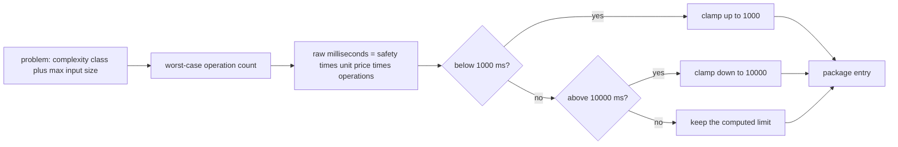
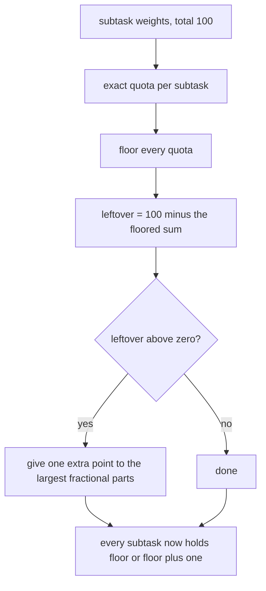
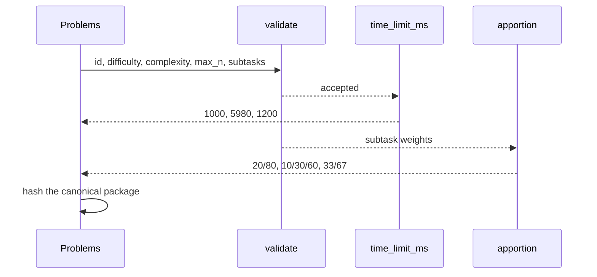

# 996 — Implement layer that converts problems into contest-ready format (time limits, scoring).

> **Tier:** Master · **CTCI chapter:** Beyond — Software Engineering & Tooling
> **Task spec:** [996-implement-layer-that-converts-problems-into-contest-ready-format.md](../../../tasks/master/996-implement-layer-that-converts-problems-into-contest-ready-format.md)
> **Solutions:** [Python](../../../solutions/python/master/996-implement-layer-that-converts-problems-into-contest-ready-format/solution.py) ·
> [Java](../../../solutions/java/master/996-implement-layer-that-converts-problems-into-contest-ready-format/Solution.java) ·
> [JavaScript](../../../solutions/javascript/master/996-implement-layer-that-converts-problems-into-contest-ready-format/solution.js) ·
> [C#](../../../solutions/csharp/master/996-implement-layer-that-converts-problems-into-contest-ready-format/Solution.cs)

## 1. Problem restatement

**Input:** authored problems and their declared shape.

```text
two-sum          difficulty 1   O(n)        max_n 1_000_000   subtasks n-squared 2, linear 8
dijkstra         difficulty 4   O(n log n)  max_n 1_000_000   subtasks small 1, medium 3, full 6
matrix-multiply  difficulty 5   O(n^2)      max_n 2_000       subtasks tiny 1, full 2
```

**Output:** a contest package.

1. a **time limit** per problem, derived from the declared complexity class and the maximum input size
   and clamped into the platform window `[1000, 10000]` ms;
2. a **points apportionment** over the subtasks that always sums to exactly `100`;
3. a **contest order** with the short names `A`…`Z`, sorted by difficulty then id;
4. rejections with a specific message for any problem that cannot be made fair.

The cost model has three constants: `UNIT_MS = 10` milliseconds per 100 000 elementary operations on the
nominal reference machine, `SAFETY = 3` as headroom over the worst case, and the window above.

## 2. Intuition

The naive contest converter copies the author's suggested time limit — usually whatever felt right on
the author's laptop. A problem whose declared worst case is `O(n log n)` at `n = 10^6` then gets a limit
two orders of magnitude too small, and dozens of correct submissions time out.

The key insight is that **the declared complexity class plus the maximum input size is a worst-case
operation count, and an operation count times a machine price is a time limit**:

```text
operations = the class evaluated at max_n     (1, n, log2 n, n log2 n, n^2)
raw_ms     = SAFETY * UNIT_MS * operations / 100_000
limit_ms   = clamp(ceil(raw_ms), 1000, 10000)
```

The clamp is what makes the model usable rather than pedantic: an `O(n)` problem at `n = 10^6` computes
`300` ms, which is below any meaningful platform minimum, so it is raised to `1000`; a quadratic problem
at `n = 2 * 10^5` would compute millions of milliseconds, so it is capped at `10000`. Both ends are
asserted, and the unclamped middle case (`O(n log n)` at `10^6` gives `5980` ms) is checked against the
closed-form cost model so the model itself is pinned, not just the clamps.

The second insight is **apportionment with an exact total**. Points must sum to `100` per problem, but
`2 : 8` divides exactly while `1 : 1 : 1` does not (each quota is `33.33`). The largest-remainder
(Hamilton) method floors every quota, then hands the leftover points to the subtasks with the largest
fractional parts — which guarantees both an exact total and the weakest possible bound on each subtask's
error: every subtask gets either `floor(quota)` or `ceil(quota)`.



## 3. Algorithm

1. **Count operations.** `operations(complexity, n)` validates the class against
   `COMPLEXITY = ("O(1)", "O(log n)", "O(n)", "O(n log n)", "O(n^2)")` and rejects `n <= 0`, then
   returns `1`, `max(1, int(log2(max(n, 2))))`, `n`, `int(n * max(1.0, log2(max(n, 2))))` or `n * n`.
2. **Price them.** `time_limit_ms` computes `raw = SAFETY * UNIT_MS * operations / 100_000` and returns
   `int(min(MAX_LIMIT_MS, max(MIN_LIMIT_MS, math.ceil(raw))))` — the `ceil` keeps a fractional millisecond
   from rounding a limit *down*.
3. **Apportion points.** `apportion(weights, total=100)` rejects an empty weight list and any
   non-positive weight, then:
   * computes every exact quota `weight * total / sum(weights)`;
   * floors them into `points` and counts `leftover = total - sum(points)`;
   * sorts the indices by `(-(quota - floor), index)` — largest fractional part first, ties by position —
     and adds one point to the first `leftover` of them.
4. **Validate the problem.** `validate(problem, seen_ids)` requires an id, uniqueness against already
   seen ids, a difficulty in `1..5`, a known complexity class, a positive `max_n` (via `operations`), a
   non-empty subtask list, and unique non-empty subtask ids with positive `max_n` each.
5. **Build the package.** `build_package` rejects more than `26` problems (the short-name alphabet),
   validates every problem, sorts by `(difficulty, id)`, then emits one entry per problem: the id, the
   short name `SHORT_NAMES[position]`, the difficulty, the time limit, `points: 100` and the per-subtask
   `{id, points, max_n}`.
6. **Cross-check.** `quota_violations(entry, weights)` characterises the apportionment independently:
   every subtask's points must equal its floor or its floor plus one.
7. **Digest.** `digest_of(package)` is the SHA-256 of the canonical JSON, so a package is reproducible
   and comparable across builds.

```text
procedure apportion(weights, total)
    if weights is empty then raise ContestFormatError requiring a subtask end
    if any weight <= 0 then raise ContestFormatError requiring positive weights end
    exact ← [ weight * total / sum(weights) for weight in weights ]
    points ← [ floor(value) for value in exact ]
    leftover ← total − sum(points)
    order ← indices sorted by ( −(exact[index] − points[index]), index )
    for index in first leftover entries of order do
        points[index] ← points[index] + 1
    end
    return points
end
```

```text
procedure build_package(problems, contest_id)
    if length of problems > 26 then raise ContestFormatError for the round size end
    seen ← empty set, ordered ← empty list
    for each problem in problems do
        validate(problem, seen)
        add problem.id to seen and append problem to ordered
    end
    sort ordered by (difficulty, id)
    entries ← empty list
    for position, problem in enumerate(ordered) do
        points ← apportion(weights of problem.subtasks)
        append an entry with short name SHORT_NAMES[position],
               limit time_limit_ms(problem.complexity, problem.max_n),
               points 100 and one {id, points, max_n} per subtask
    end
    return { contest_id, problems: entries, total_points: sum of entry points }
end
```



## 4. Worked example

Running the Python file prints:

```text
problems=3 total_points=300 limits=[1000, 5980, 1200] digest=196892c17cc5c351
```

**The limits, derived from the cost model.** The problems are ordered by `(difficulty, id)` — `two-sum`
(`1`), `dijkstra` (`4`), `matrix-multiply` (`5`) — and the printed `limits` follow that order:

| Problem | Class | `max_n` | Operations | Raw ms `= 30 * ops / 100000` | Clamped limit |
| --- | --- | --- | --- | --- | --- |
| `two-sum` | `O(n)` | `1_000_000` | `1_000_000` | `300` | `1000` (raised to the minimum) |
| `dijkstra` | `O(n log n)` | `1_000_000` | `int(10^6 * log2 10^6) = 19_931_568` | `5979.47` → `ceil` `5980` | `5980` (inside the window) |
| `matrix-multiply` | `O(n^2)` | `2_000` | `4_000_000` | `1200` | `1200` |

The middle row is the one the harness pins against the closed-form model
(`ceil(3 * 10 * int(10^6 * log2 10^6) / 100000) == 5980`), so the model — not just the clamps — is
asserted. The checks also require the limit vector to be non-decreasing in complexity
(`[time_limit_ms(c, 10^6) for c in COMPLEXITY] == sorted(...)`) and non-decreasing in input size, and
both clamps are exercised directly: `O(n)` at `n = 10` is `1000`, `O(n^2)` at `n = 10^6` is `10000`.

**Point apportionment, quota by quota:**

| Problem | Weights | Exact quotas | Floors | Leftover | Final points |
| --- | --- | --- | --- | --- | --- |
| `two-sum` | `2, 8` | `20.0, 80.0` | `20, 80` | `0` | `[20, 80]` |
| `dijkstra` | `1, 3, 6` | `10.0, 30.0, 60.0` | `10, 30, 60` | `0` | `[10, 30, 60]` |
| `matrix-multiply` | `1, 2` | `33.33, 66.67` | `33, 66` | `1` | `[33, 67]` — the larger remainder takes the point |

The indivisible case is checked separately: `apportion([1, 1, 1])` has exact quotas of `33.33` each, floors
to `[33, 33, 33]`, has one point left over and awards it to the first index by the `(-remainder, index)`
tie-break, giving `sorted(...) == [33, 33, 34]` with a total of exactly `100`.

Each entry is worth `TOTAL_POINTS = 100`, so the package totals `300` across three problems — the printed
`total_points=300` — and the independent `quota_violations` characterisation requires every subtask's
points to be its floor or its floor plus one, and no subtask to be starved (`point >= 1`).

**Validation rejections**, each with its own message:

| Mutation | Reported |
| --- | --- |
| `difficulty = 9` | `difficulty outside 1..5` |
| `complexity = "O(n!)"` | `unknown complexity` |
| two subtasks with the id `small` | `duplicate/empty subtask` |
| `subtasks = []` | `at least one subtask` |
| the same problem appended twice | `duplicate problem id` |
| 27 problems | `at most 26` |
| `apportion([0, 0])` | `weights must be positive` |

**Reproducibility and boundaries.** `build_package(list(reversed(sample_problems())))` equals the original
package (the sort by `(difficulty, id)` absorbs the input order) and hashes to the same digest, while a
different `contest_id` changes the digest. A single problem with a single subtask is short name `A` and
holds all `100` points, and `build_package([])` returns an empty package rather than raising.



## 5. Complexity

Let `R` be the problems in a round, `S` the subtasks per problem and `K` the canonical package size:

| Phase | Time | Space | Why the bound holds |
| --- | --- | --- | --- |
| `operations` | `O(1)` | `O(1)` | one logarithm at most |
| `time_limit_ms` | `O(1)` | `O(1)` | arithmetic plus a clamp |
| `apportion` | `O(S log S)` | `O(S)` | the remainder ordering sorts the subtasks |
| `validate` | `O(R * S)` | `O(R * S)` | one pass over problems and subtasks, plus two set inserts each |
| `build_package` sort | `O(R log R)` | `O(R)` | the contest order |
| entry assembly | `O(R * (S log S))` | `O(R * S)` | one apportionment per problem |
| `digest_of` | `O(K)` | `O(K)` | canonical JSON plus one hash |
| whole package | `O(R log R + R * S log S + K)` | `O(R * S)` | with `R <= 26` the round size caps everything |

The `26`-problem ceiling is not a performance bound but a *format* bound: short names are single letters.
Everything else is linear-ish, and the only algorithmic content is the apportionment — where the choice
of largest remainder over, say, rounding each quota independently is what guarantees the exact total. The
sibling implementations vary the cost model rather than the structure: the Java file derives limits from a
*measured* reference runtime times a language factor and snaps them to a published grid
(`0.5, 1, 1.5, 2, 3, 5, 10` seconds), the JavaScript file multiplies a reference runtime by a safety
factor and clamps into the house range while apportioning points the same way, and the C# file adds a
tier-based base limit with per-language factors, a memory limit and an ICPC versus weighted scoring mode.

## 6. Pitfalls and edge cases

* **`ceil`, not `round`, for the limit.** A fractional millisecond must be rounded *up*, otherwise the
  model would shave time off the worst case; `time_limit_ms("O(n log n)", 10^6)` is `5980`, not `5979`.
* **Both clamps are load-bearing.** An `O(n)` problem at a million elements computes `300` ms and would
  be unusable as a limit, so it is raised to `1000`; a quadratic problem at a million elements computes
  `3 * 10^7` ms and would be absurd, so it is capped at `10000`. The check asserts both ends.
* **A zero or negative input size is rejected inside `operations`.** `validate` calls
  `operations(problem["complexity"], problem.get("max_n", 0))` precisely so a missing or zero `max_n`
  fails with `max input size must be positive` rather than producing a degenerate limit.
* **Subtasks must be non-empty and uniquely identified.** An empty subtask list is refused
  (`at least one subtask`), and a duplicated or blank subtask id is refused
  (`duplicate/empty subtask`), because points cannot be attributed to an unnamed subtask.
* **The limit uses the problem's `max_n`, not the largest subtask `max_n`.** Each subtask's `max_n` is
  validated too, but the limit comes from the problem-level field — a deliberate choice, worth knowing
  when a problem's subtasks span several input sizes.
* **Points are integers and must total 100.** `apportion` returns integers by construction, and the
  checks require `sum(points) == 100` per problem and `point >= 1` for every subtask, so an extreme
  weighting cannot starve a subtask to zero points.
* **Apportionment ties break by index.** `sorted(range(len(weights)), key=lambda i: (-(exact[i] -
  points[i]), i))` — with equal remainders the earlier subtask wins, which makes `[1, 1, 1]` deterministic
  at `[34, 33, 33]`.
* **Order is `(difficulty, id)`, and the short names follow it.** `two-sum` is `A`, `dijkstra` is `B`,
  `matrix-multiply` is `C`; the digest of the package is therefore stable under input permutation but
  changes when a difficulty or an id changes.
* **A round is capped at 26 problems.** The 27th problem raises `a round may hold at most 26 problems`
  rather than reusing letters.
* **An empty round is legal.** `build_package([])` returns a package with no problems and a total of `0`;
  the boundary is checked so that an empty contest does not crash the publisher.

## 7. Variants and follow-ups

* **Measured versus declared timing.** The documented simplification is a closed-form cost model on a
  nominal reference machine; a measured reference runtime times a per-language factor is more accurate and
  is what the Java, JavaScript and C# solutions do, snapping to a published time-limit grid on top.
* **Scoring modes.** Fixed `100` points per problem is the ICPC-ish default; weighted scoring, per-subtask
  dependencies and partial-credit formulas are natural extensions, and the C# solution already switches
  between an ICPC mode and a weighted mode.
* **Where the subtask weights come from.** Weights are authored, but they could be derived from test
  coverage or difficulty calibration — see
  [956-implement-grading-rubric-generator-that-assigns-difficulty-and-e.md](../../../tasks/master/956-implement-grading-rubric-generator-that-assigns-difficulty-and-e.md)
  for rubric and difficulty assignment, and
  [976-implement-automatic-difficulty-calibration-from-crowd-sourced-ru.md](../../../tasks/master/976-implement-automatic-difficulty-calibration-from-crowd-sourced-ru.md)
  for calibration from runtime signal.
* **The environment that runs the contest.** A limit is only meaningful in a reproducible environment —
  see
  [990-implement-reproducible-docker-images-for-canonical-environment-w.md](../../../tasks/master/990-implement-reproducible-docker-images-for-canonical-environment-w.md)
  for the canonical image and
  [991-implement-benchmark-suite-across-machines-and-store-historical-p.md](../../../tasks/master/991-implement-benchmark-suite-across-machines-and-store-historical-p.md)
  for the cross-machine normalisation that makes a limit portable between judges.

## 8. Check yourself

<details><summary>Why is the limit clamped at both ends rather than only at the top?</summary>

Because the cost model produces limits that are technically correct but operationally useless at the
bottom. `O(n)` at `n = 10^6` computes `300` ms: a correct solution in a slow language could exceed that
on a busy judge, and the differential between a fast and a slow machine far exceeds the signal. Raising it
to `1000` ms removes that noise. The top clamp does the opposite job for quadratic problems, whose
computed limit would be minutes. Both clamps are asserted, and the middle case
(`O(n log n)` at `10^6` → `5980` ms) is asserted against the raw formula so the clamps are not hiding a
broken model.</details>

<details><summary>What exactly does largest-remainder apportionment guarantee?</summary>

Two things: the points sum to exactly `total` (the leftover is distributed, never dropped), and every
subtask's allocation is either `floor(quota)` or `ceil(quota)` — so no subtask can be off by more than one
point from its exact share. The independent check `quota_violations` re-derives each quota from the weights
and requires `points == int(quota) or points == int(quota) + 1`. For `1 : 2` the quotas are `33.33` and
`66.67`, so the answer must be `[33, 67]`; for `1 : 3 : 6` the quotas are exact and so the answer is
exactly `[10, 30, 60]`.</details>

<details><summary>Why can a round hold at most 26 problems?</summary>

Because each problem is labelled with a single letter from `SHORT_NAMES = "ABCDEFGHIJKLMNOPQRSTUVWXYZ"`,
which is a contest format constraint rather than a computational limit. The check builds 27 synthetic
problems and requires a `ContestFormatError` mentioning `at most 26` instead of an `IndexError` from the
letter lookup — failing with an explanatory message is part of the contract.</details>

<details><summary>The package digest is unchanged when the input problems are reversed. What would change it?</summary>

Anything that reaches the canonical JSON: a problem's difficulty (which reorders the round), its id, its
complexity or `max_n` (which moves the limit), its subtask weights (which move the points), and the
`contest_id` — the check asserts that a different contest id changes the digest. The sort by
`(difficulty, id)` is what makes the *input order* irrelevant, and `sorted` keys in the canonical JSON
serialiser keep the field order irrelevant as well.</details>
