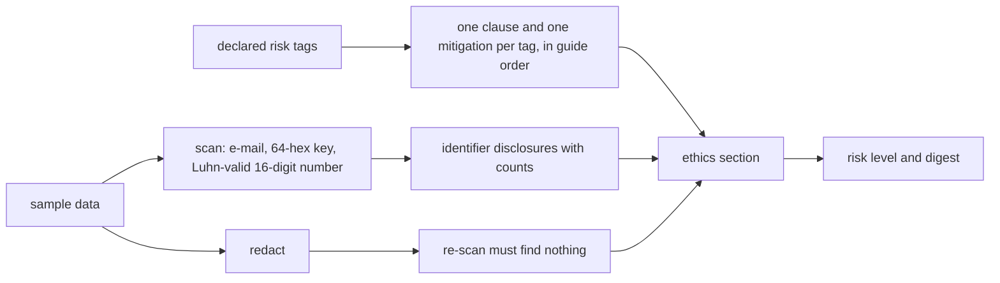
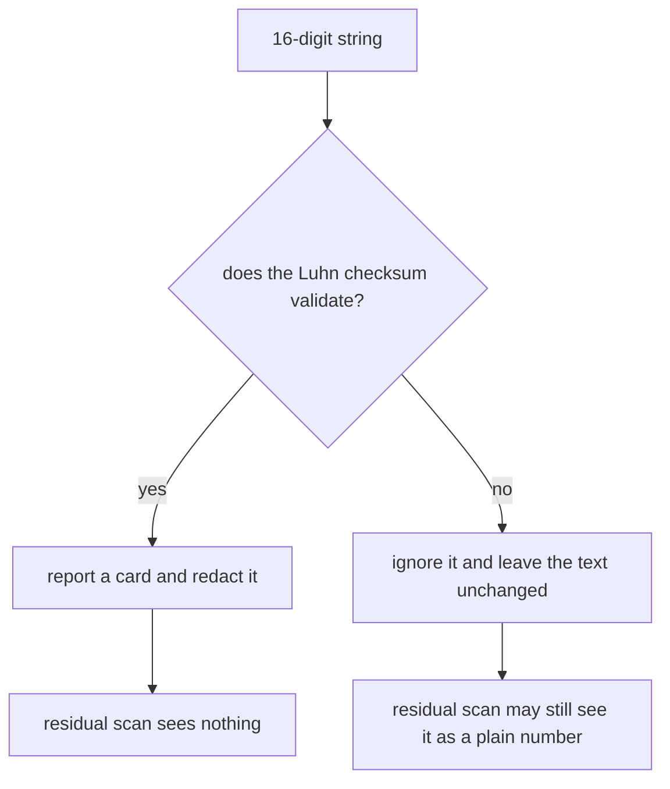
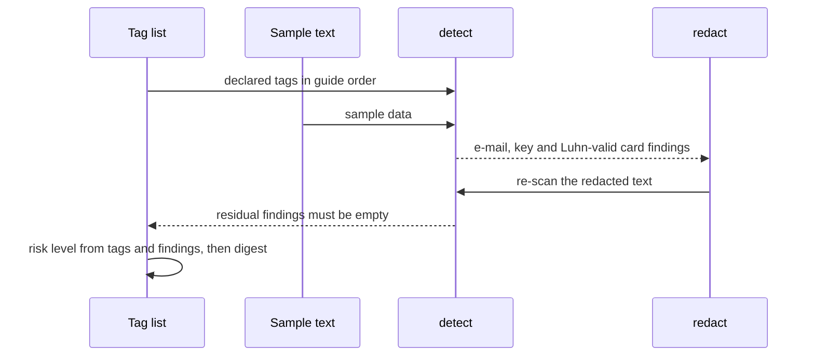

# 997 — Implement ethics section generator for problems with privacy/security implications.

> **Tier:** Master · **CTCI chapter:** Beyond — Software Engineering & Tooling
> **Task spec:** [997-implement-ethics-section-generator-for-problems-with-privacy-sec.md](../../../tasks/master/997-implement-ethics-section-generator-for-problems-with-privacy-sec.md)
> **Solutions:** [Python](../../../solutions/python/master/997-implement-ethics-section-generator-for-problems-with-privacy-sec/solution.py) ·
> [Java](../../../solutions/java/master/997-implement-ethics-section-generator-for-problems-with-privacy-sec/Solution.java) ·
> [JavaScript](../../../solutions/javascript/master/997-implement-ethics-section-generator-for-problems-with-privacy-sec/solution.js) ·
> [C#](../../../solutions/csharp/master/997-implement-ethics-section-generator-for-problems-with-privacy-sec/Solution.cs)

## 1. Problem restatement

**Input:** a problem's declared risk tags and its sample data.

```text
tags = ("PII", "credentials", "location")
sample_data = "call 555 and mail bob@example.org with key <64 hex characters>"
```

The six declarable tags are
`RISK_TAGS = ("PII", "credentials", "network", "cryptography", "biometric", "location")`, and each one
owns a clause and a mitigation, for example:

| Tag | Clause | Mitigation |
| --- | --- | --- |
| `PII` | "The task must use synthetic records; no real personal data may be shipped." | "Replace identifiers with stable pseudonyms before publication." |
| `credentials` | "Secrets must be injected at runtime; no key may appear in the test data." | "Rotate any leaked credential and add a secret-scanning check to CI." |
| `location` | "Location data must be coarsened or removed before publication." | "Round coordinates to the nearest city before publishing." |

**Output:** an ethics section with a risk level, one disclosure per declared tag, one per identifier kind
actually found in the sample, the matching mitigations, a sample policy and the residual findings after
redaction — plus a digest over the whole section.

The scan is three patterns and a checksum: e-mail addresses, 64-hex-character keys, and 16-digit numbers
that pass the Luhn check.

## 2. Intuition

The naive ethics section is authored from memory: an author writes "no real data is used" because it was
true when the problem was written. Two things then slip through — a tag the problem genuinely needs but
nobody declared, and a sample file that quietly contains a real address.

The key insight is that **a declaration and an observation must agree, and the observation is a scan, not
an opinion**. The generator therefore does both and puts both in the output:

* **Declarations drive the required clauses.** Each declared tag contributes exactly one clause and one
  mitigation, in guide order, so a missing declaration is visible as a missing clause.
* **The sample is scanned independently.** Whatever the tags claim, the sample data is read for e-mail
  addresses, 64-hex keys and Luhn-valid card numbers, and the findings are added to the disclosures with
  their counts — so a problem cannot claim to be harmless while shipping identifiers.
* **Risk is derived, not asserted.** `risk_level` is `high` as soon as anything was found **or** three or
  more tags were declared, `moderate` with any tag at all, `low` otherwise. A high-risk classification
  therefore cannot be argued away by leaving the tags empty if the data is dirty.
* **Redaction is proven, not promised.** The sample is redacted (numbered e-mail placeholders, a key
  placeholder, a card placeholder) and the scan is *re-run* on the result; `residual_findings` must be
  empty, and redaction must be idempotent.

The Luhn check is the quiet piece of judgement here: a bare 16-digit string is far more likely to be a
timestamp or an id than a card number, so the rule only reports a card when the checksum validates —
which is exactly the difference between a useful detector and a false-positive machine.



## 3. Algorithm

1. **Validate.** `validate(problem)` requires an id, requires `sample_data` to be a string, and rejects
   any tag outside `RISK_TAGS` with `unknown risk tag`.
2. **Order the tags.** `tags = [tag for tag in RISK_TAGS if tag in set(problem["tags"])]` — the declared
   tags, in *guide* order rather than declaration order, and deduplicated by the set membership test.
3. **Scan.** `detect(text)` collects `("email", ...)` for every address, `("api-key", ...)` for every
   64-hex run, and `("card", ...)` only for 16-digit numbers that satisfy `luhn_ok`, then returns the
   pairs sorted.
4. **Checksum.** `luhn_ok(digits)` walks the digits right to left, doubling every second one (subtracting
   `9` when the doubled value exceeds `9`) and requiring the total to be divisible by `10`.
5. **Disclose.** The disclosure list is the clause of each declared tag followed by one line per distinct
   identifier kind found — `"Sample data contains <kind> values (<n> occurrence(s))."` — so both the
   declaration and the observation appear.
6. **Redact.** `redact` numbers e-mail placeholders (`[REDACTED-EMAIL-1]`, `[REDACTED-EMAIL-2]`, …) so
   distinct addresses remain distinguishable, replaces keys with `[REDACTED-KEY]`, and replaces a card
   number with `[REDACTED-PAN]` only when `luhn_ok` accepts it — a non-card 16-digit string is left
   untouched.
7. **Classify.** `risk_level(tags, findings)` is `high` if there are findings or at least three tags,
   `moderate` if there is at least one tag, `low` otherwise.
8. **Assemble.** The section carries `id`, `risk_level`, `reviewed_tags`, `disclosures`, `mitigations`,
   `sample_policy` (either "No personal data detected …" or the redacted text) and
   `residual_findings = detect(cleaned)`, then a `digest` over everything before it.

```text
function detect(text)
    findings ← [ ("email", match) for each e-mail match in text ]
    findings ← findings + [ ("api-key", match) for each 64-hex match in text ]
    findings ← findings + [ ("card", match) for each 16-digit match in text where luhn_ok(match) ]
    return findings sorted
end
```

```text
procedure generate(problem)
    validate(problem)
    tags ← declared RISK_TAGS filtered into guide order
    findings ← detect(problem.sample_data)
    kinds ← sorted set of kinds in findings
    disclosures ← [ CLAUSES[tag] for tag in tags ]
    for each kind in kinds do
        append "Sample data contains kind values (count occurrence(s))." to disclosures
    end
    cleaned ← redact(problem.sample_data)
    section ← { id, risk_level: risk_level(tags, findings), reviewed_tags: tags,
                disclosures, mitigations: [ MITIGATIONS[tag] for tag in tags ],
                sample_policy, residual_findings: detect(cleaned) }
    section.digest ← digest_of(section)
    return section
end
```



## 4. Worked example

Running the Python file prints:

```text
level=high tags=PII,credentials,location disclosures=5 residual=0 digest=a3b38925a88d9461
```

**Detection on a deliberately dirty sample.** The check builds
`"student alice@school.example and bob@example.org solved it; key <64 hex>; card 4111111111111111; note 4111111111111112"`:

| Finding kind | Value | Why it fires |
| --- | --- | --- |
| `api-key` | the 64-hex run | matches the key pattern |
| `card` | `4111111111111111` | 16 digits **and** Luhn-valid |
| `email` | `alice@school.example` | matches the address pattern |
| `email` | `bob@example.org` | second address, reported separately |

The sorted kind list is `["api-key", "card", "email", "email"]`, and the check asserts both halves of the
card rule: `("card", VALID_CARD)` **is** in the findings while `("card", INVALID_CARD)` is not, even
though `4111111111111112` is also sixteen digits.

**Luhn, at the boundary.**

| Input | `luhn_ok` | Note |
| --- | --- | --- |
| `4111111111111111` | `True` | the classic test card |
| `4111111111111112` | `False` | one digit changed |
| `79927398713` | `True` | the canonical published vector |
| `79927398710` | `False` | the canonical negative vector |

**Redaction, and the re-scan.** `redact(dirty)` produces
`[REDACTED-EMAIL-1]`, `[REDACTED-EMAIL-2]`, `[REDACTED-KEY]` and `[REDACTED-PAN]`, while the
Luhn-invalid `4111111111111112` survives verbatim. `detect(cleaned)` is `[]` — the completeness proof —
and `redact(cleaned) == cleaned`, so running the redactor twice changes nothing.

**The section for the `triage` problem** (`tags = ["location", "PII", "credentials"]`, sample containing
one address and one key):

| Field | Value |
| --- | --- |
| `reviewed_tags` | `["PII", "credentials", "location"]` — guide order, not declaration order |
| `disclosures` | the three tag clauses, then `"Sample data contains api-key values (1 occurrence(s))."` and `"Sample data contains email values (1 occurrence(s))."` — `5` in total, the printed count |
| `mitigations` | three, one per declared tag, matching `len(reviewed_tags)` |
| `risk_level` | `high` — findings are present |
| `residual_findings` | `[]` — the redacted policy text carries nothing |
| `sample_policy` | `"Sample data was redacted for publication: …"` |

The completeness check is two-sided: every declared tag's clause **is** present, and no undeclared tag's
clause appears — so a generator that emitted all six clauses regardless would fail.

**The risk-level boundaries.**

| Problem | Tags | Findings | Level |
| --- | --- | --- | --- |
| `triage` | `PII`, `credentials`, `location` (`3`) | e-mail, key | `high` |
| `io` | `network` (`1`) | none | `moderate` |
| `plain` | none | none (`"just numbers 4 8 15 16 23 42"`) | `low`, no disclosures, "No personal data detected" policy |
| `all` | all six | none (empty sample) | `high` — three or more tags alone is enough |



## 5. Complexity

Let `L` be the length of the sample text, `T` the declared tags, `P` the detections and `C` the characters
of the assembled section:

| Phase | Time | Space | Why the bound holds |
| --- | --- | --- | --- |
| `luhn_ok` | `O(16)` | `O(1)` | bounded by the fixed card length |
| `detect` | `O(L)` | `O(P)` | three regex scans over the text |
| `redact` | `O(L)` | `O(L)` | three substitutions |
| `validate` | `O(T)` | `O(1)` | one membership test per declared tag |
| clause assembly | `O(T + P log P)` | `O(T + P)` | the kinds are sorted before the disclosure lines |
| `risk_level` | `O(1)` | `O(1)` | two comparisons |
| `generate` | `O(L + T + P log P + C)` | `O(L + C)` | dominated by the scans and the redacted policy text |
| `digest_of` | `O(C)` | `O(C)` | canonical JSON plus one hash |

The quadratic-looking part of a real data-classification engine — matching names against a catalogue,
running entity recognition, checking jurisdiction rules — is deliberately absent: the shipped detector is
three patterns and a checksum, `O(L)` per pass, cheap enough to run on every problem in the repository.
The real risk in such a design is *false negatives* rather than cost, which is why the generator adds
the second, independent evidence channel: even if a tag is missing, the sample scan will catch an
identifier, and even if the scan is incomplete, the tag clauses still say what the problem must promise.
The sibling implementations generalise the same two-channel idea: the Java file pairs policy rules with
the indicators that trigger them (email or identifier → privacy, password or credential → security,
exploit or vulnerability → dual use), the JavaScript file scores weighted implication signals, and the
C# file maps tags onto categories and adds cross-cutting clauses such as data minimisation for exploit
traces.

## 6. Pitfalls and edge cases

* **A Luhn-invalid number is not a card.** Sixteen digits alone is not enough; the checksum is the
  boundary, and `4111111111111112` is explicitly asserted *not* to be a finding and *not* to be redacted.
  A detector without the check turns every long id in a sample file into a privacy incident.
* **Findings are reported per kind with counts, not per occurrence.** Two addresses produce one
  `email` disclosure line with `(2 occurrence(s))`, while `detect` still lists both values — the section
  summarises, the scan itemises.
* **The placeholder for addresses is numbered.** `[REDACTED-EMAIL-1]` and `[REDACTED-EMAIL-2]` keep the
  two addresses distinguishable in the redacted text; keys and cards use a single shared placeholder
  because the generator has no reason to distinguish them.
* **Redaction is idempotent and re-verified.** `detect(redact(text))` must be empty and
  `redact(redact(text)) == redact(text)`, so a placeholder can never itself look like a finding.
* **De-duplication and ordering of tags are both by the guide.** The declared tags are filtered through
  `RISK_TAGS`, so a repeated tag produces one clause and the clause order never depends on the input
  order.
* **Tags are validated, so typos fail loudly.** `["genetics"]` raises `EthicsError` mentioning
  `unknown risk tag`, and a problem without `sample_data` raises mentioning `sample_data` — an ethics
  section cannot be generated from a problem whose data was never inspected.
* **Three tags are enough for `high` even with clean data.** `risk_level` checks findings **or**
  `len(tags) >= 3`; the `all` problem with six tags and an empty sample is `high`, which is the intended
  conservatism for a problem that touches many risk domains.
* **The no-risk boundary is fully clean.** The `plain` problem has no tags and no findings:
  `disclosures == []`, the policy reads "No personal data detected in the sample; it may be published as
  is.", and the level is `low`.
* **Determinism includes the digest.** `generate(risky)` returns the same section and digest twice, while
  dropping a tag changes the digest; the digest is a full 64-character SHA-256 over the assembled section.

## 7. Variants and follow-ups

* **Rules with indicators, not just tags.** Mapping each policy rule to the textual indicators that
  trigger it (Java), scoring weighted signals (JavaScript) or evaluating category combinations that
  demand cross-cutting clauses (C#) all generalise the tag-clause table while keeping the two-channel
  structure of declaration plus observation.
* **Where the sample data comes from.** Sample data is part of a problem's files; the packaging and
  licensing layer is what publishes it — see
  [986-implement-open-dataset-packaging-and-licensing-automation-for-pr.md](../../../tasks/master/986-implement-open-dataset-packaging-and-licensing-automation-for-pr.md)
  for the manifest that must not contain an identifier, and
  [989-implement-offline-mode-packaging-so-learners-can-download-proble.md](../../../tasks/master/989-implement-offline-mode-packaging-so-learners-can-download-proble.md)
  for the bundle that ships it.
* **The platform-side privacy rules.** An ethics section is per-problem; the platform's own data handling
  is governed by the retention, consent and erasure rules of
  [984-implement-legal-privacy-compliance-checks-for-user-data-handling.md](../../../tasks/master/984-implement-legal-privacy-compliance-checks-for-user-data-handling.md)
  and audited by
  [983-implement-end-to-end-security-review-checklist-and-automated-sca.md](../../../tasks/master/983-implement-end-to-end-security-review-checklist-and-automated-sca.md)
  for credentials in source.
* **Editorial integration.** The generated section belongs in an editorial write-up; see
  [994-implement-editorial-writing-assistant-that-drafts-explanations-p.md](../../../tasks/master/994-implement-editorial-writing-assistant-that-drafts-explanations-p.md)
  for the draft whose sections the ethics text joins.

## 8. Check yourself

<details><summary>Why is the Luhn check the right discriminator for card numbers?</summary>

Because sixteen digits is a very weak signal — order ids, timestamps and hashes are all long digit runs —
while the Luhn checksum rejects roughly nine out of ten arbitrary numbers. Requiring it means the
detector's false-positive rate is low enough to act on, at the cost of missing a mistyped card number,
which a real engine would catch with a different rule. The boundary is pinned by two pairs of vectors:
`4111111111111111` / `4111111111111112` and the published `79927398713` / `79927398710`.</details>

<details><summary>`disclosures` holds five entries for three declared tags. Where do the other two come from?</summary>

One per distinct identifier kind found in the sample: an `api-key` and an `email`. The section therefore
contains both the promises owed for the declared tags (three clauses) and the observations about the
data (two kind summaries with counts), which is what lets a reviewer compare what the problem claims with
what it ships. The check asserts that an undeclared tag contributes no clause.</details>

<details><summary>The `plain` problem has sample data (`just numbers 4 8 15 16 23 42`) and yet declares itself low risk. Why is that not a false negative?</summary>

Because none of the three patterns matches: there is no `@`, no 64-character hex run, and the numbers are
one or two digits, so the card pattern cannot even start. The policy line reports "No personal data
detected in the sample; it may be published as is." — a statement about *this* detector, which is the
honest scope of the claim.</details>

<details><summary>What would break if `redact` did not re-run the detection to prove completeness?</summary>

The redacted text becomes the published policy string, so a hole in the redactor — an address with an
unusual top-level domain, a card with spaces — would ship inside the very section that claims to have
handled it. `residual_findings` is computed by running the *same* detector over the cleaned text, and the
check requires it to be `[]`; idempotence guards the other direction, that a placeholder never becomes a
new finding.</details>
