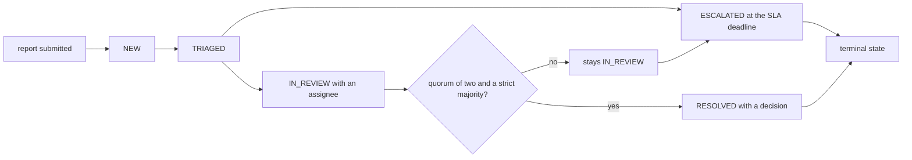
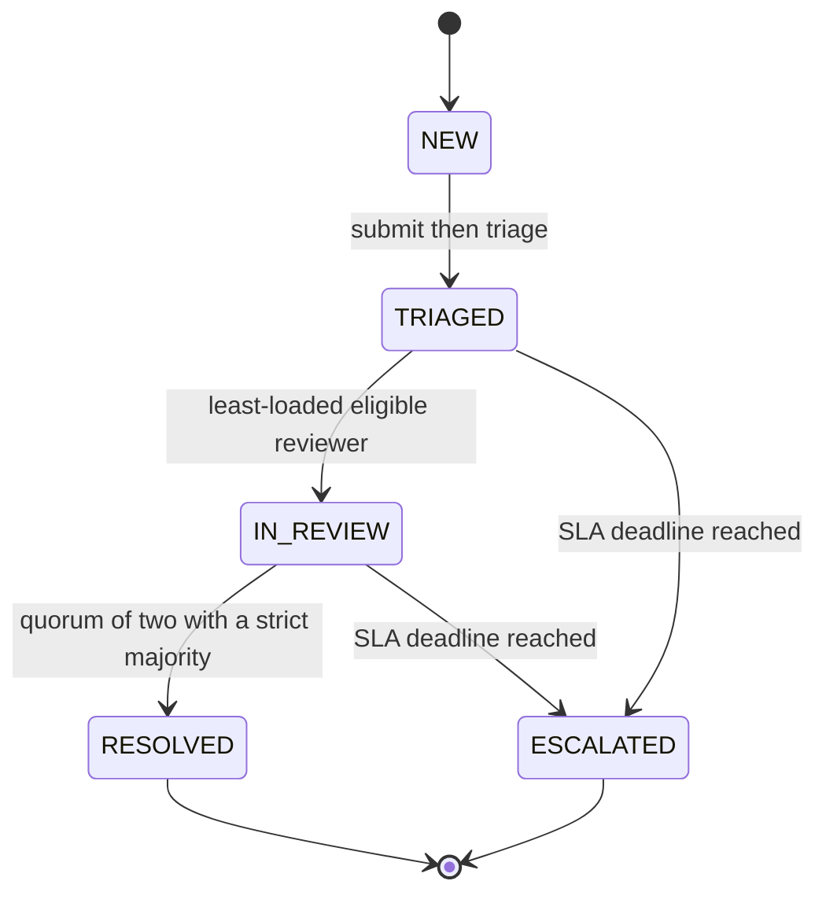
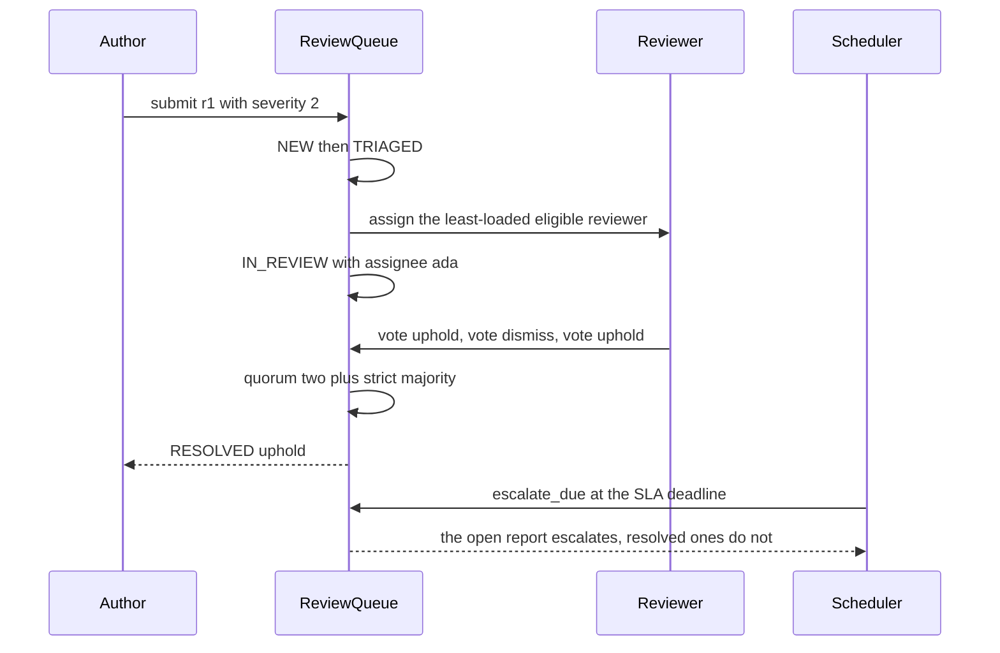

# 998 — Implement community moderation tools and quality review workflow.

> **Tier:** Master · **CTCI chapter:** Beyond — Software Engineering & Tooling
> **Task spec:** [998-implement-community-moderation-tools-and-quality-review-workflow.md](../../../tasks/master/998-implement-community-moderation-tools-and-quality-review-workflow.md)
> **Solutions:** [Python](../../../solutions/python/master/998-implement-community-moderation-tools-and-quality-review-workflow/solution.py) ·
> [Java](../../../solutions/java/master/998-implement-community-moderation-tools-and-quality-review-workflow/Solution.java) ·
> [JavaScript](../../../solutions/javascript/master/998-implement-community-moderation-tools-and-quality-review-workflow/solution.js) ·
> [C#](../../../solutions/csharp/master/998-implement-community-moderation-tools-and-quality-review-workflow/Solution.cs)

## 1. Problem restatement

**Input:** a reviewer roster and reports.

```text
reviewers  ada: algorithms, databases     grace: algorithms, tooling
           linus: algorithms              barbara: databases, tooling
reports    id, author, topic, severity 1..3, created_tick
```

**Output:** a moderation queue with an explicit state machine, conflict-free assignment, quorum
resolutions, SLA escalation and a tamper-evident audit log.

| Concern | Rule |
| --- | --- |
| States | `NEW → TRIAGED → IN_REVIEW → RESOLVED` or `→ ESCALATED` |
| Legal transitions | exactly the five in `TRANSITIONS`; anything else raises |
| Assignment | the least-loaded reviewer with matching expertise who is **not** the report's author |
| Quorum | `QUORUM = 2` distinct votes **and** a strict majority |
| SLA | `SLA_BY_SEVERITY = {1: 24, 2: 12, 3: 6}` ticks after `created_tick` |
| Audit | every state change appended with `seq`, `prev` and a digest over its own body |

## 2. Intuition

The naive moderation queue is a shared inbox with a status column. It fails in ways that are hard to
notice: the author of a report reviews it themselves (a conflict of interest decides the outcome), two
reviewers vote and a single vote "wins" because nobody defined a quorum, and a report sits open for
weeks because nothing escalates.

The key insight is that **a workflow is a state machine plus a policy, and both should be data**. Three
specific choices follow from that:

* **Legal transitions are a table.** `TRANSITIONS` is a set of `(from, to)` pairs, so an illegal move —
  publishing straight from `NEW`, or re-opening a `RESOLVED` report — is refused with a message rather
  than becoming a state nobody anticipated. `TERMINAL = ("RESOLVED", "ESCALATED")` marks the sinks.
* **Assignment is a filter plus a minimum.** `candidates` excludes the author (conflict of interest),
  excludes anyone who already voted on this report (so a reviewer cannot both vote and adjudicate the
  tiebreak), and keeps only matching expertise; `assign` then takes `min` by `(load, reviewer_id)`, so
  the least-loaded reviewer wins and ties break alphabetically.
* **Resolution is a quorum plus a strict majority.** `len(votes) >= 2 and upheld != dismissed` — one vote
  never resolves, and a 1-1 split blocks, which is why the check asserts that both leave the report in
  `IN_REVIEW`.

Everything that changes state is logged, and the log is a hash chain: each entry carries the previous
entry's digest and a digest over its own body, so a rewritten actor or a forged link is detectable
without a database — the same tamper-evidence trick as the benchmark history and the messaging tool.



## 3. Algorithm

1. **Submit.** `submit(report)` requires `id`, `author`, `topic`, `severity` and `created_tick`; rejects a
   duplicate id and a severity outside `SLA_BY_SEVERITY`; stores the record with `state = "NEW"` and logs
   the transition with actor `system`.
2. **Log.** `_log(tick, report_id, action, actor)` writes
   `{seq, tick, report, action, actor, prev, digest}` where `prev` is the previous entry's digest (or
   `"genesis"`) and `digest = sha256(canonical(body))` — with `prev` inside the body, so the chain commits
   to its own history.
3. **Transition.** `transition(report_id, target, actor, tick)` refuses any `(state, target)` pair that is
   not in `TRANSITIONS`, otherwise updates the state and logs it.
4. **Deadline.** `deadline(report_id)` is `created_tick + SLA_BY_SEVERITY[severity]`.
5. **Candidates.** `candidates` returns `(reviewer_id, load)` pairs for reviewers whose expertise contains
   the report's topic, who are not the author, and who have not already voted on it — sorted by id so the
   tie-break is deterministic.
6. **Assign.** `assign` moves `NEW → TRIAGED` when needed, then picks `min(candidates, key=(load, id))`,
   charges that reviewer's load by one, records the assignee and transitions to `IN_REVIEW`.
7. **Vote.** `vote` requires the state to be `IN_REVIEW`, refuses the author, refuses a second vote by the
   same reviewer, and requires the decision to be `"uphold"` or `"dismiss"`. Each vote is logged; when
   `len(votes) >= QUORUM` and the two sides differ, the majority decides and the report transitions to
   `RESOLVED` with actor `quorum`.
8. **Escalate.** `escalate_due(tick)` walks the reports in id order and, for every non-terminal report
   whose deadline has been reached (`deadline <= tick`), transitions it to `ESCALATED` with actor
   `scheduler`.
9. **Verify.** `verify_audit` re-derives both invariants: `seq == index` and `prev == previous digest`
   (`broken chain`), and `digest_of(body without digest) == digest` (`digest mismatch`). `audit_digest` is
   the SHA-256 of the list of entry digests, so a whole session is comparable in one string.

```text
procedure assign(queue, report_id, tick)
    record ← queue.reports[report_id]
    if record.state equals "NEW" then transition(queue, report_id, "TRIAGED", "system", tick) end
    available ← candidates for the report sorted by (load, reviewer id)
    if available is empty then
        raise ModerationError naming the topic and the author
    end
    chosen ← first entry of available
    queue.reviewers[chosen].load ← queue.reviewers[chosen].load + 1
    record.assignee ← chosen
    transition(queue, report_id, "IN_REVIEW", chosen, tick)
    return chosen
end
```

```text
procedure vote(queue, report_id, reviewer_id, decision, tick)
    record ← queue.reports[report_id]
    if record.state is not "IN_REVIEW" then raise ModerationError for the wrong state end
    if reviewer_id equals record.report.author then raise ModerationError for self-review end
    if reviewer_id is already in record.votes then raise ModerationError for a double vote end
    if decision is not "uphold" and not "dismiss" then raise ModerationError end
    record.votes[reviewer_id] ← decision
    log the vote
    upheld ← count of "uphold" votes, dismissed ← rest
    if length of record.votes >= QUORUM and upheld is not dismissed then
        record.decision ← "uphold" if upheld > dismissed else "dismiss"
        transition(queue, report_id, "RESOLVED", "quorum", tick)
    end
    return record.state, record.decision
end
```



## 4. Worked example

Running the Python file prints:

```text
audit_entries=16 state_r1=RESOLVED decision=uphold digest=346a5b30499f3e3c
```

**Assignment, step by step.** Two reports are submitted by `mallory`, then assigned:

| Report | Topic | Candidates after filtering | Chosen | Why |
| --- | --- | --- | --- | --- |
| `r1` | `algorithms` | `ada(0)`, `grace(0)`, `linus(0)` — `mallory` is excluded as the author | `ada` | all loads equal, so the alphabetical tie-break decides |
| `r2` | `databases` | `ada(1)`, `barbara(0)` | `barbara` | `ada` is already loaded, so the least-loaded rule decides |

After both assignments `ada` has load `1`, `grace` and `linus` have `0`, and `barbara` has `1` — the
check asserts exactly that, and that `r2`'s assignee equals the brute-force `min` over the candidate
list. The conflict-of-interest rule is checked twice: `mallory` never appears among `r1`'s candidates,
and a queue whose only reviewer is the author raises `no eligible reviewer` on assignment.

**The audit log, in order** — the printed `audit_entries=16`:

| `seq` | `tick` | Report | Action | Actor |
| --- | --- | --- | --- | --- |
| `0` | `0` | `r1` | `NEW` | `system` |
| `1` | `0` | `r2` | `NEW` | `system` |
| `2` | `1` | `r1` | `TRIAGED` | `system` |
| `3` | `1` | `r1` | `IN_REVIEW` | `ada` |
| `4` | `1` | `r2` | `TRIAGED` | `system` |
| `5` | `1` | `r2` | `IN_REVIEW` | `barbara` |
| `6` | `2` | `r1` | `vote:grace:uphold` | `grace` |
| `7` | `2` | `r1` | `vote:linus:dismiss` | `linus` |
| `8` | `2` | `r1` | `vote:barbara:uphold` | `barbara` |
| `9` | `2` | `r1` | `RESOLVED` | `quorum` |
| `10` | `3` | `r2` | `vote:barbara:dismiss` | `barbara` |
| `11` | `0` | `r5` | `NEW` | `system` |
| `12` | `10` | `r5` | `TRIAGED` | `system` |
| `13` | `10` | `r5` | `IN_REVIEW` | `grace` |
| `14` | `16` | `r5` | `ESCALATED` | `scheduler` |
| `15` | `1000` | `r2` | `ESCALATED` | `scheduler` |

The first six actions are asserted as a list, and `verify_audit()` returns `[]` on the fresh chain.
Tampering with entry `2`'s actor produces `["2: digest mismatch"]` on a queue that shares the mutated
list, while the original queue still verifies — the two properties are checked side by side so the test
cannot pass by accident on a chain that never validates anything.

**Votes, quorum and majority.** Three votes on `r1` produce exactly one resolution:

| Vote | Votes so far | Upheld / dismissed | Result |
| --- | --- | --- | --- |
| `grace: uphold` | `1` | `1 / 0` | `("IN_REVIEW", None)` — below quorum |
| `linus: dismiss` | `2` | `1 / 1` | `("IN_REVIEW", None)` — quorum but a tie blocks |
| `barbara: uphold` | `3` | `2 / 1` | `("RESOLVED", "uphold")` — quorum and a strict majority |

Then the guards fire: voting on `r1` afterwards raises `while it is RESOLVED`, voting on `r2` as
`mallory` raises `cannot vote on their own`, and a second `barbara` vote on `r2` raises `already voted`.
`r2` ends the run with a single `dismiss` vote and stays open until escalation.

**SLA escalation.** `r5` has severity `3`, is submitted at tick `10`, so its deadline is `10 + 6 = 16`:

| Call | Result |
| --- | --- |
| `queue.deadline("r5")` | `16` |
| `escalate_due(15)` | `[]` — one tick early |
| `escalate_due(16)` | `["r5"]`, and `r5` is now `ESCALATED` |
| `escalate_due(1000)` | `["r2"]` — the open report escalates, while `r1` stays `RESOLVED` |



## 5. Complexity

Let `R` be the reports, `V` the reviewers, `A` the audit entries and `C` the canonical-JSON size of an
entry:

| Phase | Time | Space | Why the bound holds |
| --- | --- | --- | --- |
| `submit` | `O(1)` plus one log append | `O(1)` | field checks and two dictionary lookups |
| `_log` | `O(C)` | `O(C)` | one canonical serialisation plus a hash |
| `transition` | `O(C)` | `O(1)` | a set membership test plus the log append |
| `deadline` | `O(1)` | `O(1)` | one addition |
| `candidates` | `O(V log V)` | `O(V)` | the reviewers are sorted for a deterministic tie-break |
| `assign` | `O(V log V + C)` | `O(V)` | candidate scan plus up to two log entries |
| `vote` | `O(V + C)` | `O(V)` | counting the votes plus the log entry |
| `escalate_due` | `O(R * (log R + C))` | `O(R)` | one pass over the reports, one log entry per escalation |
| `verify_audit` | `O(A * C)` | `O(A)` | one canonical serialisation per entry |
| `audit_digest` | `O(A)` | `O(A)` | join the digests, hash once |

`A` grows by one per state change or vote, so a busy queue's audit log is linear in activity — which is
the intended cost model for an append-only record. The interesting engineering question is the
*policy*, not the asymptotics: a quorum of `2` with a strict majority means a two-vote split cannot
resolve and a three-vote split always does; the SLA table makes a severity-1 report escalate after a day
and a severity-3 report after six hours; and excluding voters from the candidate list stops a reviewer
from adjudicating a report they have already voted on. The sibling implementations extend the workflow
rather than the data structures: the Java file guards transitions from `DRAFT` through review states to
`PUBLISHED` so nothing can be published straight from draft, the JavaScript file adds a
reputation-and-age priority queue, shingle-based duplicate detection and an appeal branch, and the C#
file restricts votes to matching expertise and allows a single appeal that reopens a rejection.

## 6. Pitfalls and edge cases

* **Illegal transitions are refused, not ignored.** `transition("r1", "IN_REVIEW", ...)` on a `RESOLVED`
  report raises `cannot move r1 from RESOLVED to IN_REVIEW`; re-opening a terminal report is impossible
  by construction, because `TRANSITIONS` has no outgoing edge from `RESOLVED` or `ESCALATED`.
* **Sliding `r2` into `TRIAGED` twice is also illegal.** The check asserts that a second
  `r2` assignment attempt fails, since `("IN_REVIEW", "TRIAGED")` is not in the table.
* **The author is excluded from candidates and from voting.** Both checks exist: `mallory` is absent from
  `r1`'s candidate list, and `queue.vote("r2", "mallory", "uphold", 3)` raises
  `cannot vote on their own`. Assignment alone would not be enough — a non-assignee can still call
  `vote`.
* **Quorum is two *distinct* votes.** `record["votes"]` is keyed by reviewer id, so a double vote is
  impossible; the same reviewer voting twice raises `already voted` before the count is touched.
* **A tie blocks resolution.** With `QUORUM = 2` and `upheld != dismissed` as the majority test, a 1-1
  split stays `IN_REVIEW` and needs a third vote — which is why `r1` resolves only on the third vote.
* **Escalation is inclusive at the deadline.** `deadline("r5") == 16`, `escalate_due(15) == []` and
  `escalate_due(16) == ["r5"]`; a strict inequality would leave the report open one extra tick, and the
  boundary is asserted in both directions.
* **Terminal reports never escalate.** The check calls `escalate_due(1000)` after `r1` has resolved and
  requires the result to be `["r2"]` — `r1` is skipped because `state in TERMINAL`, and `r5` was already
  escalated.
* **Reports escalate in id order.** `escalate_due` iterates `sorted(self.reports)`, so a batch escalation
  produces a stable list of ids rather than dictionary order.
* **An empty queue is inert but well formed.** No reports, no audit entries, no escalations at tick
  `10_000`, and `verify_audit() == []` — a fresh queue must not raise or produce a phantom entry.
* **The audit chain is the record of truth.** `verify_audit` reports a rewritten actor as
  `2: digest mismatch` and a forged predecessor as `broken chain`; combining both invariants means an
  edit has to change the digest *and* re-link the chain, which is precisely the tamper the design is
  meant to make expensive.
* **Reproducibility is one string.** Replaying the same script produces the same `audit_digest`, and the
  digest is a full 64-character SHA-256; the check compares two independently built queues rather than
  the same object twice.

## 7. Variants and follow-ups

* **Richer submission lifecycles.** The Java solution models authored submissions moving from `DRAFT`
  through review to `PUBLISHED`, with `CHANGES_REQUESTED` as a loop-back state, which is the same table
  pattern applied to content rather than reports; the C# solution adds a single appeal that reopens a
  rejection, which is the one transition a real system needs and a naive table forgets.
* **Triage before assignment.** Real queues prioritise: the JavaScript solution sorts by a combination of
  contributor reputation and report age, and adds shingle-based duplicate detection so that ten reports of
  the same defect are resolved together. Both are policy layers over the same state machine.
* **Who reviews the reviewers.** Reviewer load is an in-memory counter here; a production queue persists
  it, and the fairness of the distribution is itself measurable — see
  [961-implement-mentoring-workflow-pairing-novices-with-maintainers-fo.md](../../../tasks/master/961-implement-mentoring-workflow-pairing-novices-with-maintainers-fo.md)
  for the mentoring workflow that turns reviewer capacity into pairing decisions and
  [962-implement-automated-issue-triage-using-nlp-to-tag-difficulty-are.md](../../../tasks/master/962-implement-automated-issue-triage-using-nlp-to-tag-difficulty-are.md)
  for the automated triage that fills the queue in the first place.
* **What a resolution entitles the author to.** An upheld report usually implies credit, correction or
  removal; recognising and citing contributions is the adjacent workflow — see
  [985-implement-contribution-recognition-system-with-verified-citation.md](../../../tasks/master/985-implement-contribution-recognition-system-with-verified-citation.md)
  for verified citations and
  [984-implement-legal-privacy-compliance-checks-for-user-data-handling.md](../../../tasks/master/984-implement-legal-privacy-compliance-checks-for-user-data-handling.md)
  for the privacy rules that govern the personal data inside a report.

## 8. Check yourself

<details><summary>Why is a quorum plus a strict majority needed, rather than a simple majority?</summary>

Because with one vote a "majority" is trivially satisfied, and with two votes a majority is also
satisfied by the first voter if the second has not voted yet — the rule would resolve a report on
whoever voted first. Requiring `len(votes) >= 2` **and** `upheld != dismissed` means a single vote and a
1-1 split both leave the report open, which the check pins as
`("IN_REVIEW", None)` twice before the third vote resolves it as `("RESOLVED", "uphold")`.</details>

<details><summary>`r1` is assigned to `ada` although `grace` and `linus` also have zero load. What decides it?</summary>

The tie-break in `min(available, key=lambda pair: (pair[1], pair[0]))`: equal loads fall back to the
reviewer id in alphabetical order, so `ada` wins. Determinism matters more than the specific choice — a
queue that assigned by dictionary iteration order would produce different assignees across runs, and the
audit digest would not be reproducible.</details>

<details><summary>Why does `candidates` exclude reviewers who have already voted, rather than just the assignee?</summary>

So that a reviewer cannot both influence a decision and then be handed the report as the tie-breaking
adjudicator. Anyone can call `vote`, not only the assignee, so the exclusion has to be based on the vote
record rather than on `assignee` — and that is also why the author is excluded in `candidates` *and*
re-checked inside `vote`.</details>

<details><summary>What exactly is committed by an audit entry's digest?</summary>

The entry body — `seq`, `tick`, `report`, `action`, `actor` and `prev` — but not the digest field
itself. Because `prev` is inside the body, each entry commits to its predecessor's digest, so any edit
breaks either its own digest (`digest mismatch`) or the next entry's link (`broken chain`). Re-hashing a
single edited entry therefore does not repair the chain: the following entry's `prev` no longer matches,
which is what makes the log tamper-evident rather than merely tamper-recording.</details>

<details><summary>The run prints `audit_entries=16`, but only 3 reports and 4 votes happen. Where do the other entries come from?</summary>

Every state change is logged separately: three submissions (`NEW`), six assignment entries (three
reports × `TRIAGED` + `IN_REVIEW`), four votes, one `RESOLVED` entry written by the quorum rule, and two
`ESCALATED` entries. `3 + 6 + 4 + 1 + 2 = 16` — assignment being two entries rather than one is the
detail most people miss when reading the log.</details>
